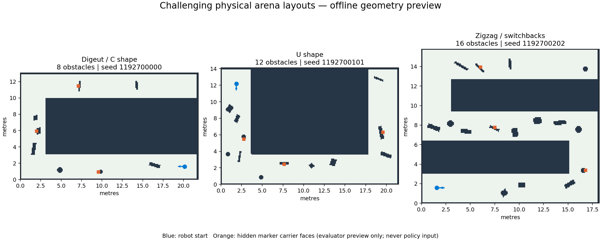

**수동 Gazebo 마커 대시보드:** 별도 시뮬에서 방향키와 화면 버튼으로 조작하고, 전방 카메라와 같은 프레임의 CNN·YOLO 후보 점수를 확인한다. [실행 방법](experiments/2026-11-26_yolo_cnn_v100/README.md#gazebo-수동-주행-대시보드)

**실물 영상 마커 후보 재생:** Mac에서 실물 257프레임을 평가했다. 후속 관찰용 영역을 프레임당 상위 5개 남겼을 때 CNN 증강형이 검토된 마커 188/197개를 포함했다. 비스듬한 마커는 11/16개, 흐린 마커는 55/59개였다. [후보 회수율과 정밀 검출 비교](experiments/2026-11-26_yolo_cnn_v100/README.md)

[Mixed · 가운데 장애물 → 벽](policy_candidates/2026-11-19_mixed_center_first/README.md)은 가운데 물체의 접근 가능한 면을 먼저 조사한 뒤 외곽 벽으로 넘어가는 실험 정책입니다.

**2026-11-19 Mixed 일반 장애물 집중 탐색 후보:** 상자 형태가 아니어도 미관찰 표면을 한 번 보고 짧게 멈추거나 회전합니다. 관찰 후 남은 면은 안전한 위치가 있을 때만 제한적으로 다시 봅니다. 마지막 실물 기록의 저장 지도 40장에 대한 정적 비교는 기존 2장·새 후보 29장입니다. 실제 주행 결과는 아닙니다. [구현·검증 범위](policy_candidates/2026-11-19_mixed_general_surface/README.md).

별도 후보 **Mixed · 이동 중 옆면 관찰**은 상자·면 목표로 가는 중 카메라가 본 옆면을 제한적으로 다시 확인한다. 기존 정책은 보존한다. [근거·설정·검증](policy_candidates/2026-11-19_mixed_side_pass/README.md)

**2026-11-19 Mixed 각진 구조 우선 후보:** 사진처럼 벽에 붙은 직각 돌출부를 지도에서 임시 사각형으로 추적하고, 접근 가능한 면을 차례로 보거나 성긴 지도에서는 코너를 향해 제자리 관찰합니다. 최근 실물 지도 2장 중 1장에서 코너 후보와 오프라인 제자리 관찰 목표가 나왔습니다. 새 후보의 실물 주행은 미실시입니다. [근거·안전 조건](policy_candidates/2026-11-19_mixed_corner_first/README.md).

**2026-11-19 Mixed 꼼꼼 탐색 후보:** 기존 Mixed를 유지하고 작은 가장자리 테두리와 지나친 후보 복귀, 부분적으로만 접근 가능한 상자 면 관찰을 별도 버전에 적용했습니다. 기존 실물 영상 727프레임 재생에서 후보 프레임 80→84, ArUco 판독 위치와 겹친 프레임 57→59입니다. 이후 약 42초 실물 주행은 정지 확인 실패로 끝나 완주 성능을 평가할 수 없습니다. [변경과 검증](policy_candidates/2026-11-19_mixed_thorough/README.md).

**2026-11-19 Mixed 상자 전면 관찰 후보:** 실물 보드의 Mixed 버튼을 별도 빌드 `flow_v3_r32_full_box_ws`에 연결했습니다. 확인된 상자에서 네 면의 안전 관측점과 연결 경로가 모두 있는 경우만 차례로 살펴봅니다. 모의 격자에서 네 면 선택과 막힌 경로의 거부를 확인했으며 실물 주행 성능은 아직 측정하지 않았습니다. [구현·검증 범위](policy_candidates/2026-11-19_mixed_full_box/README.md).

# OSP Final Project — ROS 2 Jazzy

[Gazebo 9회 비교 · 10cm 간격의 7번과 103번](experiments/2026-11-19_pair_7_103/README.md)에서 두 ID의 개별 등록과 실제 1.5m 접근은 기존 Flow v3 3/3, Mixed 3/3, 원본 R32 0/3이었습니다. 범퍼 접촉은 총 0회였습니다.


실물 보드에서 기존 Flow v3, Mixed, 원본 R32를 각각 선택해 비교할 수 있습니다. [버튼별 정책과 실험 기록](dashboard/ROBOT_BOARD.md#실물-정책-비교)

**Flow v3 · R32 합성 후보** · 같은 면의 인쇄 테두리를 반복해서 보면 안전한 관찰 지점을 요청하고, 일반 탐색에는 R32 복도 전진·우회를 사용할 수 있다. [선택 실행과 검증 결과](policy_candidates/2026-11-18_flow_v3_r32_print/README.md)

**스쳐 지나가는 마커 재관찰** · 17:37 녹화에서 제자리 관찰을 마커 방향 3.14도 회전 요청으로 바꿨다. 별도 주행 14개의 배경 회전 요청은 7회에서 1회로 줄었다. [재생 결과와 처리 시간](policy_candidates/2026-11-18_flow_v3_passing_glance/README.md)

**2026-11-18 실물 주행 복구 v4** · 실물 보드와 셸이 같은 v4 런타임을 사용합니다. 제자리에서 충돌 예측이 반복되면 막혔던 출발 방향을 기억하고 후방 공간이 확인될 때 한 번 후진합니다. 직전 주행 로그에서 목표 전환 10번 중 8번은 새 규칙이 당시의 재선택을 걸러냈습니다. [복구 조건과 격리 검증](policy_candidates/2026-11-18_face_intent_flow_v4/README.md) · 새 실물 주행은 미실시입니다.

**2026-11-18 원본 실물 로그 분석:** 265.9초 중 오돔 기준 이동 163.1초·제자리 회전 86.4초·정지 16.3초, 이동 경로 29.6m였습니다. 세 ID의 근접 증거는 있으나 원본 영상에는 사람이 든 화면이 보여 **고정 마커의 자율 탐색 성공으로 검증되지 않았습니다.** 최종 지도 좌표 보정도 미적용입니다. 정책·안전 설정 변경 없이 수행한 [오프라인 수치·영상 검토·한계](repository_snapshot/physical_run_analysis_20261118.json)입니다.

**2026-11-17 실물 실행 결과·다음 실행 설정 저장:** 마지막 실행은 로그상 **265.928초, 확인·접근 ID 0·45·68, 범퍼 0회·센서 중단 0회**로 종료했습니다. 다음 구동 쉘은 저장소의 [동일 설정](robot_profiles/wired_flow_v3/README.md)을 바로 사용합니다(Original·18픽셀 유지). 독립 실측 정답/지도 좌표 정확도 검증은 없으며 원시 기록은 로컬 보존 및 [공개 Release](https://github.com/peter010905/simul/releases/tag/policy-logs-robot-2026-11)에 업로드했고 크기·SHA-256을 검증했습니다. [결과 요약](repository_snapshot/physical_run_20261117_original18_result.json).

**2026-11-17 실물 범퍼 복구:** 단발 범퍼 접촉은 기존 후방 안전 검사·Nav2 충돌 검사 아래 20cm 후진 후 접촉 목표를 제외하고 재계획하도록 감독기 종료 조건을 변경했습니다. 접촉 횟수 제한 없이 복구하며, 지속 접촉과 낭떠러지/스톨/바퀴 들림 정지는 유지합니다. 감독기 22개·정책 접촉/후방 검사 10개 통과, 새 실물 접촉 시험은 미실시입니다. [동작과 한계](dashboard/ROBOT_BOARD.md#범퍼-접촉-뒤-복구).

**2026-11-17 실물 보드 구동·정지 버튼:** [실물 주행 보드](dashboard/ROBOT_BOARD.md#이-mac의-실물-제어) 상단에서 직접 시작·정지할 수 있습니다. 준비된 Flow v3를 재빌드 없이 실행하며, 시간·센서·범퍼·도크 상태를 확인한 뒤 준비 직후 미션을 자동 시작합니다. 준비 중 정지도 지원하고 실제 odom 정지를 확인합니다. Mac 터미널의 `./robot.sh start/stop`도 같은 실행기를 사용합니다. 페이지 열기·새로고침은 구동하지 않습니다. 격리 ROS/가짜 HTTP 시험과 화면 확인을 수행했으며 **새 실물 주행이나 출발 지연 개선은 아직 측정하지 않았습니다.**

**2026-11-17 TurtleBot4 MacBook 장착 재현 실험:** 공식 Standard 모델에 1.5kg 노트북·LAN 어댑터·케이블을 물리 링크로 추가하는 별도 ROS 패키지를 만들었습니다. 가정한 앞쪽 어댑터 배치에서는 `/scan` 19개 빔이 약 18.5cm를 읽고, 하중 없는 어댑터 조건에서도 Nav2 목표를 수락한 채 출발하지 않았습니다. 어댑터·케이블을 스캔 평면 위로 옮기고 노트북을 전방 5cm 이동한 조건은 같은 목표를 완료했습니다. 필터는 같은 방향의 외부 장애물을 가려 실물 안전 대책으로 채택할 수 없습니다. 가정한 1.5kg 중앙 장착 모델은 개방 루프 명령에서 출발 후 cliff 감지가 발생했습니다. **실물 장착 치수·센서 로그가 없고 정확한 `start_not_free` 지도 셀 상태는 재현되지 않아, 실제 원인은 미확정입니다.** [코드·명령·한계](turtlebot4_payload_sim/README.md), [CSV·그래프](repository_snapshot/payload_replication_20261117/).

**2026-11-17 정책 실행 로그 자동 업로드:** 실물 `run_robot_policy.sh`와 Gazebo 진입점에서 콘솔·ROS 로그·토픽 rosbag·정책/설정·생성 결과를 자동 기록하고 종료 시 GitHub Release로 업로드합니다. `simulation`/`robot`별 로컬 경로·Release·색인을 분리하며 업로드 실패는 보관 후 2분 간격으로 재시도합니다. 직접 ROS 명령은 `run_policy.sh --mode ... -- 명령`을 사용해야 합니다. 로그 기능 시험은 실제 로봇/Gazebo 성능과 구분합니다. [실행 방법·수집 범위·재시도](repository_snapshot/run_logs/README.md).

**2026-11-17 위치추정·최종 좌표 검증 우선 보완:** 보존된 **598.923초/600.360초**, 실제 이동 **20.57m/74.85m** U형 센서 기록을 검증해 pose 변화량+IMU 회전율 재생의 최대 위치 오차 **0.0193m/0.1120m**를 확인했습니다(wheel odom **2.709m/6.254m**). 스트리밍 추정과 배치 결과 차이는 5e-13 이내입니다. 수집기 종료 예외의 `complete=false`는 보존하고 입력 해시·시각·프레임·누락을 별도 검증한 오프라인 결과입니다. 별도 후보는 **25cm를 넘는 최종 graph 변경을 재관측 필요로 표시**하고 원래 좌표를 보존합니다. U형의 1.28m/1.51m 덮어쓰기를 막았지만 지도 정확도 검증으로 인정하지 않으며 ㄷ자 기존 위치 오차도 해결하지 않습니다. **설치 런타임 503개·감독기 8개 검사 통과**. 공식 TB4의 기존/후보 U형 두 회차가 실제 시작됐고, 새 추정기는 **파일로만 기록하며 TF·명령을 발행하지 않는 실제 ROS endpoint도 확인**했습니다. 실제 odom 교체·실물 융합 배포·새 완주 성능은 아직 미검증입니다. [장시간 재생·보정 거부·실제 실행·한계](repository_snapshot/localization_validation_progress.json).

**2026-11-17 마커 좌표 오차 분리:** U형 기준판의 ID81/204는 최종 graph 보정 전 **0.056/0.141m**, 보정 후 **1.333/1.649m**였습니다. ㄷ자 후보 ID903/319는 보정 전부터 **0.669/0.556m**로 어긋났고 최종 이동은 약 1cm뿐이었습니다. 촬영 시점 로봇 pose를 독립 실제 위치로 교체하는 오프라인 진단에서는 ㄷ 후보 마커 잔차 중앙값이 **0.011/0.016m**로 줄어, 상대 거리 추정보다 위치추정 오차의 비중이 큰 것으로 나타났습니다. 실제 입력은 wheel encoder odom이며 Create3 펌웨어 융합과 동일하지 않습니다. 원본 주행/마커 좌표는 수정하지 않았고 실물 보정·주행 성공 결과가 아닙니다. **진단 검사 3개 통과**. [원본 전후 오차·pose 치환 진단·한계](repository_snapshot/marker_coordinate_error_diagnosis.json).

**2026-11-17 결과 확인 — 목표 재평가 실험 미시작·이전 비교 중단:** frontier+coverage의 실제 종료 기록은 **U형 기준/후보 ID 2/0개·실제 접근 2/1개**, **ㄷ자 기준/후보 ID 1/2개·실제 접근 3/3개**입니다. 네 회차 모두 600초 시간 초과·접촉 0회·전체 과제 실패입니다. U 기준판 마커 오차는 1.333/1.649m, ㄷ 후보판은 0.658/0.564m로 0.5m 기준을 넘습니다. 감독기는 `face_directed_look.version == 1`만 허용하는 기존 출력 검사 때문에 실제 적용된 v2를 인프라 실패로 분류하고 중단했습니다. 네 원본 결과를 보존하며 검사 오류를 주행 성공으로 바꾸지 않습니다. 지그재그 두 회차는 미시작이고, 이후 예약한 **이동 중 목표 재평가 6회도 아직 실행되지 않았습니다**. 재평가 방식의 성능 결과는 없습니다. [원본 수치·검사 불일치·대기 상태](repository_snapshot/frontier_coverage_partial_native_result.json).

**2026-11-17 이동 중 목적지 재평가 비교 예약:** frontier+coverage 정책의 목적지를 이동 중에도 **8초마다 재평가**하는 별도 후보를 만들었습니다. 목표 최소 12초 유지·교체 비용 5초를 반영한 40% 이득·20초 교체 간격·최근 포기 위치 복귀 억제·최대 6회 제한을 적용합니다. QR 접근/좁은 출발/도착 직전은 보호하고, Nav2 취소 응답 후 최신 지도에서 다음 목표를 선택합니다. 중도 변경을 실패나 관찰 완료로 처리하지 않습니다. **설치 런타임 530개·감독기 5개 검사 통과**. 기존 U형 두 회차와 이후 ㄷ/zigzag 시험을 보존하며, 모두 종료한 뒤 **고정/재평가 목표 × U/ㄷ/zigzag 각 600초 총 6회**를 실행하도록 대기 서비스를 확인했습니다. 새 native 비교는 아직 시작되지 않았으며 성공률 개선은 미검증입니다. [실험 조건·검증·대기 상태](repository_snapshot/rolling_goal_experiment.json).

**2026-11-17 Nav2 frontier + coverage 후보 구현·새 실제 비교 시작:** 관측 지도에서 연결된 frontier 군집의 안전한 진입점을 만들고, 가까운 미관찰 장애물 면을 카메라로 확인하는 coverage를 조합했습니다. Nav2 `NavigateToPose`가 이동을 담당하는 자체 상위 정책이며 `opennav_coverage`/Fields2Cover 설치를 의미하지 않습니다. v20 이동 시간 관리와 v19의 접근 가능한 면 후보를 결합했고 **설치 런타임 513개·감독기 6개·게시기 11개 검사 통과**. 같은 U/ㄷ/zigzag 장면에서 v20과 각 600초, 총 6회를 준비했으며 **U형 기준판/후보판 두 Gazebo 회차가 실제 실행 중**입니다. 대시보드에서도 확인했습니다. 기존 감독기는 사라진 transient 서비스 조회 오류로 종료됐고, 보존한 첫 U형 결과는 기준 ID 0개/강화 ID 2개·둘 다 시간 초과·접촉 0회였습니다. 새 후보의 완주율 향상은 아직 검증하지 않았습니다. [구현·새 실행·원본 결과·검증 한계](repository_snapshot/frontier_coverage_candidate.json).

**2026-11-15 같은 목표 재개 시 시간 제한 초기화 수정·v20 대기:** U형 두 주행에서 목표 선택부터 도착 후 관찰 시작까지 **102.5초/98.0초**가 걸렸습니다. 관찰 중단 시간을 보수적으로 제외해도 이동 시간 하한은 **92.0초/83.5초**였고, 같은 목적지로 재개할 때마다 기존 65초 타이머가 초기화되는 코드를 확인했습니다. 별도 v20은 **이동 명령이 활성화된 시간을 누적**하고 관찰·센서 대기는 제외합니다. 시간을 다 쓴 목적지는 새 동작을 보내기 전에 기존 실패/재계획 처리로 넘깁니다. **설치된 런타임 490개·감독기/사건 감사 22개 검사 통과**. v17과의 변경은 mission 시간 관리·새 budget 모듈·검사뿐입니다. **U/ㄷ/zigzag × 기존/수정판 6회, 각 600초**를 현재 원본 통합 시험 종료 후 실행하도록 연결했고, 대기 서비스의 실제 PID와 새 주행 미실행을 확인했습니다. 아직 새 native 성능·QR 성공률·실물 개선 결과는 없습니다. [원본 타이밍·변경·대기열·한계](repository_snapshot/official_navigation_budget_candidate.json).

**2026-11-15 위치추정 후보 U형 추가 재생 검증:** 같은 U형 장면의 별도 센서 기록 두 개를 **138.087초/141.564초**, 실제 이동 **5.76m/6.15m** 구간에서 비교했습니다. 바퀴 pose 변화량과 IMU 회전율만 쓰는 기존 후보를 수정·계수 보정 없이 적용하자 최대 위치 오차가 wheel odom **0.865m/0.859m→0.00777m/0.01401m**였습니다. 독립 실제 위치를 공통 시작점에서 한 번만 정렬하고 최대 0.35초 간격으로 보간한 **부분 기록의 오프라인 평가**입니다. 서로 다른 두 장면·완료된 주행·실물 성능을 뜻하지 않습니다. 시각 역행/상충하는 중복/센서 끊김/프레임 변경/PID 재사용/기록 변조를 거부하는 검사 포함 **35개 통과**. 실제 TF·제어 설정은 유지했으며, 이후 ㄷ자·지그재그 네 회차의 수집기도 원래 주행 시작을 기다리도록 실행했습니다. 현재 U형 주행의 반복된 진행 실패는 여전히 조사 중입니다. [입력 해시·오차·검증 범위·수집 상태](repository_snapshot/official_pose_gyro_u_partial_result.json).

**2026-11-15 v16 실제 출발 회귀 완료·통합 주행 시작:** 옆 방향/좁은 통로는 각각 **29.988초/24.072초에 탈출·접촉 0회**였습니다. 탈출 방향 최대 진행은 v13의 **2.91/3.70m→5.24/7.66m**로 늘었으나, 완전히 나온 뒤 통로 안으로 돌아온 횟수는 **2/0→1/1회**여서 반복 주행이 해결됐다고 보지 않습니다. 둘 다 ID 0개로 전체 과제에는 실패했습니다. 원래 시작된 시험을 완료한 뒤 **v17/v18의 U형 600초 비교 두 개가 실제 실행**됐습니다. [새 native 결과·복귀 지표·전환](repository_snapshot/official_frontier_evidence_native_result.json).

**SLAM 강화 설정의 반례:** 지그재그 저장 스캔 **1,715개**의 동일 입력 비교에서 강화 검사가 유효한 루프 하나를 거부해 기준 기록의 위치 오차 중앙값이 **0.272→0.986m**로 악화됐습니다. 다른 지그재그 기록은 동일했습니다. 앞선 ㄷ/U형을 합친 여섯 기록은 **개선 1·악화 1·동일 4개**이며 공통 최적 설정으로 승격하지 않습니다. 이는 오프라인 SLAM 결과이고 준비된 native 비교는 그대로 유지합니다. [원인 분리·입력 해시](repository_snapshot/official_zigzag_loop_gate_result.json).

**위치추정 입력 진단:** 보존된 17.6초 전체 주기 센서 기록에서 바퀴 pose 변화와 보고된 twist의 누적 이동량이 달랐습니다. pose 변화량과 IMU 회전율만 결합한 오프라인 후보의 최대 위치 오차는 **0.00494m**였습니다(기존 wheel **0.0620m**, 이전 EKF **0.2907m**). **15개 추정기/기존 감사 검사·4개 수집 수명 검사 통과**. 짧은 기록 한 구간이며 실물·장시간 위치추정·주행 성공을 입증하지 않습니다. 현재 U형 두 회차에는 제어·TF 발행 없는 수집기만 연결했고 실제 위치추정 설정은 바꾸지 않았습니다. [비교 범위·오차·수집 상태](repository_snapshot/official_pose_gyro_diagnosis.json).

**2026-11-15 기존 v8/v9 지그재그 비교 종료:** 두 공식 TurtleBot4 회차 모두 **600초 시간 초과·ID 1/3·실제 1.5m 접근 3/3·접촉 0회**입니다. 확인한 ID54의 최종 지도 오차는 기준 **0.036m**, 탐색 후보 **0.975m**였습니다. 입력 검사를 통과했고 PGM/YAML/pose graph 저장도 완료했지만 전체 과제에는 실패했습니다. 기존 ㄷ/U/zigzag **6회 중 엄격한 완주 0회**이며, 새 통합 후보의 결과와 구분합니다. 두 실행 자리는 v16 출발 회귀로 전환됐고, 통과한 뒤 v17/v18의 600초 비교를 실행하도록 유지합니다. [원본 결과·독립 위치 평가·검증 범위](repository_snapshot/official_zigzag_pair_result.json).

**2026-11-15 장애물 관찰 후보 누락 보완·v19 오프라인 검사:** 관찰할 표면 48개를 먼저 뽑고 접근 가능 여부를 검사하던 방식에서, 쓸 수 있는 기존 후보를 보존하고 빈자리만 접근·시야 조건을 만족하는 표면으로 채웁니다. **491개 런타임 검사 통과**. 저장 지도 8개 중 일반 관찰 7개에서 유효 표면 후보가 **13–39개→48개**, 기하상 관찰 가능한 경계가 **3.85–15.55m 증가**했고 기존 경계 손실은 없었습니다. 초기 출발 결정 13개와 진행 지도 1개는 동일하며 전체 21개 입력에서 기존 후보를 보존했습니다. **새 주행·ID 인식·완주 성공 결과가 아니며 native 예약·승격하지 않았습니다.** 기존 v16 출발 및 v17/v18 전체 과제 시험을 보존합니다. [변경·입력 해시·한계](repository_snapshot/official_face_proposal_candidate.json).

**2026-11-15 루프 검사 비교 완료·통합 600초 시험 연결:** 공식 ㄷ/U형 저장 기록 네 개의 **4,007 스캔**을 같은 입력으로 비교했습니다. 엄격한 루프 검사는 문제 U형의 최대 위치 오차를 **1.592m→0.148m**로 줄였고, 다른 세 기록은 동일했습니다. 다른 장면의 루프 폐쇄 4개는 유지했지만 ㄷ자 최대 오차 **0.607m/0.823m**는 남아 있습니다. 이 결과는 오프라인 SLAM 비교입니다. [완료 기록](repository_snapshot/official_slam_loop_diagnosis.json).

별도 통합 **v18은 478개 런타임 검사를 통과**했습니다. v17과의 차이는 SLAM 루프 검사 세 값뿐이며, 같은 가중치로 **U/ㄷ/zigzag 각 600초·두 후보, 총 6회**를 준비했습니다. 활성화한 전환 서비스는 현재 주행과 v16 출발 시험 종료를 기다립니다. 출발 시험 두 개의 탈출·무접촉 조건이 확인되어야 새 비교를 시작하고, 이미 시작된 기존 주행은 그대로 완료시킵니다. **8개 감독기/적용 검사와 실제 미충족 선행조건의 실행 차단을 확인**했습니다. 아직 새 6회는 시작하지 않았고 성공률·실물 성능은 미검증입니다. [설정·실행 순서·검증 범위](repository_snapshot/official_integrated_comparison.json).

**2026-11-15 통합 후보 v17 빌드 완료:** 출발·도크 보정과 카메라 관찰 거리, 촬영 시각 TF 대기, 거리 추정 보완, 지도 기준 관찰 방향, 남은 시간 판단을 하나의 별도 후보로 묶었습니다. **설치된 런타임 478개 검사 통과**, 기록된 초기 진행 후보 13개는 v16과 정확히 같았습니다. 기존 가중치를 유지하며 deadline 설정을 실제 mission 로더에서 확인했습니다. **아직 native 실행 대기열에 넣지 않았고, 통합 성공률·실물 성능은 검증되지 않았습니다.** 현재 지그재그 주행 및 이후 v16 출발 검증은 보존합니다. [통합 내용·검증 범위](repository_snapshot/official_integrated_candidate.json).

**2026-11-15 SLAM 좌표 급변 원인 분리:** 완료된 U형 기존판의 저장 스캔 **1,011개**에서 입력 시각·odom·센서 기록을 동일하게 유지하고 `DoLoopClosing`만 바꿨습니다. 기존 설정은 317.632초/514.529초에 루프 폐쇄를 적용했고, 독립 평가의 최대 오차는 **1.592m**였습니다. 루프 폐쇄를 끈 재생은 **0.148m**였습니다. 이는 **저장된 스캔 부분집합의 오프라인 비교이며 새로운 주행 성공이 아닙니다**. 실제 종료 시 마커 ID81의 좌표 오차는 graph 재투영 전 0.164m→후 0.627m로 악화됐습니다. 루프 폐쇄를 유지하면서 검사 기준을 강화한 설정을 완료된 ㄷ/U형 네 기록에 순차 비교 중이며, 현재 주행 설정은 바꾸지 않았습니다. 시간 간격이 큰 실제 위치 기록을 제외하는 감사·실험 보존 검사 **6개 통과**. [조건·원본 결과·비교 한계](repository_snapshot/official_slam_loop_diagnosis.json).

**2026-11-15 출발 통과 후 왕복 원인 수정·v16 재검증 대기:** 공식 TurtleBot4의 90초 두 장면은 **옆 방향 29.172초·50cm 통로 23.868초 탈출, 모두 접촉 0회**였습니다. 그러나 옆 방향은 탈출 후 왕복했고 둘 다 ID 0개여서 전체 과제에는 실패했습니다. 현재 방의 탐색 점수가 뒤쪽 통로로 퍼지는 원인을 찾아 별도 v16에서 점수의 근거가 되는 미관측 경계부터 제한했습니다. **435개 런타임·7개 감독기 검사 통과**. 기록된 34개 결정을 재현해 초기 진행 후보 13개는 유지하고, 잘못 돌아가던 7개 시점은 일반 탐색으로 전환했습니다. 이는 오프라인 결과이며 실제 왕복 감소는 아직 미검증입니다. 진행 중인 지그재그 600초 두 회차를 보존하고 종료 후 같은 출발 장면 두 개를 자동 실행하도록 예약했습니다. [새 native 출발 결과·재생·대기 상태](repository_snapshot/official_pocket_frontier_evidence.json). 계수 학습·실물 배포는 보류 중입니다.

**2026-11-15 U형 전체 과제 비교 완료:** 기존판은 **ID 2개·실제 1.5m 접근 2개**, 탐색 후보는 **ID 1개·접근 3개**로 둘 다 600초 시간 초과·접촉 0회였습니다. 기존판의 최종 마커 한 개는 지도 오차 **0.627m**로 기준을 넘었고, 주행 중 지도 위치 오차 최대 **1.592m**가 관측됐습니다. 인식·SLAM 좌표 문제를 별도로 조사하며 성공률 개선으로 보고하지 않습니다. [최종 평가](repository_snapshot/official_u_shape_pair_result.json). 읽기 전용 시간 지연 비교는 TF 오류 40/31→0/0, 관측 수 5/12→8/16이었으나 새 주행 결과가 아닙니다. [센서 비교](repository_snapshot/official_exposure_u_shadow.json). 거리 후보의 다른 U 경로 36프레임에서는 35개 거리 시도 중 9→35개가 반환됐지만, 복구한 26개 중 하나는 10px의 오인 ID80이므로 올바른 인식으로 세지 않습니다. [정체성 재생과 한계](repository_snapshot/official_central_range_candidate.json). 완료 영상은 **325개 원격 해시 검증**을 마쳤습니다.

**2026-11-15 원본 센서에서 거리 실패 재현·v15 후보:** 같은 U형 주행의 겹치지 않는 원본 구간 64프레임에서 거리 함수 65건을 비교했습니다. 크기 기준에 맞는 54개 거리 계산 중 기존 31개→후보 54개가 값을 반환했고, 원래 성공한 값은 유지했습니다. 새로 복구한 23개의 독립 센서 기하 오차는 최대 **1.46cm**였으며 그중 9개만 ID 판독 크기인 18px 이상입니다. 이는 **지도 좌표 정확도·ID 확정·주행 성공률이 아닙니다**. 기존 평면 계산이 실패할 때만 중앙의 연속된 양쪽 빔을 재검사하며, 429개 런타임·11개 평가/재생 검사를 통과했습니다. 시간 지연 대응 v11에서 분기한 별도 후보이고 아직 native 실행을 예약하지 않았습니다. 기존 U형 두 회차와 v13 출발 검증을 유지합니다. [실제 입력·후보·검증 범위](repository_snapshot/official_central_range_candidate.json).

**2026-11-15 거리 계산·지도 변환 지연 분리:** U형 주행의 원본 RGB·CameraInfo·LiDAR 16개(ID204, 20.2–29.2px)를 보존해 기존 거리 함수를 정확히 재현했습니다. 16개 모두 거리를 반환했지만 7개는 촬영 시각의 지도 TF가 없었습니다. 별도 수집기는 필수 센서 간 TF를 유지하면서 누락된 지도 좌표를 만들지 않고 원본을 남깁니다. 완료된 C형 영상·저장 SLAM 스캔의 **근사 분석**에서는 가까운 장애물과 배경 빔의 혼합으로 평면 추정이 거부되는 사례를 찾았습니다. 각도 범위를 좁힌 결과만으로 좌표 정확도나 인식 개선을 확정할 수 없어 정책에는 적용하지 않았습니다. **관련 검사 12개·실제 센서 입력의 거리 함수 비교 16개 통과**. 두 U형 전체 과제와 이후 출발 회귀 두 개를 유지하며, 계수 학습은 보류 중입니다. [원본 재생·근사 분석·한계](repository_snapshot/official_marker_range_diagnosis.json). 같은 U형 센서 입력에 기존/지연 대응 처리를 병행하는 읽기 전용 비교 두 개를 시작했습니다. 발행 토픽과 플랫폼 검사를 확인했고, 인식 개선 결과는 아직 없습니다. [진행 상태·비교 한계](repository_snapshot/official_exposure_u_shadow.json).

**2026-11-15 관찰 방향의 odom 누적 오차 진단:** 완료된 C형 두 회차의 관찰 7건에서, 목표 선택부터 도착까지 map↔odom 방향이 최대 **22.736°** 변했습니다. 기존 코드는 관찰 끝 방향을 선택 시점의 odom에 고정해 Nav2의 지도 기준 목표와 어긋날 수 있었습니다. 별도 v14 후보는 도착 시점의 map→camera 방향으로 회전을 계산합니다. **런타임 417개·기록 재생/실제 tf2 검사 8개 통과**. 첫 관찰의 재생 회전은 50.187→72.923°로 바뀌었으며, 이는 방향 계산 수정이지 인식률 개선 결과가 아닙니다. odom·마커 판독·접근 판정은 바꾸지 않았고 native 실행은 아직 예약하지 않았습니다. 기존 U형 주행 두 개와 v13 출발 회귀 대기는 유지합니다. [기록·좌표 변환·검증 범위](repository_snapshot/official_face_frame_candidate.json).

**2026-11-15 옆 방향 출발 정지 원인·새 후보:** 저장된 SLAM 지도에는 몸체가 통과할 수 있는 좁은 통로가 있었지만, 주변에 1.38㎡의 일반 여유 공간이 있다는 이유로 출발 보조가 꺼져 목표가 그 안에만 생성됐습니다. 도크 회피 후보에서 분기한 v13은 일반 영역 밖 70cm 이상 이어지는 관측된 통로·탐색 경계가 있을 때 기존 몸체 여유를 유지한 45–70cm 진행 후보를 만듭니다. **런타임 425개·감독기 6개 검사 통과**. 실제 저장 지도 6개 중 5개에서 진행 후보가 새로 생겼고 전체 연결 경로의 몸체 여유를 검사했습니다. 이는 **오프라인 경로 생성 검증이며 실제 탈출 성공이 아닙니다**. 실행 중인 U형 두 회차는 유지하고, 종료 후 옆 방향·50cm 통로 90초 회귀 두 개를 실행한 다음 남은 지그재그 비교를 재개하도록 배정했습니다. [진단·후보·검증 범위](repository_snapshot/official_pocket_continuation.json). 추가로 기존 후보 생성·선택 **16건을 재현**하고 좌표 변환·재방문 기록을 바꾼 **90개 연결 검사**를 통과했습니다. 새 진행 후보가 재방문 필터에서 사라지지 않았지만 좁은 통로 탈출 뒤 3개 선택도 달라져 후반 탐색 성능은 별도 확인이 필요합니다. 마커 우선 선택 1건은 일반 선택 재생에서 제외했습니다. [선택 단계 검증·한계](repository_snapshot/official_pocket_selection_audit.json).

**2026-11-15 도크 회피 실제 회귀 결과:** 입력·지도 연결 검사를 통과한 두 90초 시험을 완료했습니다. 좁은 통로는 **23.052초에 탈출·접촉 0회**였습니다. 옆 방향 출발은 접촉이 **4→0회**로 줄었지만, 출구 방향 최대 진행 1.655m가 필요한 2.599m에 못 미쳐 **탈출 실패**입니다(실제 주행 6.696m). 이 후보는 전체 출발 문제를 해결하지 못했으며 승격하지 않았습니다. 구역 안에서 반복 선택한 관찰 목표·연결된 자유 공간을 다음 수정 대상으로 삼습니다. 보존된 U/지그재그 전체 과제 비교가 재개됐습니다. [최종 회귀·비교](repository_snapshot/official_dock_map_candidate.json).

**2026-11-15 공식 C형 600초 비교 2회 종료:** 기준·탐색 경계 후보 모두 **마커 1/3, 접촉 0회, 시간 초과 실패**입니다. 두 회차 모두 실제로 세 마커의 1.5m 안에 도달했지만 795만 확정했습니다(좌표 오차 각각 0.313/0.335m). 실제 주행 경로와 위치 오차를 함께 기록했으며, 이 장면에서 성공률 개선을 입증하지 못했습니다. 남은 U/지그재그 4회는 보존했고 도크 회피 회귀 2회가 진행 중입니다. [최종 쌍 비교](repository_snapshot/official_c_shape_pair_result.json). 두 완성 영상은 Release에 업로드됐고 전체 **319개** 영상의 크기·SHA-256 검증 및 인덱스 커밋을 마쳤습니다.

**2026-11-15 공식 C형 전체 과제 기준 회차 종료:** 600.479초·마커 **1/3**·접촉 **0회**로 시간 초과 실패했습니다. 실제 최단 접근 거리는 세 마커 모두 1.5m 이내(0.568/0.864/0.837m)였지만, 확인한 ID는 795 하나이며 그 지도 좌표 오차는 0.313m였습니다. 입력 검사 전부 통과한 새 Gazebo 결과입니다. 독립 위치 비교에서 SLAM 지도 기준 위치 오차 최대 0.606m, odom 오차 최대 15.380m·89.91°였습니다. 같은 기록에 방문 셀 계산만 다시 적용하면 지도/odom/평가 정답의 재방문 지표가 6.566/3.661/5.930m로 달랐습니다. 이 지표는 전체 재주행 길이가 아니며, 위치 프레임 변경의 주행 개선을 증명하지 않습니다. 다음 분석은 odom에 오래 보관하는 방문 기억·관찰 방향과 가까이 지나친 미인식 마커입니다. 도크 회피 후보의 옆 방향 출발 시험이 빈 자리에서 시작됐습니다. [최종 평가·오프라인 진단](repository_snapshot/official_c_shape_baseline_result.json).

**2026-11-15 남은 시간 반영 후보:** 기준 회차는 165.521초가 남았을 때 36.269m 이동 목표를 골랐습니다. 기존 보수적 이동·회전 계산은 193.232초가 필요했지만, `edge` 정책의 설정 로더가 시간 제한 설정을 읽지 않았습니다. 새 v12 후보에서 명시적 `deadline_aware` 설정을 연결하고, 점수 계산 뒤 원래 후보를 반환해 방문 기억·방향 정보·선택 기록을 보존했습니다. **425개 검사 통과**. 저장 입력 재현에서 해당 목표는 4.699m 관찰 지점으로 바뀌었으며 **새 주행·성공률 결과는 아닙니다**. 시간 지연 대응 v11을 포함하지만 도크/탐색 경계 후보는 포함하지 않았고, 아직 native 실행을 예약하지 않았습니다. [후보·재현 근거](repository_snapshot/official_deadline_candidate.json).

**센서 지연의 수동 관측 비교:** 기존/버퍼 처리 함수를 같은 센서 수신에 적용하는 별도 관측기를 실행했습니다. Detector 노드는 만들지 않고 결과를 로컬로만 기록하며, ROS 그래프에서 이 관측기의 발행 토픽은 `/parameter_events`뿐입니다. 합성 입력에서 기존 처리의 TF 오류와 버퍼 처리의 원래 시각 좌표 복구를 확인했습니다. 관측은 종료됐고 양쪽 모두 18px 미만 검출 1회·확정 0회였습니다. 플랫폼 검사 168회와 발행 토픽 검사는 통과했지만 native 인식 개선은 입증하지 못했습니다. U형 두 회차의 수동 관측을 시작했습니다. 후보 관측기는 센서 초기화 중 자체 중단되어 원본 기록을 보존했고, 새 관측기는 실제 프로세스·임무 실행·센서 검사·시작 검사의 통과를 모두 확인한 뒤 연결했습니다. 관측기 검사 **10개 통과**, native 주행은 중단·재시작하지 않았으며 인식 입력 확보와 결과 평가는 진행 중입니다. [관측 범위·플랫폼 검사](repository_snapshot/official_exposure_shadow.json).

**2026-11-15 센서 시간 지연 대응 후보:** 공식 TurtleBot4 기준 회차에서 촬영 시각보다 map→camera 변환이 13ms 늦어 인식 콜백 오류가 발생했습니다(중간 집계 57건). RGB·CameraInfo·LiDAR·깊이의 원본 묶음을 최대 8개 보존하고, 원래 촬영 시각의 변환을 최대 250ms 기다리는 별도 v11 후보를 만들었습니다. 지연·누락·중복·시간 역행 및 실제 tf2 Buffer를 이용한 LiDAR/깊이 경로를 포함해 **418개 검사를 통과**했습니다. **아직 Gazebo에 적용·예약하지 않았으며 학습된 새 정책이나 성공률 개선이 아닙니다.** 진행 중인 600초 비교와 도크 회귀 시험은 그대로 유지합니다. [후보·검사 범위](repository_snapshot/official_exposure_time_candidate.json).

**탐색 병목 분석:** 저장된 후보 목록에서 기존 선택을 재현했습니다(기준 18/19, 후보 13/13; 기준의 불일치 1건은 일반 점수 선택으로 해석하지 않음). 가까운 표면 관찰 후보가 있어도 13.3m·15.6m 이동 목표가 우선되는 점수 구성을 확인했으나, 가중치를 줄인 재순위만으로 실제 경로·성공 개선을 주장하지 않습니다. 별도 15분 수동 관측은 플랫폼 검사 136회 모두 통과했지만 새 마커 프레임을 얻지 못해 거리 추정 실패 원인은 미확정입니다. [관측·오프라인 재현 근거](repository_snapshot/official_sensor_ranking_audit.json).

**2026-11-15 도크 회피 지도 수정 후보:** 도크를 `odom`에 고정해 두던 문제와 공식 Nav2가 기존 도크 토픽을 구독하지 않던 문제를 함께 수정했습니다. 출발 전 관측한 도크 위치를 지도에 보존하고, 원본 SLAM 지도에서 도크 셀만 장애물로 추가한 별도 주행 지도를 전역·지역 Nav2에 전달합니다. 원본 지도·저장 파일·몸체 여유·odom·가중치는 유지합니다. **실패 회차와 같은 부모인 공식 v7에서 분기**하여 카메라/탐색 점수 후보와 효과를 분리합니다. 런타임 412개·관측/감독 검사 11개를 통과했고, 설치된 Nav2의 namespace 포함 ROS 연결 검사에서 두 주행 지도의 도크 셀이 0→254로 반영되며 35cm map→odom 보정에도 고정된 지도 위치를 유지했습니다. 이는 **합성 입력의 ROS 연결 검사이며 새 Gazebo 성공이 아닙니다.** 기존 600초 비교 2회는 그대로 진행하고, 빈 실행 자리가 생기면 옆 방향 실패 장면·50cm 통로를 각각 90초 검증한 뒤 남은 전체 과제 4회를 재개합니다. 실제 도크 TF가 없는 도킹 시작은 위치를 추측하지 않고 대기 사유를 표시합니다. 실물·임무 중 지도 재설정은 미검증입니다. [후보·검사·대기 상태](repository_snapshot/official_dock_map_candidate.json).

**2026-11-15 되돌아가는 목표 선택 진단·600초 비교:** 실제 저장 지도에서 작은 미관측 틈이 탐색 점수에 포함되는 현상을 확인했습니다. 한 선택 지점 주변의 경계 4.775m 중 3.575m가 면적 0.25m² 이하의 미관측 조각에 붙어 있었습니다. 새 후보는 **미관측 영역의 면적·폭을 탐색 점수에서만 검사**합니다. 충돌/경로 지도·몸체 여유·출발 경로·odom·가중치는 유지합니다. 기록된 후보와 비용 그대로 기존 선택 3개를 모두 재현했고, 점수 항목 하나만 바꾸자 2개 선택이 바뀌었습니다. 첫 경우 로봇 방향 기준 뒤쪽 1.53m 목표 대신 앞쪽 2.31m 목표가 선택됐습니다. **오프라인 선택 비교이며 주행 개선의 증명은 아닙니다.** 런타임 416개·감독기 5개 검사를 통과했습니다. [근거·후보 범위](repository_snapshot/official_supported_frontier.json).

**전체 과제 비교 6회 배정:** ㄷ자 좁은 출발(장애물 9개), U자 밀집(24개), zigzag 복합(20개)에서 기존 카메라 후보와 새 탐색 후보를 같은 장면·같은 가중치로 각각 **600초** 실행합니다. 정확한 ID 3개·각 실제 1.5m 접근·지도 좌표 오차 0.5m 이하·접촉 0회·600초 이내를 그대로 평가합니다. 기존 출발 검사 회차가 끝난 뒤 ㄷ자 기준판·후보판이 실제 실행 중이며, 최대 2개 한도로 나머지를 순차 배정합니다. 학습용 장면의 개발 비교이고 보류 검증 장면은 사용하지 않습니다. 계수 학습·실물 검증·production 승격 결과가 아닙니다. [6회 구성·상태](repository_snapshot/official_full_task_comparison.json).

**직전 카메라 후보 실제 결과:** 90.108초에 **23.052초 출발 탈출·실제 14.665m 이동·접촉 0회·ID 0개**였습니다. 지도 위치 오차 최대는 0.558m이며, 가까운 관측 후보가 늘어난 사실만으로 인식 개선을 확인하지 못했습니다. 기존 출발 조건군은 **5/18개 완료·4개 출발 검사 통과**입니다. 긴 막다른 통로는 31.008초, 장애물 24개 밀집 조건은 23.868초에 탈출했고 각각 접촉 0회였습니다. 반면 옆으로 출발한 조건은 **탈출 실패·접촉 4회·ID 0개**였습니다. 완료한 5개의 90초 전체 마커 과제는 모두 실패입니다.

**새 실패: odom에 고정된 도크 회피 위치.** 옆 방향 출발 회차는 실제 11.297m를 반복 주행했지만 출구 방향 진행은 최대 1.346m였습니다. 로봇의 지도 위치 오차는 최대 5.08cm였으나, `odom`에 고정된 도크를 지도에 옮긴 위치는 기록된 목표 선택 시점에 실제 도크 중심에서 최대 37.9cm 벗어났습니다. 독립 궤적에 낮은 도크와의 근접 구간이 4개 있고 다른 장애물까지의 몸체 중심 거리는 최소 35cm였습니다. **접촉 물체 로그가 없어 도크 접촉은 유력한 추론이며, 수정 후 성공은 아직 없습니다.** 실행·대기 중 원본은 유지하고 좌표 처리 수정을 다음 별도 후보에서 검증합니다. [실패·좌표 근거](repository_snapshot/official_dock_anchor_failure.json).

**2026-11-15 출발 재현 확인·카메라 관측 후보:** 같은 50cm 장면을 다시 실행해 **24.072초 탈출·15.135m 이동·접촉 0회**를 확인했습니다. ID는 0개였고 지도 위치 오차는 최대 0.742m여서 전체 과제는 실패입니다. 다음 개선 후보는 공식 CameraInfo의 초점거리 221.765px에 맞춰 장애물 면 관측 거리를 고정 1.2/1.8m에서 약 **0.545/0.712m**로 정합니다. 몸체 여유 0.32m와 실제 영상 확인 기준은 유지합니다. 저장된 12개 입력의 오프라인 재생에서, 출발 이후 5개 입력의 읽을 수 있는 방향 지정 후보가 기존 0–3개에서 19–42개로 늘었습니다. 런타임 **409개**, 관측/실행 도구 **6개** 검사를 통과했습니다. **후보 수 증가는 인식·주행 성공이 아니며** 같은 장면의 별도 native 비교를 실행 중입니다. 비스듬한 출발 조건도 **23.46초 탈출·13.009m 이동·접촉 0회**로 종료했습니다. ID 0개이며 전체 과제 성공은 아닙니다. 출발 검사 **2/18개 완료·2개 통과** 뒤 긴 막다른 통로 조건을 실행하고, 카메라 후보를 병행합니다. 동시 native 실행은 2개입니다. 중지 후 사라지는 임시 systemd 등록을 재개 가능한 [유한 조건 검증 서비스](scripts/systemd/osp-official-local-grid-matrix-v1.service)로 보완했습니다. [후보·재생 근거](repository_snapshot/official_camera_view_candidate.json).

**위치추정 비교의 한계와 관측 도구 수정:** 제어에 연결하지 않은 wheel+IMU EKF를 17.613초 구간에서 평가했습니다. 방향 오차 최대는 10.08→1.95도로 감소했지만, 위치 오차 최대는 0.062→0.291m로 증가하여 적용하지 않았습니다. 이는 같은 시작점으로만 정렬한 단기 오차 증가 비교입니다. 첫 관측 시도는 `publish_tf=false`에도 등록된 TF 발행자를 안전 검사가 감지해 U자 주행을 약 99초의 실제 시간 동안 정지시켰습니다. 도구를 종료한 뒤 정상 주행을 확인했고, 해당 U자 회차는 600.266초·ID 2개·접촉 0회로 종료했으며 깨끗한 학습/정책 비교에서 제외했습니다. 다음 관측은 TF 토픽까지 분리하여 안전 검사 18회 모두 통과했습니다. 원본 평가는 보존합니다. [관측 결과·실험 무효화](repository_snapshot/official_imu_shadow.json).

**2026-11-15 50cm 출발 개선 확인, 위치추정 미해결:** 주변 주행 지도만 6→2.5cm로 바꾼 공식 후보가 같은 장면에서 **23.46초에 몸체 전체 탈출·90.248초 동안 실제 12.905m 이동·접촉 0회·ID 1개**를 기록했습니다. 기존판은 1.272m 이동 후 탈출하지 못했습니다. 몸체·안전 여유·충돌 감시는 유지했고 런타임 401개·관련 검사 4개·실제 입력 검사 8개를 통과했습니다. 지도/pose graph 저장도 확인했습니다. 다만 인식한 마커 좌표 오차 **0.556m**는 기준 0.5m를 넘고, 주행 중 지도 위치 오차는 최대 **0.631m**, 원시 odom 위치 오차는 최대 **5.847m**였습니다. **출발 개선의 단일 비교이며 전체 과제·일반화·실물 성공이 아닙니다.** [완료 결과·위치추정 한계·원인 근거](repository_snapshot/official_local_grid_diagnosis.json).

**후속 18개 조건 비교 시작:** 같은 새 런타임과 고정 가중치로 ㄷ/U/zigzag × 6개 출발 조건을 새 캠페인에서 반복합니다. 매 종료 후 독립적인 출발 검사와 위치추정 오차 감사를 함께 저장합니다. 기존 17개 대기 장면과 진행 중인 U자 전체 과제는 유지하고, 검증용 18개 장면은 사용하지 않았습니다. 출발 검증을 통과해도 구형 6cm 런타임의 가중치 학습을 자동 재개하지 않습니다. [새 조건별 검증 상태](repository_snapshot/official_local_grid_matrix.json).

**2026-11-15 다양한 제약조건 검증 시작:** 공식 TurtleBot4 모델을 유지한 채 ㄷ/U/zigzag × 6개 조건의 학습용 18개·별도 검증용 18개 장면을 준비했습니다. 통로 폭 50/55/65/80/160cm, 출발 각도 최대 ±75도, 출발 통로 길이 2.4–4.2m, 장애물 9–24개, 장애물 뒷면 마커 8–24cm를 조합합니다. 36개 모두 2.5/2cm 격자의 몸체·도크·접근 경로 검사를 통과했고, 조건/감독기 검사 9개도 통과했습니다. **기하 검증은 주행 성공이 아닙니다.** 첫 50cm ㄷ자 native 90초 검증은 입력 검사 7개를 통과했지만 탈출에 실패해, 위의 주변 지도 후보 비교로 이어졌습니다. 검증용 18개는 사용하지 않았습니다. 기존 전체 과제 U자 주행은 유지하고 가중치 학습 추가 배정은 보류합니다. 센서 지연·누락, 바퀴 미끄러짐, 동적 장애물, 조명·부분 가림은 아직 이 새 조건군에 포함되지 않았습니다. [조건별 범위와 진행](repository_snapshot/official_constraint_matrix.json).

**공식 기존 U자 전체 과제 최종 실패:** 600.497초에 ID 2/3개·접촉 0회였고, 확인한 좌표 오차는 2.28cm·8.63cm였습니다. 놓친 ID881 근처도 실제 1.412m까지 지났지만, 기록된 카메라 시각의 거친 궤적 재생에서는 해당 마커의 앞면이 시야에 들어온 표본이 없었습니다. 가장 가까울 때 카메라 방향 차이는 약 91도였습니다. 이는 가림·영상 판독을 포함하지 않은 근사 분석이며, 다음 점검 대상은 장애물 면을 바라보는 위치와 방향입니다. [실제 실패와 시야 분석 한계](repository_snapshot/official_u_full_task_failure.json).

**2026-11-15 공식 ㄷ자 출발 개선 확인:** 회전 SLAM 갱신·시뮬레이터 무반사 입력 처리·2.5cm 지도를 결합한 후보가 같은 정지 장면에서 **20.4초에 몸체 전체를 출발 통로 밖으로 이동**했습니다. 90.392초 진단을 마쳤고 실제 이동 13.291m·접촉 0회·입력 검사 7개 통과·지도와 pose graph 저장을 확인했습니다. ID는 0개로 전체 과제 성공이 아닙니다. 지도 위치 오차는 최대 0.686m여서 위치추정 개선이 남아 있습니다. [완료된 실제 결과와 한계](repository_snapshot/official_no_return_diagnosis.json).

**공식 전체 과제 학습 v2의 현재 구성:** 같은 수정 런타임에서 ㄷ/U/zigzag·장애물 9/12/16개·600초 과제로 가중치를 비교합니다. 첫 12개 학습 장면과 학습에 쓰지 않은 별도 40개 검증 장면을 준비했습니다. 첫 ㄷ자 실행은 임무 시작 전 지도/TF 준비 시간초과로 실패했고, 다음 U자 실행은 입력 검사 7개를 통과해 주행 중입니다. 시작 실패는 주행 성능과 구분하며 기존 감독기의 보수적 종합 점수에는 실패로 남깁니다. 이전 v1 U자는 이후 600.497초에 ID 2개로 종료했습니다. 현재 v2 U자 주행은 유지하고 추가 배정은 위의 여러 조건 출발 검증 동안 보류하며, Gazebo 동시 실행은 최대 2개입니다. [새 학습 상태와 범위](repository_snapshot/official_tb4_training_v2.json).

**2026-11-15 새 ㄷ자 출발 정지 재현:** 공식 모델의 전체 과제 학습을 시작했지만 ㄷ자 첫 회차가 도킹 해제 35cm 뒤 멈췄습니다. 실제로 약 3rad 회전했는데 저장된 SLAM 스캔은 2개였고, 실행 중 `check_min_dist_and_heading_precisely=false`를 확인했습니다. 그 스캔의 해상도만 높여도 경로 후보는 생기지 않았습니다. **진단 기록을 저장하고 해당 회차를 조기 종료했으며 600초 실패로 집계하지 않습니다.** U자 전체 주행은 계속하고, 미실행 10회차와 원본 소스는 보존한 채 CEM 추가 배정을 중단했습니다. [원인 근거·한계](repository_snapshot/official_rotation_start_diagnosis.json).

[회전 갱신 후보](policy_candidates/2026-11-15_official_tb4_v4)는 90초 native 검증을 마쳤지만 출발 정지를 해결하지 못했습니다. 저장 스캔은 2→17개로 늘었으나 이동은 도킹 해제 약35cm에 그쳤고, ID 0개·접촉 0회였습니다. 앞쪽 LiDAR의 `+inf` 무반사 측정이 Karto 지도에서 제외돼 미관측 쐐기가 통로를 끊었습니다. 이를 SLAM 입력에서만 보정한 **오프라인 재생**은 도크 keepout과 몸체 여유를 유지한 65cm 전진 후보를 만들었습니다. [새 후보](policy_candidates/2026-11-15_official_tb4_v5)는 400개 런타임·4개 설정 검사를 통과했지만 같은 장면의 90초 native에서는 35cm 도킹 해제 후 정지했습니다. 원시 LiDAR·충돌 감시·공식 로봇은 유지하며, 실물에는 이 무반사 보정을 자동 적용하지 않습니다. [센서 근거·재생 범위](repository_snapshot/official_no_return_diagnosis.json). 같은 새 센서 기록을 2.5cm로 재격자화하면 도크를 유지한 69cm 후보가 생깁니다. 이를 위한 [별도 해상도 후보](policy_candidates/2026-11-15_official_tb4_v6)는 400개 검사를 통과했고 같은 장면에서 20.4초 탈출을 확인했습니다. 전체 과제·일반화·실물 성공으로 주장하지 않습니다. [보존한 학습 상태](repository_snapshot/official_tb4_training.json). 새 장면/학습 감독기 6개·위치 감사 1개 검사도 통과했으며, 준비된 학습 장면은 ㄷ/U/zigzag·장애물 9/12/16개이고 별도 40개 검증 장면은 학습에 쓰지 않았습니다.

**사용자가 확인한 정지 영상의 원인:** `crowded_start_regression_v4/03_baseline / 1196000001`은 통로가 실제로 연결돼 있는데도 `start_clearance_disconnected`를 31번 기록하며 후보를 만들지 못했습니다. 같은 센서 입력을 재생하면 기존판은 후보 0개, 개선판은 65cm 이동 후보 1개입니다. 별도로 완료된 같은 장면의 native 개선판은 **24.072초에 탈출·8.436m 이동·접촉 0회**, 기존판은 이동 1mm 미만입니다. [입력 재생과 실제 주행을 구분한 기록](repository_snapshot/crowded_sideways_start_diagnosis.json). 이는 출발 개선의 증거이며 마커 3개 전체 과제 성공이 아닙니다.

**공식 모델의 90초 비교 완료:** 55cm 통로에서 5cm 지도는 **27.948초 탈출·7.172m 이동·ID 0개**, 2.5cm는 **28.152초 탈출·12.862m 이동·ID 1개**였고 둘 다 접촉 0회입니다. 둘 다 전체 마커 과제에는 미달했습니다. 한 쌍의 결과로 해상도 우위를 확정하지 않으며, 5cm 기본값으로 시작했던 가중치 학습의 추가 배정은 새 출발 문제 검증 동안 중단했고 2.5cm 후보는 보존합니다. 독립 위치 기록의 최대 지도 위치 오차는 각각 1.51cm/1.99cm였지만, 원시 odom 오차는 0.76m/1.83m였습니다. 짧은 구간의 결과를 장시간·실물 성능으로 확대하지 않습니다. [완료 비교·위치추정 감사](repository_snapshot/official_crowded_comparison.json).

**2026-11-15 공식 시뮬레이터로 기준 전환:** 사용자 요청에 따라 공식 `turtlebot4_gz_bringup`의 로봇 생성·URDF·센서·제어기·도킹·브리지를 그대로 사용하고, 과제 월드·장애물·숨겨진 마커·탐색 정책을 추가하는 구조로 전환합니다. 기본 미로와 과제 월드에서 실제 발행된 로봇 URDF가 공식 원본과 정확히 일치함을 확인했습니다. 공식 기본값은 RGB 320×240·LiDAR 640빔·odom 명목 62Hz이며, 이전 실물 대응 프로필과 구분합니다. **공식 기본 미로의 이동 시험도 cliff 감지로 중단됐으며, 공식 모델 사용만으로 실물과 동일하거나 문제가 해결됐다고 주장하지 않습니다.** [확인 기록](repository_snapshot/official_tb4_transition.json).

[공식 기반 후보](policy_candidates/2026-11-15_official_tb4_v2)는 394개 테스트와 장애물 8개의 60초 Gazebo 구성 검사를 마쳤습니다. 공식 URDF 일치·센서·구동·바닥 검사를 통과했고, 도킹 해제 성공·실제 이동 **2.749m·접촉 0회·지도와 pose graph 저장**을 확인했습니다. 마커는 0개로 전체 과제 성공은 아닙니다. 첫 구성 시도의 IMU 좌표 연결·도킹 스테이션 TF 인식 문제는 별도 후보에서 수정했습니다. 공식 로봇 파일은 변경하지 않았고, 표준 IMU 시스템·브리지·좌표 연결과 호스트 렌더러 설정을 추가했습니다. 실제 로봇 검증은 미완료입니다.

이전 커스텀 실행의 [v4 비교](repository_snapshot/crowded_start_v4_native.json)는 60cm 통로를 24.072초에 탈출·접촉 0회였지만, 55cm는 실패했습니다. 실패한 두 기록을 다시 격자로 만들자 5cm 지도는 모든 셀이 원본과 일치하며 후보 0개, 2.5cm 지도는 몸체 안전 여유를 유지한 67.5cm 전진 후보를 생성했습니다. 이는 [오프라인 지도 재생](repository_snapshot/crowded_map_resolution_replay.json)이며 새 native 성공이 아닙니다. 해상도 후보는 390개 검사를 통과했지만 공식 기반 전환을 우선해 실행 대기열에 넣지 않았습니다.

**2026-11-14 최신 출발 비교 완료:** [v3 Gazebo 결과](repository_snapshot/crowded_start_v3_native.json)에서 60cm 통로를 옆으로 보고 시작한 개선판은 **26.724초에 탈출·60초 동안 접촉 0회**였습니다. 같은 장면의 기존판은 출발하지 못했습니다. 55cm 통로에서는 개선판도 1.13m 이동한 뒤 멈췄습니다. **두 장면 중 한 장면의 단일 성공이며, 전체 마커 과제·실물·일반화 검증은 아닙니다.**

**이전 v4 비교 구성:** [새 후보](policy_candidates/2026-11-14_crowded_start_v4)는 관측된 좁은 출발 공간에서 초기 카메라 회전을 미루고, 멀리 넓은 공간이 보여도 짧은 이동을 계속합니다. 시뮬레이션 구동 노드의 실제 명령 구독·출력·최근 수신까지 검사합니다. 런타임 390개, 감독기 실패 판정 4개, 하드웨어 모드 ROS 통신 1개 검사를 통과했습니다. 폭 55/60cm의 기존/개선판 60초 비교 4회는 종료했으며, 위 v4 완료 결과에 기록합니다. 기존 실험·소스는 보존하고 Gazebo 동시 실행은 최대 2개입니다.

이전 [v1 native 비교](repository_snapshot/crowded_start_v1_native.json)는 양쪽 모두 120초에 실제 이동 약 1mm로 실패했습니다. [v2](repository_snapshot/crowded_start_v2_native.json)는 Nav2 초기화 응답 유실 1건과 실제 구동 명령 연결 누락 1건을 정책 실패와 구분합니다. 저장 입력에서 65cm 경로를 생성한 오프라인 재생은 native 성공으로 집계하지 않습니다. 장애물 9/12/16/20개의 ㄷ/U/zigzag 출발 통로 12종은 [독립적인 기하 검사](repository_snapshot/crowded_scene_geometry.json)만 통과했으며 학습 성공률이 아닙니다.

**TB4 설정의 10분 전체 과제:** 완료한 ㄷ/U 주행은 각각 ID 2개/1개·접촉 0회·시간 초과였습니다. ㄷ자의 인식된 표적 위치 오차도 1.50–1.54m여서 실패입니다. [완료 결과](repository_snapshot/tb4_platform_first_pair.json). 남은 10개는 원본을 보존한 채 출발 문제 검증을 우선하며, 현재 CEM 학습 감독기는 실행하지 않습니다.

**2026-11-14 TurtleBot4 플랫폼 정렬:** 실물의 `odom`·TF를 사용하는 구조와 공통 SLAM/Nav2 설정, RGB preview 입력, stamped 속도 명령 검사를 [별도 후보](policy_candidates/2026-11-14_tb4_platform_v1)에 추가했습니다. 시뮬레이션 전용 EKF·휠 보정은 새 launch에서 제거했습니다. **Create 3 내부 센서 융합까지 동일한 시뮬레이션은 아니며, 실제 로봇 검증은 미완료입니다.** 373개 런타임·3개 감독기·1개 ROS 통신 검사를 통과했습니다. 새 약60초 Gazebo 구성 검사는 실제9.93m 이동·충돌0회·지도/pose graph 저장을 확인했고, 이 구간 지도 위치 오차는 최대3.8cm였습니다. 마커0개인 짧은 구성 검사이므로 전체 과제 성공으로 집계하지 않습니다. 같은 구성으로 시작한 12개 ㄷ/U/zigzag 맵 학습은 2개가 끝났고 나머지 10개는 보존했습니다. 검증과 학습 상태는 [플랫폼 기록](repository_snapshot/tb4_platform_candidate.json)에 분리합니다.

**후속 초반 위치추정 점검:** 새 ㄷ/U 주행의 처음200초에서 원시 encoder odom 최대 위치 오차는 각각2.19m/5.65m였습니다. SLAM 지도 위치 오차는 ㄷ자1.64m, U자7.4cm였습니다. ㄷ자는 약74.7초에 실제 몸체가5.1cm 이동하는 동안 지도 자세가1.54m 이동했고, 부근에서 빈 경로 실패1회 후 재계획했습니다. 처음60초의 구성 검사 통과를 장시간 위치추정 신뢰성으로 확대하지 않습니다. 이 기록은 당시 진행 중 주행의 초반 측정이며 실물 검증·전체 과제 성공률이 아닙니다. [측정 방법·초반 문제](repository_snapshot/tb4_early_odometry_audit.json).

**이전 2026-11-14 실물 대응 후보:** 열린 길 오판·동일 경로 반복에 대응하는 [새 후보와 재현 방법](policy_candidates/2026-11-14_robot_transfer_v1)을 별도 준비했습니다. 시작점 연결·방문/실패 기억·실물 실행 기본값을 수정하고, ㄷ/U/zigzag에서 합성 LiDAR 잡음·지연·누락과 encoder 오차를 넣어 native 학습을 진행했습니다. 새 플랫폼으로 전환하며 원래 실험을 보존합니다. 새 후보357개, 동일 입력의 비교 기준348개 테스트를 통과했습니다. 사용자 실물은 **TurtleBot4**로 확인됐습니다. 시뮬레이션은 원래 과제의 Standard 모델을 유지하며, 실제 센서 설정·로그는 아직 확인하지 못했습니다. 실제 로봇 성공 여부와 개선 폭은 아직 검증하지 않았습니다. [변경·이전 학습 분석](repository_snapshot/robot_transfer_candidate.json).

GitHub 진행 기록·완성 영상 게시용 로컬 `osp-training-progress.timer`를 **30분 간격**으로 활성화했고, 첫 자동 커밋·푸시까지 확인했습니다. 별도 checkout에서 요약 파일만 반영하며 호스트의 사용자 서비스가 실행되는 동안 동작합니다. **2026-11-15 게시 대상 수정:** 기존 비교·v16 출발·통합 비교·기존 조건 행렬 중 실제 native 서비스 PID가 살아 있는 시험을 우선 표시합니다. 둘 이상 실행되면 기록을 함께 남기고, 출발 통과와 전체 과제 성공은 합산하지 않습니다. 오래된 상태 파일·전환 대기·병행 실행·게시 충돌 복구·활성 시험 표기 전환 등 **10개 검사 통과**. 자동 코드 수정·무인 코드 리뷰나 실제 로봇 원격 조작은 구성하지 않았습니다. [게시 서비스 설정](scripts/systemd/osp-training-progress.service) · [타이머](scripts/systemd/osp-training-progress.timer).

최신 실제 검증 정책: [정책 계수](policy_releases/2026-11-13_face_intent_v2/policy.json) · [고정 실행 소스·빌드 방법·검증 결과](policy_releases/2026-11-13_face_intent_v2) · [최신 묶음 정보](policy_releases/latest.json). 별도 작업 공간의 재빌드와348개 테스트를 확인했습니다. 직사각형388.627초 완주 후보이며, 여러 공간의 독립 검증과 실제 로봇 검증은 아직 완료하지 않았습니다.

> **2026-11-13 병목 점검:** 같은 계수의 기준 정책은7종 새 공간에서4/7회 완주(57.1%)입니다. 다른 학습 계수까지 포함한 입력 검증 완료 주행은10/16회(62.5%)이며, 입력 검증 누락1건까지 포함한 전체 엄격 집계는10/17회(58.8%)입니다. 독립 검증 성공률은 아직 없습니다.
> 완료17회는 모두 충돌0회였습니다. 마커 인식 누락4회, 좌표 오차2회, 실험 관리상의 입력 검증 누락1회가 있습니다. 누락 주행은246.7초에 임무 자체를 달성했지만 검증 성공으로 소급 처리하지 않았습니다.
> 12개 논리 CPU의 부하도 높습니다. 실제 속도는 실시간의0.31–0.35배,10분 임무에 약29–32분이 걸립니다. [완주율 집계·제어·CPU·시간 병목](repository_snapshot/bottleneck_audit.json).
> **수정과 다음 실제 검증:** 마커 확인·접근 시 일반 탐색 회전보다 해당 마커의 카메라 방향을 우선하도록 수정했습니다. 센서 일시 중단은 목표를 유지하고, 실패·충돌·재계획은 이전 방향 지시를 지웁니다.
> 통합 후보는337개 런타임 테스트·설치 빌드와11개 실험 관리 검사를 통과했습니다. 첫 실제 직사각형은600.248초에 ID1개·충돌0회로 시간 초과했습니다. ID991 접근 뒤 해당 마커 방향으로 약4.7도 회전은 실행됐지만, 같은 맵 기준 주행의 ID2개보다 인식 결과가 좋아지지 않았습니다. [첫 통합 후보 실제 실패](repository_snapshot/integrated_first_rectangle_failure.json).
> 같은 통합 소스의 L자 실제 비교는596.1초에 전체 기준을 통과했습니다. 세 ID·각 실제1.5m 접근·근거리 관측 증거9개·좌표 오차0.5m 이내·충돌0회를 독립 검사했고, 최대 좌표 오차는7.15cm였습니다. 제한까지3.9초만 남아 있어 빠르고 안정적인 정책으로 승격하지 않습니다. 원래 L자 실패와 소스·비동기 주행 경로가 여러 부분에서 달라 특정 수정 하나의 효과로 해석하지 않습니다. [L자 실제 성공과 한계](repository_snapshot/integrated_L_native_success.json).
> 기존 실패3개 재검증 후 외곽·점유 격자가 모두 다른 새7종 공간을 주행합니다. 감독 코드v2는 실행 자리를 기다리기 전에 기존 주행의 입력 검사를 확보하며, 원래 감독 코드·실험·진행 중 PID를 보존해 인계했습니다. [마커 방향 수정·10개 실제 검증 구성](repository_snapshot/marker_directed_candidate.json).
> 추가 L자 주행은564.387초에 세 ID·실제 접근을 달성했지만 두 좌표의 오차1.67–1.79m로 실패했습니다.124.7초에 지도 자세만1.77m 이동했고 실제 몸체·odom은 약6cm 이동했습니다. 저장 후 SLAM 그래프 보정도 이 실패를 해결하지 못했습니다.
> 원래 그래프는 실제2.89m 떨어진 관측을0.20m 거리로 잘못 연결했습니다. 저장 센서255개를 재생하자124.3초의 잘못된 루프 연결과 최대1.80m 오차가 재현됐고, 더 엄격한 루프 기준에서는 해당150초 구간 최대 오차6.6cm였습니다. 새 실제 주행 성공을 뜻하지 않으며, 기록된9개 환경·7종 공간의 전체 경로에서 비교 중입니다. [두 번째 L자 위치 추정 실패와 통제 재생](repository_snapshot/second_L_localization_failure.json).
> 같은 L자 전체 기록의 후속 재생에서는 최종 정합 응답 기준만0.45→0.55로 높였을 때 최대 위치 오차1.85m→0.140m, 마지막 오차1.71m→0.069m였습니다. 루프 연결35개를 유지했습니다. 다른 공간 결과와 새 Gazebo 주행을 확인하기 전에는 실제 정책에 채택하지 않습니다.
> 응답 기준 하나만 바꾼 별도 후보는337개 런타임 테스트·빌드를 통과했고, 실제 설치본의 launch가0.55 설정을 생성하는 것도 확인했습니다. 완료한6개 기록·5종 공간 중 원형·삼각형·사다리꼴·직사각형은 기존 수준의 오차를 유지했습니다. 반면 첫 번째 L자 기록은 최대 몸체 위치 오차0.648m→0.672m로 개선되지 않았습니다. 앞선 두 번째 L자 개선만으로 모든 위치 추정 문제의 해결책으로 채택하지 않습니다.
> 남은3개 기록 비교는 실제 Gazebo2개에 CPU를 우선 배정하도록 낮은 CPU 한도로 진행합니다. 기록 재생의 몸체 위치 오차와 새 실제 임무의 최종 마커 좌표 판정은 구분합니다. [비교 그래프](repository_snapshot/loop_gate_replay_comparison.png) · [단일 기준 수정 후보·검증 범위](repository_snapshot/loop_gate_candidate.json).
> **추가 제어 문제:** 현재 직사각형 주행의 저장 입력을 재계산하자 장애물 면 확인을 위한60도 계획이 정확히 재현됐지만, 실제 도착 후 일반 탐색이 반대 방향120도 회전을 실행했습니다. 해당 면을 보는 종료 방향을 odom에 보존하는 별도 후보는348개 테스트·빌드를 통과했습니다. 마커 확인 방향을 우선하며, 이동 실패·센서 일시 중단·도착 성공의 처리를 실제 콜백으로 검사했습니다. 새 실제 완주 성능은 아직 검증되지 않았습니다. [장애물 면 관찰 방향 문제·수정 후보](repository_snapshot/face_intent_candidate.json).
> 종료한 직사각형에서 ID220은 카메라 거리0.80m까지 접근했지만 가장 가까운 순간 시선 오차159도였고, ID465도0.95m에서-177도였습니다. ID220에는 가림을 제외한 단순 영상 크기·시야각 모델에서도 읽을 만한 프레임이 없었습니다. 이 분석은 평가용 실제 자세로 수행하며 정책에 정답 위치를 전달하지 않습니다.
> 같은 맵·계수에서 관찰 방향 처리만 바꾼 실제 비교를 완료했습니다. 감독·복구 검사10개를 통과했고, 실제 Gazebo 동시2개를 유지합니다. 원래 소스와 준비된 맵은 보존합니다. [비교 구성과 실패 분석](repository_snapshot/integrated_first_rectangle_failure.json).
> **관찰 방향 후보의 실제 결과:** 이 직사각형 비교는388.627초에 전체 기준을 통과했습니다. 세 ID·각 실제1.5m 접근·근거리 관측9개·지도 좌표 오차0.5m 이내·충돌0회를 독립 검사했습니다. 최대 좌표 오차는24.37cm이며, 예정된 관찰 방향 회전도 실제1회 실행됐습니다. 같은 맵 직전 통합 후보는600.248초에 ID1개로 실패했습니다.
> 소스별1회씩이고 비동기 시작·주행 경로가 달랐습니다. ID220은 첫 면 관찰 회전보다 먼저 확정됐으므로 그 최초 발견을 해당 회전의 효과로 설명하지 않습니다. 새 소스의 여러 공간 학습과 독립 검증을 거쳐야 실사용 정책으로 승격할 수 있습니다. 원래 감독 프로세스는 복구됐습니다. [실제 성공·증거·해석 범위](repository_snapshot/face_intent_native_success.json).
> 다음 학습 소스는 이 관찰 방향 수정본입니다. 이전 통합 캠페인의 시작하지 않은8개 실험은 원본을 보존해 보류했고, 현재 실행 중인 두 새 맵 주행은 그대로 유지했습니다. 새 소스로 매번 다른 공간을 생성하는 학습은 아직 시작 전이며, 이후 독립 검증을 포함한 전환 작업이 남아 있습니다.
> 이 관찰 방향 비교는 실제 실행 중이며 센서·Nav2·속도 입력 검사를 통과했습니다. 별도로 새 사다리꼴은259.376초에 전체 기준을 통과했습니다. 세 마커의 실제 최소 접근 거리는1.03–1.10m, 좌표 오차는최대3.19cm였습니다. [새 사다리꼴 실제 결과](repository_snapshot/fresh_trapezoid_role2_native.json).
> **접근 경로 후보:** 위 사다리꼴은 세 ID를99.875초에 알았지만 마지막 근거리 관측 검증은259.376초였습니다. 저장 지도에는 알려진 안전 공간의 우회 경로가 있는데도 기존 로직이 직선 접근 불가로 새 관측 위치를 제외하는 사례를 찾았습니다. 경로 연결성과 실제 경로 길이로 판단하는 별도 후보는354개 테스트·빌드를 통과했습니다.
> 조건부 저장 입력6개 중5개에서 새 접근 경로를 찾았고, 첫 경로는60.875초 시점 약3.81m였습니다. 아직 실제 주행의 시간 단축 결과가 아닙니다. 미지 공간 통과·막힌 경로·마커 반대편 지름길은 거부하고, 이동 경로가 없어도 기존 제자리 관찰은 유지하는 검사를 포함합니다. [우회 접근 후보·재생 한계](repository_snapshot/routed_approach_candidate.json).
> **속도와 병렬 실행:** 사용자 요청대로 실제 Gazebo는 동시2개를 유지합니다. 설치된 SLAM 최적화기는50개 스레드를 요청하고12개로 제한됐습니다. 별도 CPU 예산 플러그인으로8회 순서 균형 비교를 했고, 모든 궤적과 그래프 연결 수는 같았습니다.
> 설치본 대비1개 스레드의 해당 구성요소 처리 시간 개선은약1.4%, 같은 빌드12개 대비1–2개 스레드는약2.5–3.3%였습니다. 전체 Gazebo 속도 개선은 검증되지 않아 적용하지 않았습니다. 다음 속도 비교 대상은 렌더링·물리 엔진입니다. [측정값과 비교 한계](repository_snapshot/slam_thread_budget_comparison.json).
> 앞선 센서 수정 L자 후보는600.2초에 ID2개로 실패했습니다. 구형 근접 확인 실험은 시작 전 원본을 보존해 보류했고, 그 개선을 위 통합 수정본에 포함했습니다. 실사용 정책으로 승격하지 않았습니다. [이전 통합 구성](repository_snapshot/integrated_candidate.json).

> **2026-11-13 현재:** 원형·삼각형·사다리꼴·직사각형·L자·U자·다중 방의 외곽과 주행 공간을 바꾸며 실제 Gazebo에서 학습합니다.
> 수정한 센서·위치 추정·탐색 소스를 고정한 `spatial_cem_v6`가 시작됐습니다. 첫28개 훈련 맵의 외곽선과 점유 격자는 모두 다르며,
> 장애물8–32개, 출발 자세, 마커 크기와 벽·장애물 부착 위치도 바뀝니다. 매 훈련 주행마다 새 맵을 사용합니다.
> CEM으로 SLAM/Nav2 탐색 계수를 조정합니다. 새 원형283.901초·삼각형375.1초·사다리꼴345.2초·U자545.157초가 전체 기준을 통과했습니다.
> 직사각형은600.058초에 ID2개로 시간 초과, L자는409.664초에 세 ID와 실제 접근을 달성했지만 좌표 오차61–64cm로 실패했습니다.
> 이후 새 원형460.84초·삼각형343.2초·사다리꼴562.7초가 전체 기준을 통과했고, 다중 방은600.4초에 ID1개로 실패했습니다. 다음 직사각형도600.418초에 ID1개, U자는600.431초에 ID2개로 실패했고, 추가 L자는 위 좌표 오차로 실패했습니다. 다음 원형은117.189초에 전체 기준을 통과했으며, 현재 새 삼각형에서 계수를 학습 중입니다.
> 독립 일반화 시험은 아직 완료하지 않았으며 실사용 정책으로 승격하지 않았습니다. [첫 새 맵 실제 결과](repository_snapshot/first_corrected_fresh_space_native.json).
> [현재 학습·기준·실행 상태](repository_snapshot/spatial_curriculum.json) · [28개 공간 중복·접근 가능성 검사](repository_snapshot/spatial_geometry_v6.json) · [구성한 공간 예시](repository_snapshot/spatial_training_v6_preview.png).
>
> **최신 실제 비교:** 픽셀 크기에 따른 확인 위치 선택과 SLAM 전용 UDP 설정을 결합한 후보가 같은 삼각형·가중치에서 **206.764초**에 전체 기준을 통과했습니다. 기준은375.1초였습니다.
> 좌표 오차는최대3.00cm, 실제 근거리 관측9개와 ID·접근 시점을 독립 검사했습니다. 이번1회씩의 관측 시간은44.88% 짧았고 재통과 거리는5.68→1.67m, 전체 경로62.28→35.17m였습니다.
> 통신 설정과 비동기 실행 경로도 달라서 픽셀 방식만의 인과 효과나 다른 공간의 성공률을 뜻하지 않습니다. [실제 비교·범위·영상](repository_snapshot/pixel_focus_candidate.json).
>
> **이전 실제 비교:** 원형의 같은 맵·가중치에서 근거리 관측 유지 방식을 고친 후보가 **236.793초**에 완주했습니다. 기준은399.2초였습니다.
> 세 ID, 각 실제1.5m 접근, 지도 좌표 오차0.5m 이내, 충돌0회와 저장된 근거리 관측9개의 실제 접근 시점을 모두 확인했습니다.
> 지도 좌표 오차는 최대13.34cm였습니다. 이번1회씩의 비교에서는40.68% 짧았으며, 여러 공간에서 같은 개선 폭이 나온다는 뜻은 아닙니다.
> 원통 마커의 반복 접근 요청은4회→1회였지만, 전체 재통과 거리 비율은6.22%→9.47%였습니다. 재통과 거리 자체는 약4m로 비슷해 전체 재방문 감소를 주장하지 않습니다.
> [비교 결과·물리적 접근 증거·영상](repository_snapshot/windowed_witness_candidate.json).
>
> **남은 실패:** 이전 결합 후보의 새 삼각형은360.417초에 전체 기준을 통과했습니다. 사다리꼴은580.702초에 세 ID와 실제 접근·충돌0회를 달성했지만,
> 한 마커의 지도 좌표 오차1.215m로 실패했습니다. 실제 자세를 쓴 평가용 재생에서는 해당 관측의 오차 중앙값이1.215m→5.37mm여서 잔여 위치 추정 오차를 지지합니다.
> 이 실제 자세 보정은 분석에만 쓰며 정책에 전달하지 않습니다. [공간별 실제 결과](repository_snapshot/spatial_calibrated_screen.json) · [사다리꼴 실패 분석과 한계](repository_snapshot/calibrated_trapezoid_localization_failure.json).
> **후속 수정:** 정답 위치를 사용하지 않고 저장된 SLAM 보정 자세와 마커의 odom 관측을 결합하면, 같은 사다리꼴의 좌표 오차가1.215m→0.139m로 줄었습니다.
> 저장 기록6개의 좌표 재생 중5개는0.5m 이내였지만, 원시 바퀴 입력을 쓴 다른 원형은0.710m로 여전히 실패했습니다. 이는 새 실제 완주율이 아닙니다.
> 최종 지도 좌표를 갱신하는 별도 후보는273개 테스트·빌드·설치된 C++ 변환기의 실제 저장 데이터 검사를 통과했습니다. 저장된 실제 데이터의 설치본 통합 검사에서는 최종 파일 갱신에0.232초(벽시계)가 걸렸으며, 이는 새 주행 시간 측정이 아닙니다. 주행·ID·센서 접근 판정은 유지합니다.
> 같은 사다리꼴에 새로 적용한 실제 주행은524.241초에 전체 기준을 통과했습니다. 세 ID의 최종 좌표 오차는최대4.26cm, 지도 갱신은0.275초(벽시계)였습니다.
> 이 새 주행은 최종 보정 전부터 최대6.96cm로 기준 안이었으므로, 과거1.215m 오차가 실제로 재현되어 복구됐다는 뜻은 아닙니다.
> [좌표 갱신 후보·재생 결과·한계](repository_snapshot/graph_landmark_candidate.json). 이 수정은 주행 중의 위치 추정 오차나 전체 경로를 고치는 것으로 검증되지 않았습니다.
>
> **평가와 재방문:** 정확한3개 ID·각 실제1.5m 접근·좌표 오차0.5m 이내·충돌0회·600시뮬레이션 초 이내를 유지합니다.
> 확인된 ID의 몸체 기준1.3m 이내 정상 센서 관측3개를1초 안에서 모으며, 누락된 라이다 프레임은 접근 근거를 추가하지 않습니다.
> odom 기준 관측 기억·반복 목표 억제와 실제 경로·목표 재방문 감사를 기록합니다. 필요한 통로 왕복도 재통과 거리에 포함됩니다.
> 첫 새 원형의 반복 지도 목표는0회, 각 마커 접근 요청은1회였고 재통과 거리는3.95m/전체52.81m였습니다. 다른 공간이나 하드웨어에서의 재방문 개선을 뜻하지 않습니다.
> 최종 근거리 증거는 이후 관측으로 갱신될 수 있습니다. 사다리꼴 ID225는 최종456초대 증거와 달리 첫 접근은 이미 인정됐으므로, 최종 시각만으로 재방문 원인을 추정하지 않습니다.
> [첫 접근 로그·관측 재생과 주의점](repository_snapshot/trapezoid_witness_diagnosis.json).
> 새 삼각형은 초반22.2px 단일 관측 뒤2.05m 제자리 확인을 선택했고 ID 확정이 늦었습니다. 저장 입력의 기존 선택을 정확히 재현했으며, 실제 영상 크기를 이용한 더 가까운 확인 위치를 다음 비교 대상으로 삼습니다.
> [단일 관측 확인 지연과 재생 범위](repository_snapshot/triangle_single_glance_diagnosis.json).
> 관측된 픽셀 크기를 이용하는 새 후보는 같은 입력에서2.05m 제자리 확인→안전한1.3m 위치를 골랐습니다. 예측 영상 크기는22.2px→36.0px이며 실제 새 영상 측정은 아닙니다.
> 원·삼각형·사다리꼴·L자·다중 방의 단일 관측7건에서 기존 선택을 모두 재현했고 새 위치는5건이 달라졌습니다. 새 경로와 시야는 모두 관측 지도에서 통과했습니다.
> 후보의270개 테스트·빌드와 감독기 소유권 대기4개 검사를 통과했습니다. 첫 실제 시도는 SLAM 상태 응답이 없어 임무 시작 전 실패했습니다. 메모리 OOM은 관측되지 않았으며 원본 실패와 프로세스 증거를 보존했습니다.
> SLAM에만 UDP를 적용한 다음 시도는5.34초에 준비를 통과한 뒤206.764초에 완주했습니다. 실제 SLAM 프로세스의 UDP 설정과 SHM 스레드 부재를 확인했지만 한 번의 성공으로 간헐적 시작 문제 해결을 확정하지 않습니다.
> [픽셀 기반 확인 후보](repository_snapshot/pixel_focus_candidate.json) · [여러 공간의 저장 입력 비교](repository_snapshot/pixel_focus_batch_replay.json) · [시작 실패 분석](repository_snapshot/pixel_focus_startup_failure.json).
> L자에서는20초 부근 odom 위치 점프와4m/s 이상 추정 속도를 관측했고 이후 위치 오차가 유지됐습니다. 단순 속도 제거는 부품 재생에서 오차를 키워 채택하지 않았습니다. [새 공간 실패·재방문 분석](repository_snapshot/fresh_space_failure_analysis.json).
> 바퀴 odom의 상대 변위로 속도를 구하는 별도 후보는275개 테스트·빌드를 통과했고, 실제 L자에서는600.2초에 ID2개로 실패했습니다. 인식한 두 좌표의 오차는2.4cm·8.6cm였지만, 남은 ID826의 실제 최단 거리는3.18m였습니다. 단독 정책으로 채택하지 않았습니다.
> 새 L자 주행의 초반180초 위치 오차는 중앙값2.2cm·최대5.2cm였습니다. 다른 경로에서 과거 큰 점프가 재현됐다는 뜻은 아닙니다. [초반 진단·후속 최종 실패와 한계](repository_snapshot/encoder_delta_native_early.json).
> **카메라 방향 진단:** 직사각형의 놓친 ID220은 실제24cm 마커입니다. 약60cm 앞을 지날 때 카메라 방향이88도 어긋났고, 해당 면은 관측 지도에서도 미확인 상태였습니다.
> 다중 방에서도 놓친 한 ID는 모델상 읽을 수 있는 시야에 들어오지 않았습니다. 다른 ID는 모델상20프레임의 기회가 있어 가림·영상 모서리·검출 문제를 추가 구분해야 합니다. [새 공간 시야 진단](repository_snapshot/fresh_space_missed_views.json).
> **후속 후보:** 장애물 면1.2m 안을 지날 때 확인된 지도와 odom 기억으로 짧게 바라보는 후보가286개 테스트·빌드를 통과했습니다. 마커 접근·확인 경로는 보호하고, 탐색 목표 취소 응답·안전 회전·실제 카메라 프레임 대기 후 원래 목표를 재개합니다.
> 반복 확인·시간 예산을 제한하며 새 마커 근거가 생기면 기존 ID 확인·접근 계획으로 넘깁니다. ID·지도 확인·1.5m 접근 근거를 이 동작 자체로 추가하지 않습니다.
> 저장 입력의 근접 구간10회 검사 중8회 확인 방향을 골랐지만 실제 새 주행 결과는 아닙니다. 이 소스도 마커 방향 우선순위 오류를 상속하므로, 준비된 직사각형 비교는 보류했습니다. [후보·동작 검사·재생 범위](repository_snapshot/near_pass_inspection_candidate.json).
> 모든 계수 후보는 같은 수정 소스를 사용합니다. 이후 같은 맵의 보정된 이전 정책과7쌍 파일럿·28쌍 검증 후 새 공간42회와 원래 과제40회 기준을 적용합니다.
> 실제 Gazebo는 최대 두 주행, 각6GiB 제한으로 실행하며 진행 중이던 이전 주행은 종료할 때까지 보존했습니다.
> [이전 학습 원본과 전환 상태](repository_snapshot/spatial_curriculum_v5_at_transition.json).
>
> **확인 방법:** [로컬 로봇 대시보드](http://127.0.0.1:8765)에서 RGB 카메라·SLAM·LiDAR·ID/접근 로그와 완료 영상을 확인합니다.
> 실행: `bash scripts/run_robot_dashboard.sh start`. [대시보드 사용법](dashboard/README.md).
> 새 학습은 마커 중심의 깊이값 유효 개수·중앙값·편차도 읽기 전용으로 기록합니다. 이 기록만으로 검출기가 실제 사용한 거리 센서를 단정하지 않습니다.
> 시뮬레이션 바퀴 속도 보정0.78은 실제 로봇에 검증된 값이 아닙니다. 하드웨어 검증과 모든 공간 일반화는 아직 미완료입니다.

[**시뮬레이션 영상 다운로드 — GitHub Release**](https://github.com/peter010905/simul/releases/tag/simulation-videos-2026-11)

현재 공개 저장소의 GitHub Release에서 영상을 받을 수 있습니다.
전체 영상 목록과 당시 평가 결과는 [영상 메타데이터](repository_snapshot/videos.json)에 기록합니다.


> **2026-11-06 업로드 기준:** 아래 과거 기록과 별도로 최신 수정본은
> `training_robust/native90/runtime_fix_v13_observation_staging/src/osp_mission`에 있습니다.
> 제자리 회전 복구, ID 인식과 독립적인 **1.5m 접근 판정**, 동일 위치의 상충 ID 처리,
> 미관측 면 재탐색을 반영했으며 테스트 **189개**를 통과했습니다.
> 실제 Gazebo 회귀 검증은 진행 중입니다. 기본 `src/osp_mission`과 최신 후보를 구분해 사용하세요.
> [업로드 시점 상태](repository_snapshot/status.json) ·
> [수정 내역](repository_snapshot/implementation.json) ·
> [실패 분석](training_robust/native_diagnostics/native_search_v1_failure_analysis/report_ko.txt)
>
> 저장소에는 소스·시나리오·정책·검증 요약을 포함합니다. 영상, SLAM pose graph,
> 빌드 결과와 전체 실행 로그는 로컬에 보관합니다. 기존 실험 JSON의 `/home/peter/simul` 경로는
> 실험 당시 원본 경로이며, 다른 컴퓨터에서는 작업 경로에 맞춰 설정해야 합니다.

최신 후보를 별도 빌드하려면 Ubuntu/ROS 2 Jazzy 의존성을 설치한 뒤:

```bash
cd training_robust/native90/runtime_fix_v13_observation_staging
source /opt/ros/jazzy/setup.bash
rosdep install --from-paths src --ignore-src -r -y
colcon build --symlink-install
source install/setup.bash
python3 -m pytest src/osp_mission/test -q
```


TurtleBot4 Standard / Gazebo Harmonic / Nav2 / SLAM Toolbox.
목표: 시작 신호 이후 600초 동안 자율 탐색, Original ArUco 3개 인식 및 위치 표시, 지도와 pose graph 저장.

현재 기본 시연은 추가 장애물 12개와 서로 다른 장애물 뒷면의 마커 3개다. 학습 풀은 서로 다른 배치 400개이며 장애물 수 8/12/16/24/32개, 벽·장애물·뒷면 부착, 출발 자세, 지도 방향과 센서 누락을 섞는다. 32개는 요청 수이며 배치 제약으로 실제 31개인 장면도 있다. 모든 임무는 세 번째 마커를 찾거나 600초가 되면 종료한다.

최신 2D 개발 검증은 LiDAR 640개 빔·5cm 지도·5fps 카메라로 160개 배치를 비교했다. 기본 정책은 **120/160**, 면별 실험 후보는 **125/160**, 대칭 공간 후보는 **127/160**을 성공했고 접촉은 모두 0회였다. 대칭 후보는 장애물 32개·뒷면 조건과 평균 시간이 기본 정책보다 나빠 채택하지 않았다. 학습 배치 40개에서 나온 87.5%도 다른 40개에서는 72.5%로 내려갔다. 이 수치는 정책 개발용이며 독립 시험이나 Gazebo 완주 결과가 아니다. 자세한 학습·검증 기록은 [TRAINING.md](TRAINING.md)에 있다.

2026-11-05 현재 **통신 권한은 해결**됐으며 실제 Gazebo에서 장애물 12개·뒷면 마커 3개를 **238.9초, 충돌 0회**, 좌표 오차 2.7–5.0cm로 완료했다. 이후 기존 정책의 장애물 8/16/24/32개 개발 시험은 **1/4 성공**이었다. 최신 속도·좌표 수정 후보는 실패했던 장애물 16개 배치를 **356.447초에 세 ID 발견, 충돌 0회, 좌표 오차 1.2–5.4cm**로 통과했고 세 목표 모두 2m 안쪽까지 접근했다. 실제 영상 1,783프레임과 지도·CSV 저장도 감사했다. 이는 한 개발 배치의 성공이며 다른 배치의 성능을 보장하지 않는다. 관측 기록을 유지하는 별도 후보는 16/24/32개 배치를 실행 중이다. 이전의 좌표 오차 실패 판정은 보존한다. **Gazebo 성공률 90%는 아직 미달이며, 예약한 독립 시험 40개는 미사용**이다. 기본 코드의 시작 준비·좌표 저장·얇은 벽 법선 수정은 테스트 149개와 빌드를 통과했다. 실험 후보는 별도 설치 경로에서 검증 중이다.

현재 PC의 Mesa NVK 그래픽 경로에서 GPU LiDAR의 넓은 방향이 무한대 거리로 누락되는 문제를 재현했다. 로봇 없는 사각형 방에서도 640개 중 347개만 측정됐고, 소프트웨어 렌더링에서는 640개 모두 측정되며 거리 오차 95백분위가 7.4mm였다. 시뮬레이션 기본값을 `render_backend:=software`로 바꾸고 실제 임무를 재검증 중이다. 시스템 드라이버는 변경하지 않는다. 진단 기록은 `training_robust/native_diagnostics/lidar_rendering/`에 있다.

## 설치와 빌드

Ubuntu 24.04와 ROS 2 Jazzy에서:

```bash
sudo apt install ros-jazzy-turtlebot4-simulator ros-jazzy-turtlebot4-navigation ros-jazzy-slam-toolbox ros-jazzy-nav2-map-server ros-jazzy-cv-bridge ros-jazzy-tf2-geometry-msgs python3-opencv python3-scipy python3-pytest
cd /home/peter/simul
source /opt/ros/jazzy/setup.bash
colcon build --symlink-install
source install/setup.bash
```

## 시뮬레이션 실행

모든 터미널에서 같은 ROS_DOMAIN_ID를 사용한다. 아래 48은 로컬 시뮬레이션용이며 실제 로봇에서는 로봇의 값을 사용한다.

```bash
cd /home/peter/simul
source install/setup.bash
export ROS_DOMAIN_ID=48
bash run_gazebo_guarded.sh ros2 launch osp_mission simulation.launch.py
```

준비가 끝난 뒤 다른 터미널에서:

```bash
source /home/peter/simul/install/setup.bash
export ROS_DOMAIN_ID=48
ros2 service call /mission/start std_srvs/srv/Trigger '{}'
ros2 topic echo /mission/status
```

시작 요청은 map·TF·신선한 scan·카메라와 Nav2의 활성 상태를 확인한다. Gazebo에서는 바퀴 구동 제어기 활성화와 신선한 원시 바퀴 odom도 필요하다. 준비되지 않았으면 임무 시간을 시작하지 않는다. 시뮬레이션 기본값은 PDF에 맞춰 지정 위치·방향에서 바로 출발한다. 충전 도크 출발을 별도로 시험하려면 `start_docked:=true`를 지정하며, 이 경우 시작 신호 후 자동 undock한다.

- `headless:=true rviz:=false`: 창 없이 EGL 기반 센서 렌더링으로 서버 실행.
- `render_backend:=software`: 이 PC에서 검증한 LiDAR 렌더링 우회 설정(기본값). 시뮬레이션 속도가 느려질 수 있다. 다른 PC의 정상 그래픽 경로를 사용할 때는 `render_backend:=system`으로 비교할 수 있다.
- `run_gazebo_guarded.sh`: 실행 전체의 메모리를 RAM 6GiB·swap 512MiB로 제한한다. 벤치 및 영상 실행 스크립트에도 적용된다.
- `slam_mode:=sync`: 동기식 SLAM. 기본 `async`는 큐 크기 1로 최신 스캔 위주 처리.
- `scenario:=/절대경로/scenario.yaml`: 시작 위치·방향과 마커 변경.
- `duration:=20`: 종료·저장 확인용 짧은 실행. 기본 600초는 시뮬레이션 시간 기준.
- `ros2 service call /mission/stop std_srvs/srv/Trigger '{}'`: 조기 종료 및 저장.
- 실행별 Gazebo transport partition을 분리한다. ROS domain은 위와 같이 직접 맞춘다.

## 저장·재사용

종료 후에도 launch를 유지하여 `mission/status`가 `done`이 될 때까지 기다린다. `results/날짜_시간/`에 저장한다.

| 파일 | 내용 |
|---|---|
| map.pgm, map.yaml | 점유 격자 및 메타데이터 |
| map.posegraph, map.data | SLAM graph·스캔 데이터, 이어서 지도 작성에 필요 |
| markers.csv | id,x,y — map frame, 미터 |
| result.json | 종료 사유, 시간, 발견 수, 파일별 저장 성공 여부 |
| map_saver.log | 지도 이미지 저장 로그 |

YAML은 image, resolution(기본 0.05m), origin, negate, occupied_thresh(0.65), free_thresh(0.196)를 포함한다. YAML origin은 이미지 좌하단의 map 좌표이며 로봇 시작점과 다를 수 있다.

launch 종료 후 기존 graph로 다시 시작:

```bash
ros2 launch osp_mission simulation.launch.py session:=continue \
  posegraph:=/home/peter/simul/results/실행폴더/map resume_pose:=0,0,0
```

`posegraph`는 확장자 없는 절대 경로다. `resume_pose`는 기존 map에서 현재 로봇의 x,y,yaw이며 yaw 단위는 rad다. `session:=localization`은 기존 graph 기반 위치 추정만 한다. 새 시연은 항상 기본 `session:=new`를 사용한다. 기존 지도 재사용 시 지도 좌표계는 유지된다.

SLAM Toolbox 서비스를 직접 사용할 수도 있다:

```bash
ros2 service call /slam_toolbox/serialize_map slam_toolbox/srv/SerializePoseGraph "{filename: '/tmp/studio'}"
ros2 service call /slam_toolbox/deserialize_map slam_toolbox/srv/DeserializePoseGraph "{filename: '/tmp/studio', match_type: 2, initial_pose: {x: 0.0, y: 0.0, theta: 0.0}}"
```

이는 graph를 복원해 계속 지도 작성하는 lifelong 사용 방식이다. 무기한 그래프 크기 제한·오래된 노드 자동 제거 기능은 추가하지 않았다.

## 도면과 시나리오

`src/osp_mission/config/scenario.yaml`을 복사하여 수정한다. ID는 Original ArUco 범위 0–1023, size는 검은 마커 정사각형 변 길이(m)다. yaw는 마커 앞면 법선 방향이다. `randomize: true`와 seed로 벽의 후보 위치에서 서로 다른 마커 3개를 생성한다. 알고리즘에는 scenario나 ground_truth를 전달하지 않는다. 생성한 world와 평가용 ground_truth는 `/tmp/osp_world_*`에 있다.

공간은 20.15 × 11.35m, 트랙 폭은 약 0.845m다. 중앙 빗금과 차선은 충돌 없는 바닥 표시이고 중앙도 주행 가능하다. 벽 돌출부 위치·깊이와 곡선 형상은 래스터 도면에서 추정한 근사치다. CAD 수준의 정확한 재현은 원본 DXF나 실측이 필요하다. 오른쪽 작은 그림은 상세도이므로 중복 공간으로 생성하지 않는다.

## 실제 TurtleBot4

현재 v13 후보의 탐색 코드·edge 가중치·RPP 설정을 함께 적용하려면 저장소 루트의
`run_robot_policy.sh`를 사용합니다. 로봇의 기본 센서/베이스 bringup을 먼저 실행합니다.
이 스크립트가 SLAM과 Nav2를 시작하므로 동일 namespace에 이미 있으면 점검 단계에서 종료합니다.
아래 `ROBOT_DOMAIN`을 로봇에 설정된 ROS_DOMAIN_ID 숫자로 바꿉니다.

```bash
bash /home/peter/simul/run_robot_policy.sh --domain ROBOT_DOMAIN --build-only
bash /home/peter/simul/run_robot_policy.sh --domain ROBOT_DOMAIN --check
bash /home/peter/simul/run_robot_policy.sh --domain ROBOT_DOMAIN --start --rviz
```

`--start`를 생략하면 임무는 idle 상태이며 출력된 `mission/start` 서비스로 시작합니다.
`mission/stop` 서비스로 정지할 수 있습니다. `--namespace`, `--rgb`, `--camera-info`, `--scan`,
`--duration`, `--undock`을 지원하며 `--help`에 기본값을 표시합니다.
RGB와 CameraInfo는 같은 영상에 해당해야 하며, 노트북과 로봇의 RMW·discovery 설정과 시각을 맞춥니다.
이 실행기는 Jazzy의 `TwistStamped` 인터페이스를 사용합니다.

배포용 코드는 `deployment/robot_v13`에 복사·빌드합니다.
접근/마커 후속 관측의 센서 시각 비교를 ROS 시간으로 맞췄고, 임무 제한시간에는 단조 증가 시간을 유지합니다.
실행 결과는 `results/robot_*`에 저장합니다. 다른 PC에서는 저장소를 복제하고 해당 경로의 스크립트를 실행합니다.
v13은 개발 후보이며 실물 검증은 아직입니다. 앞서 기록한 작은 마커 관측 기준, 지도 관측 기억 손실,
ID 충돌 해제와 접근 상태 표시 문제는 남아 있습니다.

1. 로봇 위 노트북과 로봇을 LAN으로 연결하고 서로 통신되는 IP를 설정한다. 로봇의 ROS 배포판·RMW·ROS_DOMAIN_ID·discovery 설정을 맞추고 `ros2 topic list`로 확인한다. 노트북과 로봇 시간도 동기화한다.
2. 로봇 기본 bringup을 실행한다. 기존 SLAM/Nav2가 실행 중이면 중복 실행하지 않는다. 노트북에서는 아래 공통 노드만 실행한다.
3. `ros2 topic info -v /cmd_vel`, `ros2 topic list`, `ros2 run tf2_ros tf2_echo odom base_link`로 타입과 TF를 확인한다. 이 프로젝트는 공식 Jazzy 설정에 맞춰 TwistStamped를 사용한다.

```bash
ros2 launch osp_mission robot.launch.py \
  rgb_topic:=oakd/rgb/preview/image_raw \
  camera_info_topic:=oakd/rgb/preview/camera_info \
  depth_topic:=unused_depth
```

기본 실제 로봇 사용은 **LiDAR 부착면 기반 거리 추정**으로 한다. 깊이를 사용하려면 RGB와 같은 해상도·시야·좌표계로 정렬된 depth 토픽을 지정한다. 원시 stereo depth를 RGB depth처럼 쓰면 안 된다. `scan_topic`, `base_frame`, `namespace`도 실제 bringup에 맞춰 지정할 수 있다. RViz는 기본 무네임스페이스 토픽을 사용하므로 namespace를 쓰면 Displays의 토픽을 해당 prefix로 변경한다.

실제 로봇은 기본 `undock:=false`이며 출발 지점에 놓고 시작한다. 도크에서 시작할 경우 `undock:=true`를 지정한다. 센서나 TF가 없으면 정지하고 Nav2 목표를 취소한다. 복구되면 탐색을 재개한다. 제한시간은 실제 로봇에서는 단조 증가 시간이다.

## 검증 및 한계

```bash
source install/setup.bash
python3 -m pytest src/osp_mission/test -q
```

단위 검증은 도달 가능한 frontier, 중앙 표시의 충돌 제외, 마커 패턴의 ID, 무작위 배치 재현성, 크기가 다른 마커의 깊이 기반 좌표 및 관측 확정을 확인한다. 실제 10분 내 발견률과 0.3m 위치 오차는 성능 목표이며 보장값이 아니다.

마커 관측은 odom에 누적하고 최신 map→odom 보정으로 표시한다. 큰 loop closure의 비강체 그래프 수정에 대한 개별 관측 재최적화는 구현하지 않았으므로, 장거리 누적 오차가 크면 재관측이 필요하다. 자동 저장한 마커 목록은 해당 실행에서 발견한 목록이며 이전 실행 목록은 자동 병합하지 않는다.

## 초기 구현 단계에서 확인한 결과

- colcon build 성공, pytest 4개 통과.
- LiDAR 640개 샘플 중 유효 거리 약 1–12m 수신 및 점유·자유 격자 생성 확인.
- 시작 서비스, undock에 따른 odom 이동, 시간 초과 시 정지 및 5개 결과 파일 저장 확인.
- Nav2 NavigateToPose 주행 요청이 SUCCEEDED(status 4, error_code 0)로 완료됨.
- 저장한 pose graph를 Sync 노드에서 읽고 Nav2 활성화 확인.
- 마커 7 앞에서 실제 렌더링 영상의 ID 7 검출 및 map 좌표 약 (1.048, 0.002)m 확인. 해당 시작 자세에서 정답은 (1.05, 0)m.
- 서로 다른 세 배치의 600초 완주 성공률과 실물 로봇 검증은 아직 수행하지 않았다.

시뮬레이션용 로봇 description은 설치된 모델을 메모리에서 생성한 뒤 센서 엔진만 Ogre2로 통일한다. `/opt/ros` 파일은 수정하지 않는다. 마커는 흑백 셀을 실제 visual geometry로 생성하여 텍스처 로딩 의존성을 피한다.

## 장애물 배치와 학습

다중 장애물 시나리오와 CEM 탐색 정책의 현재 실행·검증은 [TRAINING.md](TRAINING.md)를 참고한다. 초기 숨김 과제의 14.6% 시험 결과와 연속 감독은 역사적 기록이다. 현재 강화 배치는 별도 학습으로 진행한다.

현재 기본 시나리오는 강화 배치 `config/robust_demo.yaml`이다. 장애물 12개와 서로 다른 장애물의 시작점 반대 면에 붙인 Original ArUco 3개를 배치했다. PDF 예시 기반의 쉬운 4개 배치는 `scenario:=.../config/assignment_demo.yaml`로 재사용할 수 있다. 기본 카메라는 960×720·5fps이며, 마커 위치는 탐색기에 전달하지 않는다. 이전의 장애물 뒤 숨김 과제는 별도 고난도 실험으로 보존했다. 최신 조건·평가와 실행법은 [TRAINING.md](TRAINING.md)의 맨 위 절을 참고한다.

학습은 시연 장면 하나를 반복하지 않는다. 이전 학습은 200개 배치를 모두 사용했고, 새 v2 풀은 학습 400개·검증 160개다. 새 학습 두 건은 각각 이 중 160개 배치까지 사용했으며 전체 400개를 모두 학습한 것은 아니다. 유형별 중복 없는 추출과 지도 좌표 회전을 적용한다. `planner:=directional`과 `planner:=edge`는 부착면의 카메라 관측을 구분하는 비교용 모드다. `edge`는 얇은 장애물의 앞뒤 면을 별도 상태로 기록한다. 새 시험용 시드 200개는 아직 생성·평가하지 않았다.

시뮬레이션의 현재 기본값은 `planner:=surface_endpoint`와 `config/surface_endpoint_policy.json`이다. 실제로 처리된 RGB와 신선한 LiDAR·TF가 있어야 표면 관측을 누적한다. 이전 정책은 `planner:=legacy`로 비교할 수 있다. 도크 이탈 취소 문제는 수정했고, 현재는 LiDAR 렌더링과 IMU 기반 회전 추정을 수정한 환경에서 탐색 성능과 마커 좌표 정확도를 검증하고 있다.

실제 Gazebo 관찰 화면·로봇 카메라·LiDAR와 SLAM 지도 확장을 함께 녹화하려면 호스트 터미널에서 `bash /home/peter/simul/run_gazebo_video.sh`를 실행한다. 장애물 12개와 장애물 뒷면 마커 3개 배치이며, 출력 폴더의 `video/mission.mp4`에 저장한다. 같은 실패 배치 재검사는 `bash /home/peter/simul/run_gazebo_runtime_probe.sh --record-video`다. 자세한 검증 범위와 결과 위치는 [TRAINING.md](TRAINING.md)의 첫 절에 있다.

## GitHub 유지보수 및 영상 추가

작업 완료 시 관련 검증 → 변경 검토 → 커밋 → `main` 푸시를 수행합니다.
이 지침은 [AGENTS.md](AGENTS.md)에 저장했습니다. 별도의 상시 자동 코드 배포 작업은 설정하지 않았습니다.

완료된 Gazebo 영상은 다음 명령으로 Release에 추가합니다. 이미 업로드한 파일은 SHA-256을
대조하고 건너뛰며, 최종 평가나 정상적으로 마감된 영상이 없는 실행은 보류합니다.

```bash
python3 scripts/publish_simulation_videos.py --upload
```

명령 실행 후 갱신된 `repository_snapshot/videos.json`과 영상 목록을 검토하고 커밋합니다.
전체 실험 영상은 Git 이력에 넣지 않고 Release 자산으로 관리합니다.

<!-- SIMULATION_VIDEO_INDEX:START -->

## 저장된 Gazebo 영상

[GitHub Release에서 다운로드](https://github.com/peter010905/simul/releases/tag/simulation-videos-2026-11) · 검증된 영상 342개

아래 성공 여부는 당시 평가 결과이며, 현재 기준의 독립 완주율을 뜻하지 않습니다. 환경 오류로 종료한 영상은 정책 학습 표본에서 제외합니다.

<details><summary>전체 영상과 평가 결과 펼치기</summary>

| 영상 | 당시 평가 | 실제 1.5m 접근 | 시간(시뮬레이션 초) |
|---|---|---|---:|
| [fix_v10_escape_regression3__9802005.mp4](https://github.com/peter010905/simul/releases/download/simulation-videos-2026-11/fix_v10_escape_regression3__9802005.mp4) | 성공 | 확인 | 335.45 |
| [fix_v10_escape_regression3__9802009.mp4](https://github.com/peter010905/simul/releases/download/simulation-videos-2026-11/fix_v10_escape_regression3__9802009.mp4) | 성공 | 확인 | 345.245 |
| [fix_v10_escape_regression3__9802018.mp4](https://github.com/peter010905/simul/releases/download/simulation-videos-2026-11/fix_v10_escape_regression3__9802018.mp4) | 실패 | 확인 | 600.477 |
| [fix_v11_completion_regression1__9802000.mp4](https://github.com/peter010905/simul/releases/download/simulation-videos-2026-11/fix_v11_completion_regression1__9802000.mp4) | 성공 | 확인 | 182.5 |
| [fix_v12_identity_regression1__9802012.mp4](https://github.com/peter010905/simul/releases/download/simulation-videos-2026-11/fix_v12_identity_regression1__9802012.mp4) | 성공 | 확인 | 55.195 |
| [fix_v13_observation_regression6__9801004.mp4](https://github.com/peter010905/simul/releases/download/simulation-videos-2026-11/fix_v13_observation_regression6__9801004.mp4) | 성공 | 확인 | 555.6 |
| [fix_v13_observation_regression6__9802001.mp4](https://github.com/peter010905/simul/releases/download/simulation-videos-2026-11/fix_v13_observation_regression6__9802001.mp4) | 성공 | 확인 | 210.411 |
| [fix_v13_observation_regression6__9802011.mp4](https://github.com/peter010905/simul/releases/download/simulation-videos-2026-11/fix_v13_observation_regression6__9802011.mp4) | 성공 | 확인 | 218.153 |
| [fix_v13_observation_regression6__9802014.mp4](https://github.com/peter010905/simul/releases/download/simulation-videos-2026-11/fix_v13_observation_regression6__9802014.mp4) | 실패 | 미달 | 600.416 |
| [fix_v13_observation_regression6__9802015.mp4](https://github.com/peter010905/simul/releases/download/simulation-videos-2026-11/fix_v13_observation_regression6__9802015.mp4) | 실패 | 미달 | 600.269 |
| [fix_v13_observation_regression6__9802017.mp4](https://github.com/peter010905/simul/releases/download/simulation-videos-2026-11/fix_v13_observation_regression6__9802017.mp4) | 실패 | 미달 | 600.411 |
| [approach_rpp_v8_screen3__8600007.mp4](https://github.com/peter010905/simul/releases/download/simulation-videos-2026-11/approach_rpp_v8_screen3__8600007.mp4) | 성공 | 확인 | 386.903 |
| [approach_rpp_v8_screen3__8600133.mp4](https://github.com/peter010905/simul/releases/download/simulation-videos-2026-11/approach_rpp_v8_screen3__8600133.mp4) | 실패 | 확인 | 600.0 |
| [approach_rpp_v8_screen3__8600139.mp4](https://github.com/peter010905/simul/releases/download/simulation-videos-2026-11/approach_rpp_v8_screen3__8600139.mp4) | 실패 | 확인 | 600.3 |
| [approach_v8_screen3__8600007.mp4](https://github.com/peter010905/simul/releases/download/simulation-videos-2026-11/approach_v8_screen3__8600007.mp4) | 성공 | 확인 | 512.519 |
| [approach_v9_io_remaining2__8600133.mp4](https://github.com/peter010905/simul/releases/download/simulation-videos-2026-11/approach_v9_io_remaining2__8600133.mp4) | 실패 | 확인 | 600.467 |
| [approach_v9_io_remaining2__8600139.mp4](https://github.com/peter010905/simul/releases/download/simulation-videos-2026-11/approach_v9_io_remaining2__8600139.mp4) | 성공 | 확인 | 524.0 |
| [bounded_gain_fresh_probe_v1__case_0__1160000404.mp4](https://github.com/peter010905/simul/releases/download/simulation-videos-2026-11/bounded_gain_fresh_probe_v1__case_0__1160000404.mp4) | 성공 | 확인 | 197.4 |
| [concave_challenge_v3__00000_train_g0_0__1192700000.mp4](https://github.com/peter010905/simul/releases/download/simulation-videos-2026-11/concave_challenge_v3__00000_train_g0_0__1192700000.mp4) | 성공 | 확인 | 273.5 |
| [concave_challenge_v3__00001_train_g0_0__1192700101.mp4](https://github.com/peter010905/simul/releases/download/simulation-videos-2026-11/concave_challenge_v3__00001_train_g0_0__1192700101.mp4) | 성공 | 확인 | 249.629 |
| [concave_challenge_v3__00002_train_g0_0__1192700202.mp4](https://github.com/peter010905/simul/releases/download/simulation-videos-2026-11/concave_challenge_v3__00002_train_g0_0__1192700202.mp4) | 실패 | 미달 | 600.043 |
| [concave_challenge_v3__00003_train_g0_1__1192700303.mp4](https://github.com/peter010905/simul/releases/download/simulation-videos-2026-11/concave_challenge_v3__00003_train_g0_1__1192700303.mp4) | 실패 | 확인 | 600.066 |
| [concave_challenge_v3__00004_train_g0_1__1192700404.mp4](https://github.com/peter010905/simul/releases/download/simulation-videos-2026-11/concave_challenge_v3__00004_train_g0_1__1192700404.mp4) | 성공 | 확인 | 431.5 |
| [concave_challenge_v3__00005_train_g0_1__1192700505.mp4](https://github.com/peter010905/simul/releases/download/simulation-videos-2026-11/concave_challenge_v3__00005_train_g0_1__1192700505.mp4) | 실패 | 확인 | 600.054 |
| [concave_challenge_v3__00006_train_g0_2__1192700606.mp4](https://github.com/peter010905/simul/releases/download/simulation-videos-2026-11/concave_challenge_v3__00006_train_g0_2__1192700606.mp4) | 성공 | 확인 | 444.197 |
| [concave_challenge_v3__00007_train_g0_2__1192700707.mp4](https://github.com/peter010905/simul/releases/download/simulation-videos-2026-11/concave_challenge_v3__00007_train_g0_2__1192700707.mp4) | 성공 | 확인 | 295.1 |
| [concave_challenge_v3__00008_train_g0_2__1192700808.mp4](https://github.com/peter010905/simul/releases/download/simulation-videos-2026-11/concave_challenge_v3__00008_train_g0_2__1192700808.mp4) | 실패 | 확인 | 600.279 |
| [concave_challenge_v3__00009_train_g0_3__1192700909.mp4](https://github.com/peter010905/simul/releases/download/simulation-videos-2026-11/concave_challenge_v3__00009_train_g0_3__1192700909.mp4) | 실패 | 확인 | 600.0 |
| [concave_challenge_v3__00010_train_g0_3__1192701010.mp4](https://github.com/peter010905/simul/releases/download/simulation-videos-2026-11/concave_challenge_v3__00010_train_g0_3__1192701010.mp4) | 성공 | 확인 | 499.078 |
| [concave_challenge_v3__00012_pilot_g0_candidate__1192701212.mp4](https://github.com/peter010905/simul/releases/download/simulation-videos-2026-11/concave_challenge_v3__00012_pilot_g0_candidate__1192701212.mp4) | 성공 | 확인 | 470.138 |
| [concave_challenge_v3__00013_pilot_g0_baseline__1192701212.mp4](https://github.com/peter010905/simul/releases/download/simulation-videos-2026-11/concave_challenge_v3__00013_pilot_g0_baseline__1192701212.mp4) | 실패 | 확인 | 600.376 |
| [concave_challenge_v3__00014_pilot_g0_candidate__1192701414.mp4](https://github.com/peter010905/simul/releases/download/simulation-videos-2026-11/concave_challenge_v3__00014_pilot_g0_candidate__1192701414.mp4) | 성공 | 확인 | 483.722 |
| [concave_challenge_v3__00015_pilot_g0_baseline__1192701414.mp4](https://github.com/peter010905/simul/releases/download/simulation-videos-2026-11/concave_challenge_v3__00015_pilot_g0_baseline__1192701414.mp4) | 성공 | 확인 | 339.219 |
| [concave_challenge_v3__00016_pilot_g0_candidate__1192701616.mp4](https://github.com/peter010905/simul/releases/download/simulation-videos-2026-11/concave_challenge_v3__00016_pilot_g0_candidate__1192701616.mp4) | 실패 | 확인 | 600.264 |
| [concave_challenge_v3__00017_pilot_g0_baseline__1192701616.mp4](https://github.com/peter010905/simul/releases/download/simulation-videos-2026-11/concave_challenge_v3__00017_pilot_g0_baseline__1192701616.mp4) | 실패 | 확인 | 600.1 |
| [concave_challenge_v3__00018_train_g1_0__1192701818.mp4](https://github.com/peter010905/simul/releases/download/simulation-videos-2026-11/concave_challenge_v3__00018_train_g1_0__1192701818.mp4) | 성공 | 확인 | 589.6 |
| [concave_challenge_v3__00019_train_g1_0__1192701919.mp4](https://github.com/peter010905/simul/releases/download/simulation-videos-2026-11/concave_challenge_v3__00019_train_g1_0__1192701919.mp4) | 실패 | 확인 | 600.125 |
| [concave_challenge_v3__00020_train_g1_0__1192702020.mp4](https://github.com/peter010905/simul/releases/download/simulation-videos-2026-11/concave_challenge_v3__00020_train_g1_0__1192702020.mp4) | 실패 | 확인 | 600.036 |
| [concave_challenge_v3__00021_train_g1_1__1192702121.mp4](https://github.com/peter010905/simul/releases/download/simulation-videos-2026-11/concave_challenge_v3__00021_train_g1_1__1192702121.mp4) | 성공 | 확인 | 523.502 |
| [concave_challenge_v3__00022_train_g1_1__1192702222.mp4](https://github.com/peter010905/simul/releases/download/simulation-videos-2026-11/concave_challenge_v3__00022_train_g1_1__1192702222.mp4) | 실패 | 확인 | 600.071 |
| [concave_challenge_v3__00023_train_g1_1__1192702323.mp4](https://github.com/peter010905/simul/releases/download/simulation-videos-2026-11/concave_challenge_v3__00023_train_g1_1__1192702323.mp4) | 실패 | 확인 | 600.043 |
| [concave_challenge_v3__00024_train_g1_2__1192702424.mp4](https://github.com/peter010905/simul/releases/download/simulation-videos-2026-11/concave_challenge_v3__00024_train_g1_2__1192702424.mp4) | 성공 | 확인 | 592.115 |
| [concave_challenge_v3__00025_train_g1_2__1192702525.mp4](https://github.com/peter010905/simul/releases/download/simulation-videos-2026-11/concave_challenge_v3__00025_train_g1_2__1192702525.mp4) | 실패 | 확인 | 600.291 |
| [concave_challenge_v3__00026_train_g1_2__1192702626.mp4](https://github.com/peter010905/simul/releases/download/simulation-videos-2026-11/concave_challenge_v3__00026_train_g1_2__1192702626.mp4) | 성공 | 확인 | 584.623 |
| [concave_challenge_v3__00027_train_g1_3__1192702727.mp4](https://github.com/peter010905/simul/releases/download/simulation-videos-2026-11/concave_challenge_v3__00027_train_g1_3__1192702727.mp4) | 실패 | 확인 | 600.483 |
| [concave_challenge_v3__00028_train_g1_3__1192702828.mp4](https://github.com/peter010905/simul/releases/download/simulation-videos-2026-11/concave_challenge_v3__00028_train_g1_3__1192702828.mp4) | 성공 | 확인 | 349.7 |
| [concave_challenge_v3__00029_train_g1_3__1192702929.mp4](https://github.com/peter010905/simul/releases/download/simulation-videos-2026-11/concave_challenge_v3__00029_train_g1_3__1192702929.mp4) | 실패 | 확인 | 600.364 |
| [concave_challenge_v3__00030_pilot_g1_candidate__1192703030.mp4](https://github.com/peter010905/simul/releases/download/simulation-videos-2026-11/concave_challenge_v3__00030_pilot_g1_candidate__1192703030.mp4) | 실패 | 확인 | 600.351 |
| [concave_challenge_v3__00031_pilot_g1_baseline__1192703030.mp4](https://github.com/peter010905/simul/releases/download/simulation-videos-2026-11/concave_challenge_v3__00031_pilot_g1_baseline__1192703030.mp4) | 성공 | 확인 | 446.2 |
| [concave_challenge_v3__00032_pilot_g1_candidate__1192703232.mp4](https://github.com/peter010905/simul/releases/download/simulation-videos-2026-11/concave_challenge_v3__00032_pilot_g1_candidate__1192703232.mp4) | 실패 | 확인 | 600.234 |
| [concave_challenge_v3__00033_pilot_g1_baseline__1192703232.mp4](https://github.com/peter010905/simul/releases/download/simulation-videos-2026-11/concave_challenge_v3__00033_pilot_g1_baseline__1192703232.mp4) | 성공 | 확인 | 338.038 |
| [concave_challenge_v3__00034_pilot_g1_candidate__1192703434.mp4](https://github.com/peter010905/simul/releases/download/simulation-videos-2026-11/concave_challenge_v3__00034_pilot_g1_candidate__1192703434.mp4) | 실패 | 확인 | 600.481 |
| [concave_challenge_v3__00035_pilot_g1_baseline__1192703434.mp4](https://github.com/peter010905/simul/releases/download/simulation-videos-2026-11/concave_challenge_v3__00035_pilot_g1_baseline__1192703434.mp4) | 실패 | 확인 | 600.028 |
| [concave_challenge_v3__00036_train_g2_0__1192703636.mp4](https://github.com/peter010905/simul/releases/download/simulation-videos-2026-11/concave_challenge_v3__00036_train_g2_0__1192703636.mp4) | 실패 | 확인 | 600.3 |
| [concave_challenge_v3__00037_train_g2_0__1192703737.mp4](https://github.com/peter010905/simul/releases/download/simulation-videos-2026-11/concave_challenge_v3__00037_train_g2_0__1192703737.mp4) | 실패 | 확인 | 600.468 |
| [concave_challenge_v3__00038_train_g2_0__1192703838.mp4](https://github.com/peter010905/simul/releases/download/simulation-videos-2026-11/concave_challenge_v3__00038_train_g2_0__1192703838.mp4) | 실패 | 확인 | 600.107 |
| [concave_challenge_v3__00039_train_g2_1__1192703939.mp4](https://github.com/peter010905/simul/releases/download/simulation-videos-2026-11/concave_challenge_v3__00039_train_g2_1__1192703939.mp4) | 성공 | 확인 | 305.636 |
| [concave_challenge_v3__00040_train_g2_1__1192704040.mp4](https://github.com/peter010905/simul/releases/download/simulation-videos-2026-11/concave_challenge_v3__00040_train_g2_1__1192704040.mp4) | 실패 | 확인 | 600.1 |
| [concave_challenge_v3__00041_train_g2_1__1192704141.mp4](https://github.com/peter010905/simul/releases/download/simulation-videos-2026-11/concave_challenge_v3__00041_train_g2_1__1192704141.mp4) | 실패 | 확인 | 600.264 |
| [concave_challenge_v3__00042_train_g2_2__1192704242.mp4](https://github.com/peter010905/simul/releases/download/simulation-videos-2026-11/concave_challenge_v3__00042_train_g2_2__1192704242.mp4) | 성공 | 확인 | 557.203 |
| [concave_challenge_v3__00043_train_g2_2__1192704343.mp4](https://github.com/peter010905/simul/releases/download/simulation-videos-2026-11/concave_challenge_v3__00043_train_g2_2__1192704343.mp4) | 실패 | 확인 | 600.489 |
| [concave_challenge_v3__00044_train_g2_2__1192704444.mp4](https://github.com/peter010905/simul/releases/download/simulation-videos-2026-11/concave_challenge_v3__00044_train_g2_2__1192704444.mp4) | 성공 | 확인 | 406.237 |
| [concave_challenge_v3__00045_train_g2_3__1192704545.mp4](https://github.com/peter010905/simul/releases/download/simulation-videos-2026-11/concave_challenge_v3__00045_train_g2_3__1192704545.mp4) | 실패 | 확인 | 600.243 |
| [concave_challenge_v3__00046_train_g2_3__1192704646.mp4](https://github.com/peter010905/simul/releases/download/simulation-videos-2026-11/concave_challenge_v3__00046_train_g2_3__1192704646.mp4) | 성공 | 확인 | 595.041 |
| [concave_challenge_v3__00047_train_g2_3__1192704747.mp4](https://github.com/peter010905/simul/releases/download/simulation-videos-2026-11/concave_challenge_v3__00047_train_g2_3__1192704747.mp4) | 성공 | 확인 | 529.71 |
| [concave_challenge_v3__00048_pilot_g2_candidate__1192704848.mp4](https://github.com/peter010905/simul/releases/download/simulation-videos-2026-11/concave_challenge_v3__00048_pilot_g2_candidate__1192704848.mp4) | 실패 | 확인 | 600.03 |
| [concave_challenge_v3__00049_pilot_g2_baseline__1192704848.mp4](https://github.com/peter010905/simul/releases/download/simulation-videos-2026-11/concave_challenge_v3__00049_pilot_g2_baseline__1192704848.mp4) | 실패 | 확인 | 600.128 |
| [concave_challenge_v3__00050_pilot_g2_candidate__1192705050.mp4](https://github.com/peter010905/simul/releases/download/simulation-videos-2026-11/concave_challenge_v3__00050_pilot_g2_candidate__1192705050.mp4) | 성공 | 확인 | 510.538 |
| [concave_challenge_v3__00051_pilot_g2_baseline__1192705050.mp4](https://github.com/peter010905/simul/releases/download/simulation-videos-2026-11/concave_challenge_v3__00051_pilot_g2_baseline__1192705050.mp4) | 성공 | 확인 | 448.18 |
| [concave_challenge_v3__00052_pilot_g2_candidate__1192705252.mp4](https://github.com/peter010905/simul/releases/download/simulation-videos-2026-11/concave_challenge_v3__00052_pilot_g2_candidate__1192705252.mp4) | 성공 | 확인 | 460.067 |
| [concave_challenge_v3__00053_pilot_g2_baseline__1192705252.mp4](https://github.com/peter010905/simul/releases/download/simulation-videos-2026-11/concave_challenge_v3__00053_pilot_g2_baseline__1192705252.mp4) | 성공 | 확인 | 358.533 |
| [concave_challenge_v3__00054_train_g3_0__1192705454.mp4](https://github.com/peter010905/simul/releases/download/simulation-videos-2026-11/concave_challenge_v3__00054_train_g3_0__1192705454.mp4) | 실패 | 확인 | 600.163 |
| [concave_challenge_v3__00055_train_g3_0__1192705555.mp4](https://github.com/peter010905/simul/releases/download/simulation-videos-2026-11/concave_challenge_v3__00055_train_g3_0__1192705555.mp4) | 성공 | 확인 | 334.0 |
| [concave_challenge_v3__00056_train_g3_0__1192705656.mp4](https://github.com/peter010905/simul/releases/download/simulation-videos-2026-11/concave_challenge_v3__00056_train_g3_0__1192705656.mp4) | 성공 | 확인 | 572.295 |
| [concave_challenge_v3__00057_train_g3_1__1192705757.mp4](https://github.com/peter010905/simul/releases/download/simulation-videos-2026-11/concave_challenge_v3__00057_train_g3_1__1192705757.mp4) | 실패 | 확인 | 600.011 |
| [concave_challenge_v3__00058_train_g3_1__1192705858.mp4](https://github.com/peter010905/simul/releases/download/simulation-videos-2026-11/concave_challenge_v3__00058_train_g3_1__1192705858.mp4) | 성공 | 확인 | 480.4 |
| [concave_challenge_v3__00059_train_g3_1__1192705959.mp4](https://github.com/peter010905/simul/releases/download/simulation-videos-2026-11/concave_challenge_v3__00059_train_g3_1__1192705959.mp4) | 실패 | 확인 | 600.14 |
| [concave_challenge_v3__00060_train_g3_2__1192706060.mp4](https://github.com/peter010905/simul/releases/download/simulation-videos-2026-11/concave_challenge_v3__00060_train_g3_2__1192706060.mp4) | 성공 | 확인 | 445.106 |
| [concave_challenge_v3__00061_train_g3_2__1192706161.mp4](https://github.com/peter010905/simul/releases/download/simulation-videos-2026-11/concave_challenge_v3__00061_train_g3_2__1192706161.mp4) | 실패 | 확인 | 600.395 |
| [concave_challenge_v3__00062_train_g3_2__1192706262.mp4](https://github.com/peter010905/simul/releases/download/simulation-videos-2026-11/concave_challenge_v3__00062_train_g3_2__1192706262.mp4) | 실패 | 미달 | 600.267 |
| [concave_challenge_v3__00063_train_g3_3__1192706363.mp4](https://github.com/peter010905/simul/releases/download/simulation-videos-2026-11/concave_challenge_v3__00063_train_g3_3__1192706363.mp4) | 실패 | 확인 | 600.389 |
| [concave_challenge_v3__00064_train_g3_3__1192706464.mp4](https://github.com/peter010905/simul/releases/download/simulation-videos-2026-11/concave_challenge_v3__00064_train_g3_3__1192706464.mp4) | 성공 | 확인 | 430.57 |
| [concave_challenge_v3__00065_train_g3_3__1192706565.mp4](https://github.com/peter010905/simul/releases/download/simulation-videos-2026-11/concave_challenge_v3__00065_train_g3_3__1192706565.mp4) | 실패 | 미달 | 600.042 |
| [concave_challenge_v3__00066_pilot_g3_candidate__1192706666.mp4](https://github.com/peter010905/simul/releases/download/simulation-videos-2026-11/concave_challenge_v3__00066_pilot_g3_candidate__1192706666.mp4) | 실패 | 확인 | 600.13 |
| [concave_challenge_v3__00067_pilot_g3_baseline__1192706666.mp4](https://github.com/peter010905/simul/releases/download/simulation-videos-2026-11/concave_challenge_v3__00067_pilot_g3_baseline__1192706666.mp4) | 성공 | 확인 | 366.84 |
| [concave_challenge_v3__00068_pilot_g3_candidate__1192706868.mp4](https://github.com/peter010905/simul/releases/download/simulation-videos-2026-11/concave_challenge_v3__00068_pilot_g3_candidate__1192706868.mp4) | 성공 | 확인 | 286.651 |
| [concave_challenge_v3__00069_pilot_g3_baseline__1192706868.mp4](https://github.com/peter010905/simul/releases/download/simulation-videos-2026-11/concave_challenge_v3__00069_pilot_g3_baseline__1192706868.mp4) | 실패 | 확인 | 600.112 |
| [concave_challenge_v3__00070_pilot_g3_candidate__1192707070.mp4](https://github.com/peter010905/simul/releases/download/simulation-videos-2026-11/concave_challenge_v3__00070_pilot_g3_candidate__1192707070.mp4) | 실패 | 확인 | 600.449 |
| [concave_challenge_v3__00071_pilot_g3_baseline__1192707070.mp4](https://github.com/peter010905/simul/releases/download/simulation-videos-2026-11/concave_challenge_v3__00071_pilot_g3_baseline__1192707070.mp4) | 성공 | 확인 | 588.073 |
| [concave_challenge_v3__00072_train_g4_0__1192707272.mp4](https://github.com/peter010905/simul/releases/download/simulation-videos-2026-11/concave_challenge_v3__00072_train_g4_0__1192707272.mp4) | 실패 | 확인 | 600.202 |
| [concave_challenge_v3__00073_train_g4_0__1192707373.mp4](https://github.com/peter010905/simul/releases/download/simulation-videos-2026-11/concave_challenge_v3__00073_train_g4_0__1192707373.mp4) | 실패 | 미달 | 600.3 |
| [concave_challenge_v3__00074_train_g4_0__1192707474.mp4](https://github.com/peter010905/simul/releases/download/simulation-videos-2026-11/concave_challenge_v3__00074_train_g4_0__1192707474.mp4) | 실패 | 확인 | 600.132 |
| [concave_challenge_v3__00075_train_g4_1__1192707575.mp4](https://github.com/peter010905/simul/releases/download/simulation-videos-2026-11/concave_challenge_v3__00075_train_g4_1__1192707575.mp4) | 실패 | 확인 | 600.124 |
| [concave_challenge_v3__00076_train_g4_1__1192707676.mp4](https://github.com/peter010905/simul/releases/download/simulation-videos-2026-11/concave_challenge_v3__00076_train_g4_1__1192707676.mp4) | 성공 | 확인 | 583.3 |
| [concave_challenge_v3__00077_train_g4_1__1192707777.mp4](https://github.com/peter010905/simul/releases/download/simulation-videos-2026-11/concave_challenge_v3__00077_train_g4_1__1192707777.mp4) | 실패 | 확인 | 600.145 |
| [concave_challenge_v3__00079_train_g4_2__1192707979.mp4](https://github.com/peter010905/simul/releases/download/simulation-videos-2026-11/concave_challenge_v3__00079_train_g4_2__1192707979.mp4) | 성공 | 확인 | 322.896 |
| [concave_challenge_v3__00081_train_g4_3__1192708181.mp4](https://github.com/peter010905/simul/releases/download/simulation-videos-2026-11/concave_challenge_v3__00081_train_g4_3__1192708181.mp4) | 실패 | 확인 | 600.167 |
| [concave_challenge_v3__00082_train_g4_3__1192708282.mp4](https://github.com/peter010905/simul/releases/download/simulation-videos-2026-11/concave_challenge_v3__00082_train_g4_3__1192708282.mp4) | 성공 | 확인 | 548.179 |
| [crowded_start_regression_v1__00_baseline__1196000000.mp4](https://github.com/peter010905/simul/releases/download/simulation-videos-2026-11/crowded_start_regression_v1__00_baseline__1196000000.mp4) | 실패 | 미달 | 120.47 |
| [crowded_start_regression_v1__01_candidate__1196000000.mp4](https://github.com/peter010905/simul/releases/download/simulation-videos-2026-11/crowded_start_regression_v1__01_candidate__1196000000.mp4) | 실패 | 미달 | 120.048 |
| [crowded_start_regression_v2__01_baseline__1196000000.mp4](https://github.com/peter010905/simul/releases/download/simulation-videos-2026-11/crowded_start_regression_v2__01_baseline__1196000000.mp4) | 실패 | 미달 | 60.115 |
| [crowded_start_regression_v2__02_candidate__1196000001.mp4](https://github.com/peter010905/simul/releases/download/simulation-videos-2026-11/crowded_start_regression_v2__02_candidate__1196000001.mp4) | 실패 | 미달 | 60.403 |
| [crowded_start_regression_v3__00_candidate__1196000000.mp4](https://github.com/peter010905/simul/releases/download/simulation-videos-2026-11/crowded_start_regression_v3__00_candidate__1196000000.mp4) | 실패 | 미달 | 60.303 |
| [crowded_start_regression_v3__01_baseline__1196000000.mp4](https://github.com/peter010905/simul/releases/download/simulation-videos-2026-11/crowded_start_regression_v3__01_baseline__1196000000.mp4) | 실패 | 미달 | 60.246 |
| [crowded_start_regression_v3__02_candidate__1196000001.mp4](https://github.com/peter010905/simul/releases/download/simulation-videos-2026-11/crowded_start_regression_v3__02_candidate__1196000001.mp4) | 실패 | 미달 | 60.246 |
| [crowded_start_regression_v3__03_baseline__1196000001.mp4](https://github.com/peter010905/simul/releases/download/simulation-videos-2026-11/crowded_start_regression_v3__03_baseline__1196000001.mp4) | 실패 | 미달 | 60.31 |
| [crowded_start_regression_v4__00_candidate__1196000000.mp4](https://github.com/peter010905/simul/releases/download/simulation-videos-2026-11/crowded_start_regression_v4__00_candidate__1196000000.mp4) | 실패 | 미달 | 60.291 |
| [crowded_start_regression_v4__01_baseline__1196000000.mp4](https://github.com/peter010905/simul/releases/download/simulation-videos-2026-11/crowded_start_regression_v4__01_baseline__1196000000.mp4) | 실패 | 미달 | 60.036 |
| [crowded_start_regression_v4__02_candidate__1196000001.mp4](https://github.com/peter010905/simul/releases/download/simulation-videos-2026-11/crowded_start_regression_v4__02_candidate__1196000001.mp4) | 실패 | 미달 | 60.168 |
| [crowded_start_regression_v4__03_baseline__1196000001.mp4](https://github.com/peter010905/simul/releases/download/simulation-videos-2026-11/crowded_start_regression_v4__03_baseline__1196000001.mp4) | 실패 | 미달 | 60.296 |
| [development_frontier_v1__runtime_probes__20261104T225516_124417Z.mp4](https://github.com/peter010905/simul/releases/download/simulation-videos-2026-11/development_frontier_v1__runtime_probes__20261104T225516_124417Z.mp4) | 실패 | 미달 | 136.514 |
| [development_imu_screen4__8600007.mp4](https://github.com/peter010905/simul/releases/download/simulation-videos-2026-11/development_imu_screen4__8600007.mp4) | 실패 | 미달 | 600.049 |
| [development_imu_screen4__8600040.mp4](https://github.com/peter010905/simul/releases/download/simulation-videos-2026-11/development_imu_screen4__8600040.mp4) | 성공 | 미달 | 117.2 |
| [development_imu_screen4__8600133.mp4](https://github.com/peter010905/simul/releases/download/simulation-videos-2026-11/development_imu_screen4__8600133.mp4) | 실패 | 미달 | 600.0 |
| [development_imu_screen4__8600139.mp4](https://github.com/peter010905/simul/releases/download/simulation-videos-2026-11/development_imu_screen4__8600139.mp4) | 실패 | 미달 | 600.1 |
| [development_imu_v1__runtime_probes__20261104T230250_371315Z.mp4](https://github.com/peter010905/simul/releases/download/simulation-videos-2026-11/development_imu_v1__runtime_probes__20261104T230250_371315Z.mp4) | 성공 | 미달 | 238.9 |
| [directed_integrated_screen_v1__case_0__1191300303.mp4](https://github.com/peter010905/simul/releases/download/simulation-videos-2026-11/directed_integrated_screen_v1__case_0__1191300303.mp4) | 실패 | 확인 | 600.248 |
| [directed_integrated_screen_v1__case_1__1191300404.mp4](https://github.com/peter010905/simul/releases/download/simulation-videos-2026-11/directed_integrated_screen_v1__case_1__1191300404.mp4) | 성공 | 확인 | 596.1 |
| [edge_runtime_v2__runtime_probes__20261104T234253_265975Z.mp4](https://github.com/peter010905/simul/releases/download/simulation-videos-2026-11/edge_runtime_v2__runtime_probes__20261104T234253_265975Z.mp4) | 실패 | 미달 | 600.306 |
| [encoder_delta_regression_v1__case_0__1191300404.mp4](https://github.com/peter010905/simul/releases/download/simulation-videos-2026-11/encoder_delta_regression_v1__case_0__1191300404.mp4) | 실패 | 미달 | 600.2 |
| [face_intent_regression_v2__case_0__1191300303.mp4](https://github.com/peter010905/simul/releases/download/simulation-videos-2026-11/face_intent_regression_v2__case_0__1191300303.mp4) | 성공 | 확인 | 388.627 |
| [floor_pose_regression_v1__case_0__1136000000.mp4](https://github.com/peter010905/simul/releases/download/simulation-videos-2026-11/floor_pose_regression_v1__case_0__1136000000.mp4) | 성공 | 확인 | 288.903 |
| [floor_pose_regression_v1__case_1__1136000101.mp4](https://github.com/peter010905/simul/releases/download/simulation-videos-2026-11/floor_pose_regression_v1__case_1__1136000101.mp4) | 성공 | 확인 | 427.501 |
| [fresh_map_cem_v1__00000_train_g0_0__1121200000.mp4](https://github.com/peter010905/simul/releases/download/simulation-videos-2026-11/fresh_map_cem_v1__00000_train_g0_0__1121200000.mp4) | 실패 | 미달 | 600.455 |
| [fresh_map_cem_v1__00001_train_g0_1__1121200101.mp4](https://github.com/peter010905/simul/releases/download/simulation-videos-2026-11/fresh_map_cem_v1__00001_train_g0_1__1121200101.mp4) | 실패 | 미달 | 600.309 |
| [fresh_map_cem_v1__00002_train_g0_2__1121200202.mp4](https://github.com/peter010905/simul/releases/download/simulation-videos-2026-11/fresh_map_cem_v1__00002_train_g0_2__1121200202.mp4) | 실패 | 확인 | 600.3 |
| [fresh_map_cem_v1__00003_train_g0_3__1121200303.mp4](https://github.com/peter010905/simul/releases/download/simulation-videos-2026-11/fresh_map_cem_v1__00003_train_g0_3__1121200303.mp4) | 성공 | 확인 | 317.4 |
| [fresh_map_cem_v1__00004_train_g0_0__1121200404.mp4](https://github.com/peter010905/simul/releases/download/simulation-videos-2026-11/fresh_map_cem_v1__00004_train_g0_0__1121200404.mp4) | 성공 | 확인 | 362.907 |
| [fresh_map_cem_v1__00005_train_g0_1__1121200505.mp4](https://github.com/peter010905/simul/releases/download/simulation-videos-2026-11/fresh_map_cem_v1__00005_train_g0_1__1121200505.mp4) | 성공 | 확인 | 318.301 |
| [fresh_map_cem_v2__00000_train_g0_0__1123200000.mp4](https://github.com/peter010905/simul/releases/download/simulation-videos-2026-11/fresh_map_cem_v2__00000_train_g0_0__1123200000.mp4) | 성공 | 확인 | 581.66 |
| [fresh_map_cem_v2__00001_train_g0_1__1123200101.mp4](https://github.com/peter010905/simul/releases/download/simulation-videos-2026-11/fresh_map_cem_v2__00001_train_g0_1__1123200101.mp4) | 성공 | 확인 | 325.378 |
| [fresh_map_cem_v2__00002_train_g0_2__1123200202.mp4](https://github.com/peter010905/simul/releases/download/simulation-videos-2026-11/fresh_map_cem_v2__00002_train_g0_2__1123200202.mp4) | 성공 | 확인 | 541.282 |
| [frontier_coverage_comparison_v1__00_u_shape_baseline__1205010303.mp4](https://github.com/peter010905/simul/releases/download/simulation-videos-2026-11/frontier_coverage_comparison_v1__00_u_shape_baseline__1205010303.mp4) | 실패 | 미달 | 600.464 |
| [frontier_coverage_comparison_v1__01_u_shape_candidate__1205010303.mp4](https://github.com/peter010905/simul/releases/download/simulation-videos-2026-11/frontier_coverage_comparison_v1__01_u_shape_candidate__1205010303.mp4) | 실패 | 미달 | 600.263 |
| [frontier_coverage_comparison_v1__02_c_shape_baseline__1205000000.mp4](https://github.com/peter010905/simul/releases/download/simulation-videos-2026-11/frontier_coverage_comparison_v1__02_c_shape_baseline__1205000000.mp4) | 실패 | 확인 | 600.294 |
| [frontier_coverage_comparison_v1__03_c_shape_candidate__1205000000.mp4](https://github.com/peter010905/simul/releases/download/simulation-videos-2026-11/frontier_coverage_comparison_v1__03_c_shape_candidate__1205000000.mp4) | 실패 | 확인 | 600.275 |
| [graph_landmark_regression_v1__case_0__1171300202.mp4](https://github.com/peter010905/simul/releases/download/simulation-videos-2026-11/graph_landmark_regression_v1__case_0__1171300202.mp4) | 성공 | 확인 | 524.241 |
| [heading_prior_regression_v1__case_0__1163000000.mp4](https://github.com/peter010905/simul/releases/download/simulation-videos-2026-11/heading_prior_regression_v1__case_0__1163000000.mp4) | 실패 | 확인 | 247.622 |
| [low_rotation_video_20261112__episode_8000001.mp4](https://github.com/peter010905/simul/releases/download/simulation-videos-2026-11/low_rotation_video_20261112__episode_8000001.mp4) | 성공 | 확인 | 494.534 |
| [marker_focus_v6_screen3__8600007.mp4](https://github.com/peter010905/simul/releases/download/simulation-videos-2026-11/marker_focus_v6_screen3__8600007.mp4) | 실패 | 자료 없음 | 242.819 |
| [marker_focus_v6_service_screen3__8600007.mp4](https://github.com/peter010905/simul/releases/download/simulation-videos-2026-11/marker_focus_v6_service_screen3__8600007.mp4) | 실패 | 미달 | 347.089 |
| [marker_sizes_v1_native5__9811000.mp4](https://github.com/peter010905/simul/releases/download/simulation-videos-2026-11/marker_sizes_v1_native5__9811000.mp4) | 성공 | 확인 | 285.242 |
| [marker_sizes_v1_native5__9811006.mp4](https://github.com/peter010905/simul/releases/download/simulation-videos-2026-11/marker_sizes_v1_native5__9811006.mp4) | 성공 | 확인 | 370.5 |
| [marker_sizes_v1_native5__9811012.mp4](https://github.com/peter010905/simul/releases/download/simulation-videos-2026-11/marker_sizes_v1_native5__9811012.mp4) | 성공 | 확인 | 255.3 |
| [marker_sizes_v1_native5__9811018.mp4](https://github.com/peter010905/simul/releases/download/simulation-videos-2026-11/marker_sizes_v1_native5__9811018.mp4) | 실패 | 미달 | 600.383 |
| [marker_sizes_v1_native5__9811019.mp4](https://github.com/peter010905/simul/releases/download/simulation-videos-2026-11/marker_sizes_v1_native5__9811019.mp4) | 실패 | 미달 | 600.261 |
| [motion_v1_mixed16__8600007.mp4](https://github.com/peter010905/simul/releases/download/simulation-videos-2026-11/motion_v1_mixed16__8600007.mp4) | 실패 | 미달 | 68.797 |
| [motion_v2_drive_ready_mixed16__8600007.mp4](https://github.com/peter010905/simul/releases/download/simulation-videos-2026-11/motion_v2_drive_ready_mixed16__8600007.mp4) | 성공 | 확인 | 356.447 |
| [native_search_v1__001_screen_mppi_frontier_9801000__9801000.mp4](https://github.com/peter010905/simul/releases/download/simulation-videos-2026-11/native_search_v1__001_screen_mppi_frontier_9801000__9801000.mp4) | 성공 | 확인 | 303.6 |
| [native_search_v1__002_screen_mppi_short_travel_9801000__9801000.mp4](https://github.com/peter010905/simul/releases/download/simulation-videos-2026-11/native_search_v1__002_screen_mppi_short_travel_9801000__9801000.mp4) | 성공 | 확인 | 408.815 |
| [native_search_v1__003_screen_rpp_balanced_9801000__9801000.mp4](https://github.com/peter010905/simul/releases/download/simulation-videos-2026-11/native_search_v1__003_screen_rpp_balanced_9801000__9801000.mp4) | 성공 | 확인 | 552.611 |
| [native_search_v1__004_screen_mppi_balanced_9801001__9801001.mp4](https://github.com/peter010905/simul/releases/download/simulation-videos-2026-11/native_search_v1__004_screen_mppi_balanced_9801001__9801001.mp4) | 성공 | 확인 | 285.139 |
| [native_search_v1__005_screen_mppi_frontier_9801001__9801001.mp4](https://github.com/peter010905/simul/releases/download/simulation-videos-2026-11/native_search_v1__005_screen_mppi_frontier_9801001__9801001.mp4) | 성공 | 확인 | 559.059 |
| [native_search_v1__006_screen_mppi_short_travel_9801001__9801001.mp4](https://github.com/peter010905/simul/releases/download/simulation-videos-2026-11/native_search_v1__006_screen_mppi_short_travel_9801001__9801001.mp4) | 성공 | 확인 | 331.753 |
| [native_search_v1__007_screen_rpp_balanced_9801001__9801001.mp4](https://github.com/peter010905/simul/releases/download/simulation-videos-2026-11/native_search_v1__007_screen_rpp_balanced_9801001__9801001.mp4) | 성공 | 확인 | 268.557 |
| [native_search_v1__008_screen_mppi_balanced_9801002__9801002.mp4](https://github.com/peter010905/simul/releases/download/simulation-videos-2026-11/native_search_v1__008_screen_mppi_balanced_9801002__9801002.mp4) | 성공 | 확인 | 307.203 |
| [native_search_v1__009_screen_mppi_frontier_9801002__9801002.mp4](https://github.com/peter010905/simul/releases/download/simulation-videos-2026-11/native_search_v1__009_screen_mppi_frontier_9801002__9801002.mp4) | 성공 | 확인 | 449.9 |
| [native_search_v1__010_screen_mppi_short_travel_9801002__9801002.mp4](https://github.com/peter010905/simul/releases/download/simulation-videos-2026-11/native_search_v1__010_screen_mppi_short_travel_9801002__9801002.mp4) | 성공 | 확인 | 423.604 |
| [native_search_v1__011_screen_rpp_balanced_9801002__9801002.mp4](https://github.com/peter010905/simul/releases/download/simulation-videos-2026-11/native_search_v1__011_screen_rpp_balanced_9801002__9801002.mp4) | 성공 | 확인 | 456.284 |
| [native_search_v1__012_screen_mppi_balanced_9801003__9801003.mp4](https://github.com/peter010905/simul/releases/download/simulation-videos-2026-11/native_search_v1__012_screen_mppi_balanced_9801003__9801003.mp4) | 실패 | 확인 | 600.0 |
| [native_search_v1__013_screen_mppi_frontier_9801003__9801003.mp4](https://github.com/peter010905/simul/releases/download/simulation-videos-2026-11/native_search_v1__013_screen_mppi_frontier_9801003__9801003.mp4) | 성공 | 확인 | 419.7 |
| [native_search_v1__014_screen_mppi_short_travel_9801003__9801003.mp4](https://github.com/peter010905/simul/releases/download/simulation-videos-2026-11/native_search_v1__014_screen_mppi_short_travel_9801003__9801003.mp4) | 실패 | 확인 | 600.0 |
| [native_search_v1__015_screen_rpp_balanced_9801003__9801003.mp4](https://github.com/peter010905/simul/releases/download/simulation-videos-2026-11/native_search_v1__015_screen_rpp_balanced_9801003__9801003.mp4) | 성공 | 확인 | 489.978 |
| [native_search_v1__016_screen_mppi_balanced_9801004__9801004.mp4](https://github.com/peter010905/simul/releases/download/simulation-videos-2026-11/native_search_v1__016_screen_mppi_balanced_9801004__9801004.mp4) | 실패 | 미달 | 600.389 |
| [native_search_v1__017_screen_mppi_frontier_9801004__9801004.mp4](https://github.com/peter010905/simul/releases/download/simulation-videos-2026-11/native_search_v1__017_screen_mppi_frontier_9801004__9801004.mp4) | 성공 | 확인 | 572.862 |
| [native_search_v1__018_screen_mppi_short_travel_9801004__9801004.mp4](https://github.com/peter010905/simul/releases/download/simulation-videos-2026-11/native_search_v1__018_screen_mppi_short_travel_9801004__9801004.mp4) | 실패 | 미달 | 600.3 |
| [native_search_v1__019_screen_rpp_balanced_9801004__9801004.mp4](https://github.com/peter010905/simul/releases/download/simulation-videos-2026-11/native_search_v1__019_screen_rpp_balanced_9801004__9801004.mp4) | 성공 | 확인 | 515.6 |
| [native_search_v1__020_validation_rpp_balanced_9802000__9802000.mp4](https://github.com/peter010905/simul/releases/download/simulation-videos-2026-11/native_search_v1__020_validation_rpp_balanced_9802000__9802000.mp4) | 성공 | 확인 | 472.637 |
| [native_search_v1__021_validation_mppi_frontier_9802000__9802000.mp4](https://github.com/peter010905/simul/releases/download/simulation-videos-2026-11/native_search_v1__021_validation_mppi_frontier_9802000__9802000.mp4) | 실패 | 확인 | 600.0 |
| [native_search_v1__022_validation_rpp_balanced_9802001__9802001.mp4](https://github.com/peter010905/simul/releases/download/simulation-videos-2026-11/native_search_v1__022_validation_rpp_balanced_9802001__9802001.mp4) | 실패 | 미달 | 600.289 |
| [native_search_v1__023_validation_mppi_frontier_9802001__9802001.mp4](https://github.com/peter010905/simul/releases/download/simulation-videos-2026-11/native_search_v1__023_validation_mppi_frontier_9802001__9802001.mp4) | 실패 | 미달 | 600.118 |
| [native_search_v1__024_validation_rpp_balanced_9802002__9802002.mp4](https://github.com/peter010905/simul/releases/download/simulation-videos-2026-11/native_search_v1__024_validation_rpp_balanced_9802002__9802002.mp4) | 성공 | 확인 | 546.3 |
| [native_search_v1__025_validation_mppi_frontier_9802002__9802002.mp4](https://github.com/peter010905/simul/releases/download/simulation-videos-2026-11/native_search_v1__025_validation_mppi_frontier_9802002__9802002.mp4) | 실패 | 확인 | 600.245 |
| [native_search_v1__026_validation_rpp_balanced_9802003__9802003.mp4](https://github.com/peter010905/simul/releases/download/simulation-videos-2026-11/native_search_v1__026_validation_rpp_balanced_9802003__9802003.mp4) | 성공 | 확인 | 453.6 |
| [native_search_v1__027_validation_mppi_frontier_9802003__9802003.mp4](https://github.com/peter010905/simul/releases/download/simulation-videos-2026-11/native_search_v1__027_validation_mppi_frontier_9802003__9802003.mp4) | 성공 | 확인 | 431.25 |
| [native_search_v1__028_validation_rpp_balanced_9802004__9802004.mp4](https://github.com/peter010905/simul/releases/download/simulation-videos-2026-11/native_search_v1__028_validation_rpp_balanced_9802004__9802004.mp4) | 실패 | 확인 | 600.103 |
| [native_search_v1__029_validation_mppi_frontier_9802004__9802004.mp4](https://github.com/peter010905/simul/releases/download/simulation-videos-2026-11/native_search_v1__029_validation_mppi_frontier_9802004__9802004.mp4) | 성공 | 확인 | 579.1 |
| [native_search_v1__030_validation_rpp_balanced_9802005__9802005.mp4](https://github.com/peter010905/simul/releases/download/simulation-videos-2026-11/native_search_v1__030_validation_rpp_balanced_9802005__9802005.mp4) | 실패 | 확인 | 600.042 |
| [native_search_v1__031_validation_mppi_frontier_9802005__9802005.mp4](https://github.com/peter010905/simul/releases/download/simulation-videos-2026-11/native_search_v1__031_validation_mppi_frontier_9802005__9802005.mp4) | 실패 | 미달 | 600.146 |
| [native_search_v1__032_validation_rpp_balanced_9802006__9802006.mp4](https://github.com/peter010905/simul/releases/download/simulation-videos-2026-11/native_search_v1__032_validation_rpp_balanced_9802006__9802006.mp4) | 성공 | 확인 | 369.635 |
| [native_search_v1__033_validation_mppi_frontier_9802006__9802006.mp4](https://github.com/peter010905/simul/releases/download/simulation-videos-2026-11/native_search_v1__033_validation_mppi_frontier_9802006__9802006.mp4) | 성공 | 확인 | 458.061 |
| [native_search_v1__034_validation_rpp_balanced_9802007__9802007.mp4](https://github.com/peter010905/simul/releases/download/simulation-videos-2026-11/native_search_v1__034_validation_rpp_balanced_9802007__9802007.mp4) | 성공 | 확인 | 316.583 |
| [native_search_v1__035_validation_mppi_frontier_9802007__9802007.mp4](https://github.com/peter010905/simul/releases/download/simulation-videos-2026-11/native_search_v1__035_validation_mppi_frontier_9802007__9802007.mp4) | 실패 | 미달 | 600.4 |
| [native_search_v1__036_validation_rpp_balanced_9802008__9802008.mp4](https://github.com/peter010905/simul/releases/download/simulation-videos-2026-11/native_search_v1__036_validation_rpp_balanced_9802008__9802008.mp4) | 성공 | 확인 | 464.379 |
| [native_search_v1__037_validation_mppi_frontier_9802008__9802008.mp4](https://github.com/peter010905/simul/releases/download/simulation-videos-2026-11/native_search_v1__037_validation_mppi_frontier_9802008__9802008.mp4) | 성공 | 확인 | 237.3 |
| [native_search_v1__038_validation_rpp_balanced_9802009__9802009.mp4](https://github.com/peter010905/simul/releases/download/simulation-videos-2026-11/native_search_v1__038_validation_rpp_balanced_9802009__9802009.mp4) | 실패 | 미달 | 600.0 |
| [native_search_v1__039_validation_mppi_frontier_9802009__9802009.mp4](https://github.com/peter010905/simul/releases/download/simulation-videos-2026-11/native_search_v1__039_validation_mppi_frontier_9802009__9802009.mp4) | 실패 | 미달 | 600.443 |
| [native_search_v1__040_validation_rpp_balanced_9802010__9802010.mp4](https://github.com/peter010905/simul/releases/download/simulation-videos-2026-11/native_search_v1__040_validation_rpp_balanced_9802010__9802010.mp4) | 성공 | 확인 | 585.741 |
| [native_search_v1__041_validation_mppi_frontier_9802010__9802010.mp4](https://github.com/peter010905/simul/releases/download/simulation-videos-2026-11/native_search_v1__041_validation_mppi_frontier_9802010__9802010.mp4) | 성공 | 확인 | 492.0 |
| [native_search_v1__042_validation_rpp_balanced_9802011__9802011.mp4](https://github.com/peter010905/simul/releases/download/simulation-videos-2026-11/native_search_v1__042_validation_rpp_balanced_9802011__9802011.mp4) | 실패 | 확인 | 600.012 |
| [native_search_v1__043_validation_mppi_frontier_9802011__9802011.mp4](https://github.com/peter010905/simul/releases/download/simulation-videos-2026-11/native_search_v1__043_validation_mppi_frontier_9802011__9802011.mp4) | 성공 | 확인 | 347.916 |
| [native_search_v1__044_validation_rpp_balanced_9802012__9802012.mp4](https://github.com/peter010905/simul/releases/download/simulation-videos-2026-11/native_search_v1__044_validation_rpp_balanced_9802012__9802012.mp4) | 실패 | 확인 | 600.2 |
| [native_search_v1__045_validation_mppi_frontier_9802012__9802012.mp4](https://github.com/peter010905/simul/releases/download/simulation-videos-2026-11/native_search_v1__045_validation_mppi_frontier_9802012__9802012.mp4) | 성공 | 확인 | 118.532 |
| [native_search_v1__046_validation_rpp_balanced_9802013__9802013.mp4](https://github.com/peter010905/simul/releases/download/simulation-videos-2026-11/native_search_v1__046_validation_rpp_balanced_9802013__9802013.mp4) | 성공 | 확인 | 510.104 |
| [native_search_v1__047_validation_mppi_frontier_9802013__9802013.mp4](https://github.com/peter010905/simul/releases/download/simulation-videos-2026-11/native_search_v1__047_validation_mppi_frontier_9802013__9802013.mp4) | 실패 | 미달 | 600.365 |
| [native_search_v1__048_validation_rpp_balanced_9802014__9802014.mp4](https://github.com/peter010905/simul/releases/download/simulation-videos-2026-11/native_search_v1__048_validation_rpp_balanced_9802014__9802014.mp4) | 실패 | 미달 | 600.254 |
| [native_search_v1__049_validation_mppi_frontier_9802014__9802014.mp4](https://github.com/peter010905/simul/releases/download/simulation-videos-2026-11/native_search_v1__049_validation_mppi_frontier_9802014__9802014.mp4) | 실패 | 확인 | 600.213 |
| [native_search_v1__050_validation_rpp_balanced_9802015__9802015.mp4](https://github.com/peter010905/simul/releases/download/simulation-videos-2026-11/native_search_v1__050_validation_rpp_balanced_9802015__9802015.mp4) | 실패 | 확인 | 600.339 |
| [native_search_v1__051_validation_mppi_frontier_9802015__9802015.mp4](https://github.com/peter010905/simul/releases/download/simulation-videos-2026-11/native_search_v1__051_validation_mppi_frontier_9802015__9802015.mp4) | 실패 | 확인 | 600.176 |
| [native_search_v1__052_validation_rpp_balanced_9802016__9802016.mp4](https://github.com/peter010905/simul/releases/download/simulation-videos-2026-11/native_search_v1__052_validation_rpp_balanced_9802016__9802016.mp4) | 실패 | 미달 | 600.0 |
| [native_search_v1__053_validation_mppi_frontier_9802016__9802016.mp4](https://github.com/peter010905/simul/releases/download/simulation-videos-2026-11/native_search_v1__053_validation_mppi_frontier_9802016__9802016.mp4) | 성공 | 확인 | 580.672 |
| [native_search_v1__054_validation_rpp_balanced_9802017__9802017.mp4](https://github.com/peter010905/simul/releases/download/simulation-videos-2026-11/native_search_v1__054_validation_rpp_balanced_9802017__9802017.mp4) | 실패 | 확인 | 600.106 |
| [native_search_v1__055_validation_mppi_frontier_9802017__9802017.mp4](https://github.com/peter010905/simul/releases/download/simulation-videos-2026-11/native_search_v1__055_validation_mppi_frontier_9802017__9802017.mp4) | 실패 | 확인 | 600.09 |
| [native_search_v1__056_validation_rpp_balanced_9802018__9802018.mp4](https://github.com/peter010905/simul/releases/download/simulation-videos-2026-11/native_search_v1__056_validation_rpp_balanced_9802018__9802018.mp4) | 실패 | 미달 | 600.477 |
| [native_search_v1__057_validation_mppi_frontier_9802018__9802018.mp4](https://github.com/peter010905/simul/releases/download/simulation-videos-2026-11/native_search_v1__057_validation_mppi_frontier_9802018__9802018.mp4) | 실패 | 미달 | 600.307 |
| [native_search_v1__058_validation_rpp_balanced_9802019__9802019.mp4](https://github.com/peter010905/simul/releases/download/simulation-videos-2026-11/native_search_v1__058_validation_rpp_balanced_9802019__9802019.mp4) | 성공 | 확인 | 546.723 |
| [native_search_v1__059_validation_mppi_frontier_9802019__9802019.mp4](https://github.com/peter010905/simul/releases/download/simulation-videos-2026-11/native_search_v1__059_validation_mppi_frontier_9802019__9802019.mp4) | 성공 | 확인 | 522.737 |
| [navigation_regression_v1__case_0__1159000000.mp4](https://github.com/peter010905/simul/releases/download/simulation-videos-2026-11/navigation_regression_v1__case_0__1159000000.mp4) | 성공 | 확인 | 270.5 |
| [navigation_regression_v1__case_1__1159000000.mp4](https://github.com/peter010905/simul/releases/download/simulation-videos-2026-11/navigation_regression_v1__case_1__1159000000.mp4) | 성공 | 확인 | 504.60200000000003 |
| [official_camera_view_screen_v1__1205000000.mp4](https://github.com/peter010905/simul/releases/download/simulation-videos-2026-11/official_camera_view_screen_v1__1205000000.mp4) | 실패 | 미달 | 90.108 |
| [official_constraint_screen_v1__00_c_shape_narrow__1205000000.mp4](https://github.com/peter010905/simul/releases/download/simulation-videos-2026-11/official_constraint_screen_v1__00_c_shape_narrow__1205000000.mp4) | 실패 | 미달 | 90.284 |
| [official_crowded_comparison_v1__00_candidate__1196100000.mp4](https://github.com/peter010905/simul/releases/download/simulation-videos-2026-11/official_crowded_comparison_v1__00_candidate__1196100000.mp4) | 실패 | 미달 | 90.50099999999999 |
| [official_crowded_comparison_v1__01_baseline__1196100000.mp4](https://github.com/peter010905/simul/releases/download/simulation-videos-2026-11/official_crowded_comparison_v1__01_baseline__1196100000.mp4) | 실패 | 미달 | 90.439 |
| [official_dock_screen_v1__00_sideways_small__1205000404.mp4](https://github.com/peter010905/simul/releases/download/simulation-videos-2026-11/official_dock_screen_v1__00_sideways_small__1205000404.mp4) | 실패 | 미달 | 90.21 |
| [official_dock_screen_v1__01_narrow__1205000000.mp4](https://github.com/peter010905/simul/releases/download/simulation-videos-2026-11/official_dock_screen_v1__01_narrow__1205000000.mp4) | 실패 | 미달 | 90.011 |
| [official_fine_no_return_screen_v1__1200100000.mp4](https://github.com/peter010905/simul/releases/download/simulation-videos-2026-11/official_fine_no_return_screen_v1__1200100000.mp4) | 실패 | 미달 | 90.392 |
| [official_frontier_comparison_v1__00_c_shape_baseline__1205000000.mp4](https://github.com/peter010905/simul/releases/download/simulation-videos-2026-11/official_frontier_comparison_v1__00_c_shape_baseline__1205000000.mp4) | 실패 | 확인 | 600.479 |
| [official_frontier_comparison_v1__01_c_shape_candidate__1205000000.mp4](https://github.com/peter010905/simul/releases/download/simulation-videos-2026-11/official_frontier_comparison_v1__01_c_shape_candidate__1205000000.mp4) | 실패 | 확인 | 600.134 |
| [official_frontier_comparison_v1__02_u_shape_baseline__1205010303.mp4](https://github.com/peter010905/simul/releases/download/simulation-videos-2026-11/official_frontier_comparison_v1__02_u_shape_baseline__1205010303.mp4) | 실패 | 미달 | 600.239 |
| [official_frontier_comparison_v1__03_u_shape_candidate__1205010303.mp4](https://github.com/peter010905/simul/releases/download/simulation-videos-2026-11/official_frontier_comparison_v1__03_u_shape_candidate__1205010303.mp4) | 실패 | 확인 | 600.451 |
| [official_frontier_comparison_v1__04_zigzag_baseline__1205020505.mp4](https://github.com/peter010905/simul/releases/download/simulation-videos-2026-11/official_frontier_comparison_v1__04_zigzag_baseline__1205020505.mp4) | 실패 | 확인 | 600.2 |
| [official_frontier_comparison_v1__05_zigzag_candidate__1205020505.mp4](https://github.com/peter010905/simul/releases/download/simulation-videos-2026-11/official_frontier_comparison_v1__05_zigzag_candidate__1205020505.mp4) | 실패 | 확인 | 600.215 |
| [official_frontier_evidence_screen_v1__00_sideways_small__1205000404.mp4](https://github.com/peter010905/simul/releases/download/simulation-videos-2026-11/official_frontier_evidence_screen_v1__00_sideways_small__1205000404.mp4) | 실패 | 미달 | 90.133 |
| [official_frontier_evidence_screen_v1__01_narrow__1205000000.mp4](https://github.com/peter010905/simul/releases/download/simulation-videos-2026-11/official_frontier_evidence_screen_v1__01_narrow__1205000000.mp4) | 실패 | 미달 | 90.1 |
| [official_integrated_comparison_v1__00_u_shape_baseline__1205010303.mp4](https://github.com/peter010905/simul/releases/download/simulation-videos-2026-11/official_integrated_comparison_v1__00_u_shape_baseline__1205010303.mp4) | 실패 | 미달 | 600.3 |
| [official_integrated_comparison_v1__01_u_shape_candidate__1205010303.mp4](https://github.com/peter010905/simul/releases/download/simulation-videos-2026-11/official_integrated_comparison_v1__01_u_shape_candidate__1205010303.mp4) | 실패 | 미달 | 600.483 |
| [official_local_grid_matrix_v1__00_c_shape_narrow__1205000000.mp4](https://github.com/peter010905/simul/releases/download/simulation-videos-2026-11/official_local_grid_matrix_v1__00_c_shape_narrow__1205000000.mp4) | 실패 | 미달 | 90.103 |
| [official_local_grid_matrix_v1__01_c_shape_angled_start__1205000101.mp4](https://github.com/peter010905/simul/releases/download/simulation-videos-2026-11/official_local_grid_matrix_v1__01_c_shape_angled_start__1205000101.mp4) | 실패 | 미달 | 90.447 |
| [official_local_grid_matrix_v1__02_c_shape_long_pocket__1205000202.mp4](https://github.com/peter010905/simul/releases/download/simulation-videos-2026-11/official_local_grid_matrix_v1__02_c_shape_long_pocket__1205000202.mp4) | 실패 | 미달 | 90.299 |
| [official_local_grid_matrix_v1__03_c_shape_dense__1205000303.mp4](https://github.com/peter010905/simul/releases/download/simulation-videos-2026-11/official_local_grid_matrix_v1__03_c_shape_dense__1205000303.mp4) | 실패 | 미달 | 90.464 |
| [official_local_grid_matrix_v1__04_c_shape_sideways_small__1205000404.mp4](https://github.com/peter010905/simul/releases/download/simulation-videos-2026-11/official_local_grid_matrix_v1__04_c_shape_sideways_small__1205000404.mp4) | 실패 | 미달 | 90.47699999999999 |
| [official_local_grid_matrix_v1__05_c_shape_combined__1205000505.mp4](https://github.com/peter010905/simul/releases/download/simulation-videos-2026-11/official_local_grid_matrix_v1__05_c_shape_combined__1205000505.mp4) | 실패 | 미달 | 90.319 |
| [official_local_grid_screen_v1__1205000000.mp4](https://github.com/peter010905/simul/releases/download/simulation-videos-2026-11/official_local_grid_screen_v1__1205000000.mp4) | 실패 | 미달 | 90.248 |
| [official_localization_validation_v1__00_u_shape_baseline__1205010303.mp4](https://github.com/peter010905/simul/releases/download/simulation-videos-2026-11/official_localization_validation_v1__00_u_shape_baseline__1205010303.mp4) | 실패 | 미달 | 600.456 |
| [official_localization_validation_v1__01_u_shape_candidate__1205010303.mp4](https://github.com/peter010905/simul/releases/download/simulation-videos-2026-11/official_localization_validation_v1__01_u_shape_candidate__1205010303.mp4) | 실패 | 미달 | 600.451 |
| [official_localization_validation_v1__02_c_shape_baseline__1205000000.mp4](https://github.com/peter010905/simul/releases/download/simulation-videos-2026-11/official_localization_validation_v1__02_c_shape_baseline__1205000000.mp4) | 실패 | 확인 | 600.1 |
| [official_localization_validation_v1__03_c_shape_candidate__1205000000.mp4](https://github.com/peter010905/simul/releases/download/simulation-videos-2026-11/official_localization_validation_v1__03_c_shape_candidate__1205000000.mp4) | 실패 | 확인 | 600.468 |
| [official_localization_validation_v1__04_zigzag_baseline__1205020505.mp4](https://github.com/peter010905/simul/releases/download/simulation-videos-2026-11/official_localization_validation_v1__04_zigzag_baseline__1205020505.mp4) | 실패 | 미달 | 600.003 |
| [official_localization_validation_v1__05_zigzag_candidate__1205020505.mp4](https://github.com/peter010905/simul/releases/download/simulation-videos-2026-11/official_localization_validation_v1__05_zigzag_candidate__1205020505.mp4) | 실패 | 확인 | 600.383 |
| [official_no_return_screen_v1__1200100000.mp4](https://github.com/peter010905/simul/releases/download/simulation-videos-2026-11/official_no_return_screen_v1__1200100000.mp4) | 실패 | 미달 | 90.167 |
| [official_pocket_screen_v1__00_sideways_small__1205000404.mp4](https://github.com/peter010905/simul/releases/download/simulation-videos-2026-11/official_pocket_screen_v1__00_sideways_small__1205000404.mp4) | 실패 | 미달 | 90.407 |
| [official_pocket_screen_v1__01_narrow__1205000000.mp4](https://github.com/peter010905/simul/releases/download/simulation-videos-2026-11/official_pocket_screen_v1__01_narrow__1205000000.mp4) | 실패 | 미달 | 90.499 |
| [official_rotation_scan_screen_v1__1200100000.mp4](https://github.com/peter010905/simul/releases/download/simulation-videos-2026-11/official_rotation_scan_screen_v1__1200100000.mp4) | 실패 | 미달 | 90.092 |
| [official_tb4_cem_v1__00000_train_g0_0__1200100000.mp4](https://github.com/peter010905/simul/releases/download/simulation-videos-2026-11/official_tb4_cem_v1__00000_train_g0_0__1200100000.mp4) | 실패 | 미달 | 76.29599999999999 |
| [official_tb4_cem_v1__00001_train_g0_0__1200100101.mp4](https://github.com/peter010905/simul/releases/download/simulation-videos-2026-11/official_tb4_cem_v1__00001_train_g0_0__1200100101.mp4) | 실패 | 확인 | 600.497 |
| [official_tb4_cem_v2__00001_train_g0_0__1203000101.mp4](https://github.com/peter010905/simul/releases/download/simulation-videos-2026-11/official_tb4_cem_v2__00001_train_g0_0__1203000101.mp4) | 환경 오류 | 확인 | 600.266 |
| [official_tb4_screen_v2__1195000000.mp4](https://github.com/peter010905/simul/releases/download/simulation-videos-2026-11/official_tb4_screen_v2__1195000000.mp4) | 실패 | 미달 | 60.201 |
| [panorama_v5_screen2__8600007.mp4](https://github.com/peter010905/simul/releases/download/simulation-videos-2026-11/panorama_v5_screen2__8600007.mp4) | 실패 | 미달 | 600.0 |
| [panorama_v5_screen2__8600139.mp4](https://github.com/peter010905/simul/releases/download/simulation-videos-2026-11/panorama_v5_screen2__8600139.mp4) | 성공 | 미달 | 293.6 |
| [persistent_edge_v3_mixed16__8600007.mp4](https://github.com/peter010905/simul/releases/download/simulation-videos-2026-11/persistent_edge_v3_mixed16__8600007.mp4) | 실패 | 미달 | 358.113 |
| [persistent_map_v4_recovery32__8600139.mp4](https://github.com/peter010905/simul/releases/download/simulation-videos-2026-11/persistent_map_v4_recovery32__8600139.mp4) | 실패 | 미달 | 600.464 |
| [persistent_map_v4_screen3__8600007.mp4](https://github.com/peter010905/simul/releases/download/simulation-videos-2026-11/persistent_map_v4_screen3__8600007.mp4) | 실패 | 미달 | 600.12 |
| [persistent_map_v4_screen3__8600133.mp4](https://github.com/peter010905/simul/releases/download/simulation-videos-2026-11/persistent_map_v4_screen3__8600133.mp4) | 실패 | 미달 | 600.305 |
| [persistent_map_v4_screen3__8600139.mp4](https://github.com/peter010905/simul/releases/download/simulation-videos-2026-11/persistent_map_v4_screen3__8600139.mp4) | 실패 | 자료 없음 | 257.887 |
| [pixel_focus_udp_regression_v1__case_0__1191300101.mp4](https://github.com/peter010905/simul/releases/download/simulation-videos-2026-11/pixel_focus_udp_regression_v1__case_0__1191300101.mp4) | 성공 | 확인 | 206.764 |
| [reacquisition_startup_regression_v2__case_0__1163000000.mp4](https://github.com/peter010905/simul/releases/download/simulation-videos-2026-11/reacquisition_startup_regression_v2__case_0__1163000000.mp4) | 실패 | 확인 | 188.674 |
| [robot_transfer_cem_v1__00000_train_g0_0__1194000000.mp4](https://github.com/peter010905/simul/releases/download/simulation-videos-2026-11/robot_transfer_cem_v1__00000_train_g0_0__1194000000.mp4) | 실패 | 미달 | 600.305 |
| [robot_transfer_cem_v1__00001_train_g0_0__1194000101.mp4](https://github.com/peter010905/simul/releases/download/simulation-videos-2026-11/robot_transfer_cem_v1__00001_train_g0_0__1194000101.mp4) | 실패 | 확인 | 600.003 |
| [robot_transfer_cem_v1__00002_train_g0_0__1194000202.mp4](https://github.com/peter010905/simul/releases/download/simulation-videos-2026-11/robot_transfer_cem_v1__00002_train_g0_0__1194000202.mp4) | 실패 | 확인 | 600.142 |
| [robot_transfer_cem_v1__00004_train_g0_1__1194000404.mp4](https://github.com/peter010905/simul/releases/download/simulation-videos-2026-11/robot_transfer_cem_v1__00004_train_g0_1__1194000404.mp4) | 성공 | 확인 | 451.301 |
| [route_v14_timecost_screen3__9802001.mp4](https://github.com/peter010905/simul/releases/download/simulation-videos-2026-11/route_v14_timecost_screen3__9802001.mp4) | 성공 | 확인 | 394.932 |
| [route_v14_timecost_screen3__9802011.mp4](https://github.com/peter010905/simul/releases/download/simulation-videos-2026-11/route_v14_timecost_screen3__9802011.mp4) | 성공 | 확인 | 302.6 |
| [route_v14_timecost_screen3__9802014.mp4](https://github.com/peter010905/simul/releases/download/simulation-videos-2026-11/route_v14_timecost_screen3__9802014.mp4) | 실패 | 미달 | 600.151 |
| [rpp_v7_service_screen3__8600007.mp4](https://github.com/peter010905/simul/releases/download/simulation-videos-2026-11/rpp_v7_service_screen3__8600007.mp4) | 실패 | 미달 | 347.66799999999995 |
| [slam_nav2_search_v1__000_screen_control_9810000__9810000.mp4](https://github.com/peter010905/simul/releases/download/simulation-videos-2026-11/slam_nav2_search_v1__000_screen_control_9810000__9810000.mp4) | 실패 | 미달 | 600.221 |
| [slam_nav2_search_v1__001_screen_stable_map_9810000__9810000.mp4](https://github.com/peter010905/simul/releases/download/simulation-videos-2026-11/slam_nav2_search_v1__001_screen_stable_map_9810000__9810000.mp4) | 실패 | 미달 | 600.151 |
| [slam_nav2_search_v1__002_screen_frontier_balanced_9810000__9810000.mp4](https://github.com/peter010905/simul/releases/download/simulation-videos-2026-11/slam_nav2_search_v1__002_screen_frontier_balanced_9810000__9810000.mp4) | 성공 | 확인 | 576.891 |
| [slam_nav2_search_v1__004_screen_stable_map_9810012__9810012.mp4](https://github.com/peter010905/simul/releases/download/simulation-videos-2026-11/slam_nav2_search_v1__004_screen_stable_map_9810012__9810012.mp4) | 성공 | 확인 | 315.2 |
| [slam_nav2_search_v1__005_screen_frontier_balanced_9810012__9810012.mp4](https://github.com/peter010905/simul/releases/download/simulation-videos-2026-11/slam_nav2_search_v1__005_screen_frontier_balanced_9810012__9810012.mp4) | 성공 | 확인 | 178.416 |
| [slam_nav2_search_v1__006_screen_control_9810018__9810018.mp4](https://github.com/peter010905/simul/releases/download/simulation-videos-2026-11/slam_nav2_search_v1__006_screen_control_9810018__9810018.mp4) | 실패 | 미달 | 600.412 |
| [slam_nav2_search_v1__007_screen_stable_map_9810018__9810018.mp4](https://github.com/peter010905/simul/releases/download/simulation-videos-2026-11/slam_nav2_search_v1__007_screen_stable_map_9810018__9810018.mp4) | 실패 | 미달 | 600.45 |
| [slam_nav2_search_v1__008_screen_frontier_balanced_9810018__9810018.mp4](https://github.com/peter010905/simul/releases/download/simulation-videos-2026-11/slam_nav2_search_v1__008_screen_frontier_balanced_9810018__9810018.mp4) | 실패 | 미달 | 600.122 |
| [slam_nav2_search_v1__009_validation_frontier_balanced_9811006__9811006.mp4](https://github.com/peter010905/simul/releases/download/simulation-videos-2026-11/slam_nav2_search_v1__009_validation_frontier_balanced_9811006__9811006.mp4) | 성공 | 확인 | 287.908 |
| [slam_nav2_search_v1__010_validation_frontier_balanced_9811013__9811013.mp4](https://github.com/peter010905/simul/releases/download/simulation-videos-2026-11/slam_nav2_search_v1__010_validation_frontier_balanced_9811013__9811013.mp4) | 성공 | 확인 | 428.354 |
| [slam_nav2_search_v1__011_validation_frontier_balanced_9811019__9811019.mp4](https://github.com/peter010905/simul/releases/download/simulation-videos-2026-11/slam_nav2_search_v1__011_validation_frontier_balanced_9811019__9811019.mp4) | 실패 | 확인 | 600.083 |
| [small_marker_followup_v2__regression__case_0__1121200000.mp4](https://github.com/peter010905/simul/releases/download/simulation-videos-2026-11/small_marker_followup_v2__regression__case_0__1121200000.mp4) | 성공 | 확인 | 282.519 |
| [small_marker_followup_v2__regression__case_1__1121200101.mp4](https://github.com/peter010905/simul/releases/download/simulation-videos-2026-11/small_marker_followup_v2__regression__case_1__1121200101.mp4) | 성공 | 확인 | 193.2 |
| [spatial_calibrated_screen_v1__screen_0__case_0__1171300000.mp4](https://github.com/peter010905/simul/releases/download/simulation-videos-2026-11/spatial_calibrated_screen_v1__screen_0__case_0__1171300000.mp4) | 성공 | 확인 | 399.2 |
| [spatial_calibrated_screen_v1__screen_1__case_0__1171300101.mp4](https://github.com/peter010905/simul/releases/download/simulation-videos-2026-11/spatial_calibrated_screen_v1__screen_1__case_0__1171300101.mp4) | 성공 | 확인 | 360.417 |
| [spatial_calibrated_screen_v1__screen_2__case_0__1171300202.mp4](https://github.com/peter010905/simul/releases/download/simulation-videos-2026-11/spatial_calibrated_screen_v1__screen_2__case_0__1171300202.mp4) | 실패 | 확인 | 580.702 |
| [spatial_cem_v1__00000_train_g0_0__1136000000.mp4](https://github.com/peter010905/simul/releases/download/simulation-videos-2026-11/spatial_cem_v1__00000_train_g0_0__1136000000.mp4) | 환경 오류 | 미달 | 372.574 |
| [spatial_cem_v1__00001_train_g0_0__1136000101.mp4](https://github.com/peter010905/simul/releases/download/simulation-videos-2026-11/spatial_cem_v1__00001_train_g0_0__1136000101.mp4) | 환경 오류 | 미달 | 375.854 |
| [spatial_cem_v2__00000_train_g0_0__1148000000.mp4](https://github.com/peter010905/simul/releases/download/simulation-videos-2026-11/spatial_cem_v2__00000_train_g0_0__1148000000.mp4) | 성공 | 확인 | 139.266 |
| [spatial_cem_v2__00001_train_g0_0__1148000101.mp4](https://github.com/peter010905/simul/releases/download/simulation-videos-2026-11/spatial_cem_v2__00001_train_g0_0__1148000101.mp4) | 실패 | 미달 | 600.019 |
| [spatial_cem_v3__00000_train_g0_0__1159000000.mp4](https://github.com/peter010905/simul/releases/download/simulation-videos-2026-11/spatial_cem_v3__00000_train_g0_0__1159000000.mp4) | 실패 | 미달 | 600.2 |
| [spatial_cem_v3__00002_train_g0_0__1159000202.mp4](https://github.com/peter010905/simul/releases/download/simulation-videos-2026-11/spatial_cem_v3__00002_train_g0_0__1159000202.mp4) | 성공 | 확인 | 470.371 |
| [spatial_cem_v3__00003_train_g0_0__1159000303.mp4](https://github.com/peter010905/simul/releases/download/simulation-videos-2026-11/spatial_cem_v3__00003_train_g0_0__1159000303.mp4) | 성공 | 확인 | 588.901 |
| [spatial_cem_v5__00000_train_g0_0__1163000000.mp4](https://github.com/peter010905/simul/releases/download/simulation-videos-2026-11/spatial_cem_v5__00000_train_g0_0__1163000000.mp4) | 실패 | 미달 | 600.222 |
| [spatial_cem_v5__00001_train_g0_0__1163000101.mp4](https://github.com/peter010905/simul/releases/download/simulation-videos-2026-11/spatial_cem_v5__00001_train_g0_0__1163000101.mp4) | 성공 | 확인 | 408.346 |
| [spatial_cem_v5__00002_train_g0_0__1163000202.mp4](https://github.com/peter010905/simul/releases/download/simulation-videos-2026-11/spatial_cem_v5__00002_train_g0_0__1163000202.mp4) | 성공 | 확인 | 52.778999999999996 |
| [spatial_cem_v5__00003_train_g0_0__1163000303.mp4](https://github.com/peter010905/simul/releases/download/simulation-videos-2026-11/spatial_cem_v5__00003_train_g0_0__1163000303.mp4) | 성공 | 확인 | 319.661 |
| [spatial_cem_v5__00004_train_g0_0__1163000404.mp4](https://github.com/peter010905/simul/releases/download/simulation-videos-2026-11/spatial_cem_v5__00004_train_g0_0__1163000404.mp4) | 성공 | 확인 | 225.069 |
| [spatial_cem_v5__00005_train_g0_0__1163000505.mp4](https://github.com/peter010905/simul/releases/download/simulation-videos-2026-11/spatial_cem_v5__00005_train_g0_0__1163000505.mp4) | 성공 | 확인 | 387.504 |
| [spatial_cem_v5__00006_train_g0_0__1163000606.mp4](https://github.com/peter010905/simul/releases/download/simulation-videos-2026-11/spatial_cem_v5__00006_train_g0_0__1163000606.mp4) | 성공 | 확인 | 387.0 |
| [spatial_cem_v5__00007_train_g0_1__1163000707.mp4](https://github.com/peter010905/simul/releases/download/simulation-videos-2026-11/spatial_cem_v5__00007_train_g0_1__1163000707.mp4) | 실패 | 미달 | 600.269 |
| [spatial_cem_v5__00008_train_g0_1__1163000808.mp4](https://github.com/peter010905/simul/releases/download/simulation-videos-2026-11/spatial_cem_v5__00008_train_g0_1__1163000808.mp4) | 성공 | 확인 | 358.712 |
| [spatial_cem_v5__00009_train_g0_1__1163000909.mp4](https://github.com/peter010905/simul/releases/download/simulation-videos-2026-11/spatial_cem_v5__00009_train_g0_1__1163000909.mp4) | 성공 | 확인 | 507.1 |
| [spatial_cem_v5__00011_train_g0_1__1163001111.mp4](https://github.com/peter010905/simul/releases/download/simulation-videos-2026-11/spatial_cem_v5__00011_train_g0_1__1163001111.mp4) | 성공 | 확인 | 358.222 |
| [spatial_cem_v5__00012_train_g0_1__1163001212.mp4](https://github.com/peter010905/simul/releases/download/simulation-videos-2026-11/spatial_cem_v5__00012_train_g0_1__1163001212.mp4) | 성공 | 확인 | 59.812 |
| [spatial_cem_v5__00013_train_g0_1__1163001313.mp4](https://github.com/peter010905/simul/releases/download/simulation-videos-2026-11/spatial_cem_v5__00013_train_g0_1__1163001313.mp4) | 실패 | 확인 | 600.146 |
| [spatial_cem_v5__00014_train_g0_2__1163001414.mp4](https://github.com/peter010905/simul/releases/download/simulation-videos-2026-11/spatial_cem_v5__00014_train_g0_2__1163001414.mp4) | 성공 | 확인 | 403.502 |
| [spatial_cem_v5__00015_train_g0_2__1163001515.mp4](https://github.com/peter010905/simul/releases/download/simulation-videos-2026-11/spatial_cem_v5__00015_train_g0_2__1163001515.mp4) | 실패 | 확인 | 600.295 |
| [spatial_cem_v5__00016_train_g0_2__1163001616.mp4](https://github.com/peter010905/simul/releases/download/simulation-videos-2026-11/spatial_cem_v5__00016_train_g0_2__1163001616.mp4) | 실패 | 미달 | 600.447 |
| [spatial_cem_v5__00017_train_g0_2__1163001717.mp4](https://github.com/peter010905/simul/releases/download/simulation-videos-2026-11/spatial_cem_v5__00017_train_g0_2__1163001717.mp4) | 실패 | 확인 | 600.1 |
| [spatial_cem_v5__00018_train_g0_2__1163001818.mp4](https://github.com/peter010905/simul/releases/download/simulation-videos-2026-11/spatial_cem_v5__00018_train_g0_2__1163001818.mp4) | 실패 | 미달 | 600.4 |
| [spatial_cem_v5__00020_train_g0_2__1163002020.mp4](https://github.com/peter010905/simul/releases/download/simulation-videos-2026-11/spatial_cem_v5__00020_train_g0_2__1163002020.mp4) | 실패 | 확인 | 600.376 |
| [spatial_cem_v5__00021_train_g0_3__1163002121.mp4](https://github.com/peter010905/simul/releases/download/simulation-videos-2026-11/spatial_cem_v5__00021_train_g0_3__1163002121.mp4) | 실패 | 확인 | 265.224 |
| [spatial_cem_v5__00022_train_g0_3__1163002222.mp4](https://github.com/peter010905/simul/releases/download/simulation-videos-2026-11/spatial_cem_v5__00022_train_g0_3__1163002222.mp4) | 실패 | 확인 | 600.157 |
| [spatial_cem_v5__00023_train_g0_3__1163002323.mp4](https://github.com/peter010905/simul/releases/download/simulation-videos-2026-11/spatial_cem_v5__00023_train_g0_3__1163002323.mp4) | 실패 | 미달 | 600.236 |
| [spatial_cem_v5__00024_train_g0_3__1163002424.mp4](https://github.com/peter010905/simul/releases/download/simulation-videos-2026-11/spatial_cem_v5__00024_train_g0_3__1163002424.mp4) | 실패 | 확인 | 600.2 |
| [spatial_cem_v5__00025_train_g0_3__1163002525.mp4](https://github.com/peter010905/simul/releases/download/simulation-videos-2026-11/spatial_cem_v5__00025_train_g0_3__1163002525.mp4) | 성공 | 확인 | 446.382 |
| [spatial_cem_v6__00000_train_g0_0__1191300000.mp4](https://github.com/peter010905/simul/releases/download/simulation-videos-2026-11/spatial_cem_v6__00000_train_g0_0__1191300000.mp4) | 성공 | 확인 | 283.90099999999995 |
| [spatial_cem_v6__00001_train_g0_0__1191300101.mp4](https://github.com/peter010905/simul/releases/download/simulation-videos-2026-11/spatial_cem_v6__00001_train_g0_0__1191300101.mp4) | 성공 | 확인 | 375.1 |
| [spatial_cem_v6__00002_train_g0_0__1191300202.mp4](https://github.com/peter010905/simul/releases/download/simulation-videos-2026-11/spatial_cem_v6__00002_train_g0_0__1191300202.mp4) | 성공 | 확인 | 345.2 |
| [spatial_cem_v6__00003_train_g0_0__1191300303.mp4](https://github.com/peter010905/simul/releases/download/simulation-videos-2026-11/spatial_cem_v6__00003_train_g0_0__1191300303.mp4) | 실패 | 확인 | 600.058 |
| [spatial_cem_v6__00004_train_g0_0__1191300404.mp4](https://github.com/peter010905/simul/releases/download/simulation-videos-2026-11/spatial_cem_v6__00004_train_g0_0__1191300404.mp4) | 실패 | 확인 | 409.664 |
| [spatial_cem_v6__00005_train_g0_0__1191300505.mp4](https://github.com/peter010905/simul/releases/download/simulation-videos-2026-11/spatial_cem_v6__00005_train_g0_0__1191300505.mp4) | 성공 | 확인 | 545.157 |
| [spatial_cem_v6__00006_train_g0_0__1191300606.mp4](https://github.com/peter010905/simul/releases/download/simulation-videos-2026-11/spatial_cem_v6__00006_train_g0_0__1191300606.mp4) | 실패 | 확인 | 600.4 |
| [spatial_cem_v6__00007_train_g0_1__1191300707.mp4](https://github.com/peter010905/simul/releases/download/simulation-videos-2026-11/spatial_cem_v6__00007_train_g0_1__1191300707.mp4) | 성공 | 확인 | 460.84 |
| [spatial_cem_v6__00008_train_g0_1__1191300808.mp4](https://github.com/peter010905/simul/releases/download/simulation-videos-2026-11/spatial_cem_v6__00008_train_g0_1__1191300808.mp4) | 성공 | 확인 | 343.2 |
| [spatial_cem_v6__00009_train_g0_1__1191300909.mp4](https://github.com/peter010905/simul/releases/download/simulation-videos-2026-11/spatial_cem_v6__00009_train_g0_1__1191300909.mp4) | 성공 | 확인 | 562.7 |
| [spatial_cem_v6__00010_train_g0_1__1191301010.mp4](https://github.com/peter010905/simul/releases/download/simulation-videos-2026-11/spatial_cem_v6__00010_train_g0_1__1191301010.mp4) | 실패 | 확인 | 600.418 |
| [spatial_cem_v6__00011_train_g0_1__1191301111.mp4](https://github.com/peter010905/simul/releases/download/simulation-videos-2026-11/spatial_cem_v6__00011_train_g0_1__1191301111.mp4) | 실패 | 확인 | 564.387 |
| [spatial_cem_v6__00012_train_g0_1__1191301212.mp4](https://github.com/peter010905/simul/releases/download/simulation-videos-2026-11/spatial_cem_v6__00012_train_g0_1__1191301212.mp4) | 실패 | 확인 | 600.431 |
| [spatial_cem_v6__00013_train_g0_1__1191301313.mp4](https://github.com/peter010905/simul/releases/download/simulation-videos-2026-11/spatial_cem_v6__00013_train_g0_1__1191301313.mp4) | 성공 | 확인 | 246.7 |
| [spatial_cem_v6__00014_train_g0_2__1191301414.mp4](https://github.com/peter010905/simul/releases/download/simulation-videos-2026-11/spatial_cem_v6__00014_train_g0_2__1191301414.mp4) | 성공 | 확인 | 117.189 |
| [spatial_cem_v6__00015_train_g0_2__1191301515.mp4](https://github.com/peter010905/simul/releases/download/simulation-videos-2026-11/spatial_cem_v6__00015_train_g0_2__1191301515.mp4) | 성공 | 확인 | 380.888 |
| [spatial_cem_v6__00016_train_g0_2__1191301616.mp4](https://github.com/peter010905/simul/releases/download/simulation-videos-2026-11/spatial_cem_v6__00016_train_g0_2__1191301616.mp4) | 성공 | 확인 | 259.376 |
| [spatial_cem_v6__00017_train_g0_2__1191301717.mp4](https://github.com/peter010905/simul/releases/download/simulation-videos-2026-11/spatial_cem_v6__00017_train_g0_2__1191301717.mp4) | 실패 | 미달 | 600.314 |
| [spatial_cem_v6__00018_train_g0_2__1191301818.mp4](https://github.com/peter010905/simul/releases/download/simulation-videos-2026-11/spatial_cem_v6__00018_train_g0_2__1191301818.mp4) | 성공 | 확인 | 198.006 |
| [spatial_cem_v6__00019_train_g0_2__1191301919.mp4](https://github.com/peter010905/simul/releases/download/simulation-videos-2026-11/spatial_cem_v6__00019_train_g0_2__1191301919.mp4) | 성공 | 확인 | 287.761 |
| [spatial_cem_v6__00020_train_g0_2__1191302020.mp4](https://github.com/peter010905/simul/releases/download/simulation-videos-2026-11/spatial_cem_v6__00020_train_g0_2__1191302020.mp4) | 실패 | 미달 | 600.4 |
| [spatial_cem_v6__00021_train_g0_3__1191302121.mp4](https://github.com/peter010905/simul/releases/download/simulation-videos-2026-11/spatial_cem_v6__00021_train_g0_3__1191302121.mp4) | 성공 | 확인 | 163.754 |
| [spatial_cem_v6__00022_train_g0_3__1191302222.mp4](https://github.com/peter010905/simul/releases/download/simulation-videos-2026-11/spatial_cem_v6__00022_train_g0_3__1191302222.mp4) | 실패 | 확인 | 600.0 |
| [strict_approach_regression_v1__case_0__1163000000.mp4](https://github.com/peter010905/simul/releases/download/simulation-videos-2026-11/strict_approach_regression_v1__case_0__1163000000.mp4) | 성공 | 확인 | 496.132 |
| [tb4_platform_cem_v1__00000_train_g0_0__1195000000.mp4](https://github.com/peter010905/simul/releases/download/simulation-videos-2026-11/tb4_platform_cem_v1__00000_train_g0_0__1195000000.mp4) | 실패 | 확인 | 600.502 |
| [tb4_platform_cem_v1__00001_train_g0_0__1195000101.mp4](https://github.com/peter010905/simul/releases/download/simulation-videos-2026-11/tb4_platform_cem_v1__00001_train_g0_0__1195000101.mp4) | 실패 | 확인 | 600.419 |
| [tb4_platform_screen_v2__1194900000.mp4](https://github.com/peter010905/simul/releases/download/simulation-videos-2026-11/tb4_platform_screen_v2__1194900000.mp4) | 실패 | 미달 | 60.257 |
| [tf_restamp_v1__regression__case_0__1121200000.mp4](https://github.com/peter010905/simul/releases/download/simulation-videos-2026-11/tf_restamp_v1__regression__case_0__1121200000.mp4) | 성공 | 확인 | 231.867 |
| [tf_restamp_v1__regression__case_1__1121200101.mp4](https://github.com/peter010905/simul/releases/download/simulation-videos-2026-11/tf_restamp_v1__regression__case_1__1121200101.mp4) | 성공 | 확인 | 229.859 |
| [velocity_calibration_regression_v1__case_0__1163000000.mp4](https://github.com/peter010905/simul/releases/download/simulation-videos-2026-11/velocity_calibration_regression_v1__case_0__1163000000.mp4) | 성공 | 확인 | 204.2 |
| [windowed_witness_regression_v2__case_0__1171300000.mp4](https://github.com/peter010905/simul/releases/download/simulation-videos-2026-11/windowed_witness_regression_v2__case_0__1171300000.mp4) | 성공 | 확인 | 236.793 |

</details>

<!-- SIMULATION_VIDEO_INDEX:END -->

## 마커 크기 무작위화

기존 배치는 마커 한 변12~30cm를 사용했습니다. 새 크기 변동 배치
`scenarios_robust/marker_sizes_v1`은 기본 **8~30cm** 범위에서 크기를 생성합니다.
크기는 검은 마커 정사각형의 한 변이며, 흰색 배경은 그1.25배입니다.
벽·장애물·가려진 면의 배치40개(학습용)와20개(검증용),총180개 마커를 생성했습니다.
각 마커의 부착면에 맞는 범위를3등분하고 작은·중간·큰 구간을 무작위로 배정합니다.
좁은 부착면에서는 상한이 작아지며, 각 마커에 실제 적용한 크기와 상한을 YAML에 기록합니다.

크기 난수 시드는 장애물 배치·ID·시작 위치와 독립적입니다. 한 회차 안에서는 물리적 크기가
고정되고 다음 배치에서 달라집니다. 실제 검출기는 정답 크기를 전달받지 않고 RGB·깊이·LiDAR를 사용합니다.
새 배치를 만들려면 기존 폴더와 겹치지 않는 출력 경로를 지정합니다:

```bash
PYTHONPATH=src/osp_mission python3 training_robust/prepare_marker_size_curriculum.py \
  --output scenarios_robust/marker_sizes_v2 \
  --minimum 0.08 --maximum 0.30 --size-mode mixed \
  --seed 9820000 --size-seed 19820000
```

`--size-mode uniform`은 각 마커의 허용 범위에서 독립 균등 샘플링합니다.
[크기 변동 Gazebo 검증 계획](repository_snapshot/marker_sizes.json)은5회이며 기존 수정본 회귀 검증 뒤에
실행합니다. 배치 생성과 테스트 통과는 실제 Gazebo 인식 성공을 뜻하지 않습니다.

## 이동·탐색 회전 비용 비교 후보(v14)

경로 로그에서 목적지 도착 후360도 관측 회전 시간이 점수 계산에 포함되지 않음을 확인했습니다.
최신 v13의 두 성공 사례는218.2초 중81.0초,210.4초 중54.9초를 거의 제자리에서 회전했습니다
(실제 궤적 기준 선속도0.02m/s 미만·각속도0.15rad/s 초과; 전부 불필요한 회전이라는 뜻은 아님).

`training_robust/native90/runtime_route_v14_staging`은 관측으로 얻을 정보의 점수에
예정된 회전 시간(`abs(scan_angle)/0.85`)을 비용으로 추가한 비교 후보입니다.
이동·방향전환 계수와 인식·접근·충돌 판정은 유지합니다.360도 관측도 정보 이득이 충분하면 선택합니다.
테스트192개가 통과했으며, 저장 입력20개를 다시 평가했을 때360도 선택은9개에서2개로 줄었습니다.
이 수치는 입력 재생 결과이며 실제 주행 개선이나 완주율 향상을 뜻하지 않습니다.
동일 배치3개에서 실제 Gazebo 비교를 진행합니다.
[상세 진단과 비교 계획](repository_snapshot/route_timecost.json)

## 추가 점검 결과 — 수정 전 확인 사항

[재현 기록](repository_snapshot/additional_issues.json)은 실행 중인 v14 소스를 변경하지 않고 만든 읽기 전용 진단입니다.

- **작은 마커 관측 완료 기준:** 크기 변동 배치는8cm까지 포함하지만 면 관측 신뢰도에는12cm 가정이 남아 있습니다.
  정면3.5m의8cm 마커는 약15.2px(검출 최소18px)인데도 합성 입력에서 면 관측 완료가 재현됐습니다.
  새로운 크기 범위의 실제 인식 성공을 아직 주장하지 않습니다.
- **지도 갱신 중 관측 기억 손실:** v14 실제 입력 재생에서 이전 관측 면62개 중6개만 유지된 구간이 있었습니다.
  SLAM 보정 후 일부 무효화는 필요하므로 모든 기억을 무조건 유지하는 수정은 적절하지 않습니다.
  중복 탐색에 미치는 실제 영향과 보존 조건은 추가 검증이 필요합니다.
- **상충 ID 보류의 해제 문제:** 관측 이력은 ID별30개로 제한되지만 우세 판정은3배를 요구합니다.
  같은 위치의 잘못된 ID 관측이11개 쌓인 조건에서는 정상 ID를100프레임 더 봐도30:11에 머물러
  둘 다 보류됩니다. 제어된 입력으로 재현했으며 완료된 실제 실험의 발생 사례로 확정한 것은 아닙니다.
- **상태 표시와 완료 판정 불일치:** 접근 상태 표시는 과거 마커 위치, 완료 판정은 현재 위치를 사용합니다.
  마커 추정 위치가10cm 수정되면 화면에는3개 접근 완료지만 내부 완료 조건은 거짓일 수 있습니다.
  이는 상태 표시 결함이며 잘못된 완주를 인정했다는 뜻은 아닙니다.

재현 명령:

```bash
python3 training_robust/audit_additional_issues.py \
  --workspace training_robust/native90/runtime_route_v14_staging \
  --campaign training_robust/native90/route_v14_timecost_screen3 \
  --output repository_snapshot/additional_issues.json
```

실제 정책 입력 스냅샷은 로컬 실험 산출물로 보관합니다. 새 체크아웃에는 요약 재현 기록만 포함됩니다.

## SLAM + Nav2 파라미터 학습 — 2026-11-09

`slam_nav2_search_v1`은 실제 Gazebo에서 `slam_toolbox`와 Nav2 RPP를 실행하는 개발용 탐색입니다.
v13 기준, 지도 갱신과 주행을 보수적으로 조정한 후보, frontier 가중치를 높인 후보의 세 조합을 비교합니다.
공통으로 센서 시각 비교를 ROS 시간으로 맞추고 관측 신뢰도의 최소 마커 크기를8cm로 수정했습니다.

장애물8/16/24개와 벽·장애물·뒷면 부착을 섞은 훈련 배치3개에서9회 비교하고,
1위 후보를 별도12/24/32개 배치3개에서 검증합니다. 마커 크기는8–30cm입니다.
최대2개 Gazebo 실행과 각6GiB 메모리 제한을 사용하며 영상과 평가 결과를 저장합니다.
평가는 정확한 ID3개, 각1.5m 접근, 좌표 오차0.5m 이하, 충돌0회,600초 이내 완료입니다.
후보 선택은 가중치와 SLAM/Nav2 설정의 제한된 파라미터 탐색이며 결과 확인 후 별도 배치 검증이 필요합니다.
독립40개 holdout은 사용하지 않습니다. 기본 실물 실행기는 계속 v13 후보를 가리킵니다.

[학습 시작 시점의 구성과 진행 상태](repository_snapshot/slam_nav2_search.json)

```bash
python3 training_robust/prepare_slam_nav2_search.py --output training_robust/native90/NEW_SEARCH
```

새 경로에서 후보별 `colcon build`를 마친 후 `native_tournament.py NEW_SEARCH`로 실행합니다.
이12회 비교는 종료됐습니다. 훈련 비교에서 기준0/3, 지도 안정화1/3, frontier2/3 완주였고,
frontier의 별도 검증은2/3 완주였습니다. 이후 학습은 아래의 새 맵 연속 학습으로 이어갑니다.
최근 완료된 v13 회귀 실험은3/6, v14 회전 비용 비교는2/3, 마커 크기 변동 실험은3/5 성공했습니다.
v14는 공통 성공 배치 두 개에서 v13보다 느렸습니다. 이 개발 배치 결과를 일반 완주율로 해석할 수는 없습니다.


## 불필요한 회전 감소 후보 — 2026-11-12

기존 관측은 시작 시360도, 이동 후120도 또는360도를 회전했습니다.
새 후보는 현재 카메라의 위치·방향·시야와 관측된 장애물 면을 이용해,
미확인 면을 보는 **짧은 방향의 최대120도 회전**을 고릅니다.
제한된 회전 중 얻을 수 있는 최대 관측량의90%를 유지하는 가장 짧은 각도를 선택합니다.
이미 카메라 정면에 있는 면과 가려진 면은 추가 회전 이득에서 제외하고,
새로 볼 면이 없으면 회전 없이1.5초간 영상을 처리합니다.
이동 실패·취소 후에도 도착한 것처럼 관측 회전을 시작하던 동작을 제거했습니다.
관측 완료 기록은 실제 카메라 처리에서만 갱신하며, 목표물 정답은 사용하지 않습니다.

검증은 기본 소스174개, v13에서 분리한 후보194개, 실물 어댑터4개 테스트 통과 및
후보 colcon 빌드 성공입니다. 합성 지도에서는 왼쪽/오른쪽 미확인 벽을 각각+105도/−105도로
관측하고, 이미 확인한 면은0도로 생략했습니다.
이는 **합성 입력과 코드 검증**이며 새 Gazebo 완주 결과나 실물 성능이 아닙니다.
기존 benchmark·영상·동결된 v13/v14 소스는 보존했습니다. 기본 실물 실행은 v13을 유지합니다.

새 후보를 별도 경로에 준비해 실행하려면:

```bash
bash run_robot_policy.sh --domain ROBOT_DOMAIN --low-rotation --build-only
bash run_robot_policy.sh --domain ROBOT_DOMAIN --low-rotation --rviz --start
```

`ROBOT_DOMAIN`은 실제 로봇 ROS 도메인 숫자로 바꿉니다. `--build-only`는 로봇을 움직이지 않습니다.
후보 소스는 `deployment/robot_low_rotation/`에 분리해 보관하며 재빌드 시 덮어쓰지 않습니다.
이 코드 변경 당시에는 세 마커의 정확한 ID·각1.5m 접근·올바른 지도 좌표·무충돌600초 완주를 검증하지 않았습니다.
이후 수행한 새 Gazebo 녹화 결과는 아래 항목에 별도로 기록합니다.


## 회전 감소 후보의 새 Gazebo 녹화 — 2026-11-12

장애물12개, 장애물 뒤에 숨긴 마커3개가 있는 개발 배치(seed8000001)에서
회전 감소 후보를 **새로 실행하고 녹화**했습니다. 재생·과거 로그의 재평가가 아닙니다.

- 완료 시간:494.534초(약8분15초), 접촉0회.
- 실제 ID283·337·388을 모두 인식했습니다.
- 평가용 정답 좌표에 대한 실제 최소 접근 거리:각1.216m·0.858m·0.562m로 모두1.5m 이내입니다.
- 지도 위치 오차:각7.1cm·1.8cm·1.9cm입니다(허용0.5m).
- 관측 회전 요청34회 중5회 생략, 나머지 요청은 모두 최대120도 이내였습니다.
  이는 관측용 회전 요청이며 Nav2 이동 중 방향 변경까지 합친 총 회전량은 아닙니다.
- 영상:1280×720,5fps,495초. 2,475프레임 전체 디코딩 및 세 영상 소스 수신을 확인했습니다.

한 개발 배치의 성공입니다. 같은 배치의 기존 후보와 대조 실험을 하지 않았으므로
시간 단축·완주율 향상을 입증한 것으로 해석하지 않습니다. 실물 기본 후보는 계속v13이며
production 승격은 하지 않았습니다. 평가용 정답은 정책에 전달하지 않았습니다.

[새 실행 결과와 영상 검증](repository_snapshot/low_rotation_video.json).
소유자의 이번 요청에 따라 공개 GitHub Release 업로드를 허용받았습니다.

[이번 회전 감소 후보의 8분15초 영상 다운로드](https://github.com/peter010905/simul/releases/download/simulation-videos-2026-11/low_rotation_video_20261112__episode_8000001.mp4)

## 매 훈련 회차 새 맵을 사용하는 연속 학습 — 2026-11-12

`fresh_map_cem_v1`은 매 훈련 실행마다 새 seed로 실제 장애물 지도와 마커 배치를 생성합니다.
PDF의20.15×11.35m 외곽은 유지하고 장애물8/12/16/24/32개, 위치·방향, 부착면,
마커 ID·8–30cm 크기, 도달 가능한 출발 위치·방향을 바꿉니다.
장애물 뒤 배치는 마커 정면이 시작 위치에서 보이지 않는 쪽으로 출발 위치를 제한합니다.
환경 seed와 물리 배치 hash를 기록하고 훈련 맵 재사용을 거부합니다.
준비한 첫20개 회차의 seed와 물리 배치 hash는 모두 서로 다릅니다.
별도 검사에서도 ID·seed를 제외한0.10m 해상도 장애물/지지대 점유 격자가20개 모두 달랐고,
출발 위치도20개 모두 달랐습니다. 이는 준비된 환경의 기하 검사이며 실행 완료 횟수가 아닙니다.
[점유 격자 기반 다양성 검사](repository_snapshot/fresh_map_diversity.json).

한 세대는 탐색 가중치 후보4개×각5개의 서로 다른 맵으로 구성됩니다.
Gazebo에서 SLAM과 Nav2를 실행한 평가 결과로 상위 후보2개의 로그 가중치 분포를 갱신하고,
다음 세대에서 새 후보·새 맵을 생성합니다. 초기 가중치는 이전 frontier 후보에서 가져왔고,
회전 감소 코드와8cm 관측 기준을 사용합니다.
실패는1,200초, 완주는 실제 소요 시간을 반영하는 PAR-2 시간 비용으로 평가합니다.
파일럿 검증은 별도5개 맵에서 후보와 이전 frontier 후보를 같은 조건으로 비교합니다.
이 비교에서4/5 이상 완주·접촉0·시간 비용20% 감소를 충족하면20개 배치의 짝지은 검증으로 넘어갑니다.
20개 검증에서18/20 이상 완주·접촉0·시간 비용20% 감소 후 독립40개 최종 평가를 수행합니다.
검증 맵만 후보와 기준 정책에 동일하게 제공하며 정책은 정답 좌표를 받지 않습니다.
최종 평가에서 실패한 배치도 훈련에 재사용하지 않고 이후 새 독립 배치로 평가합니다.

`marker_events.jsonl`에 ID 확정·철회,1.5m 접근 추정·철회, 임무 상태 변경을 누적합니다.
별도 정답 기반 접근 거리·지도 좌표·ID 감사는 `episode_audit.json`, 영상은 `video/mission.mp4`,
각 회차의 가중치·결과는 `learning_log.json`과 `state.json`에 보관합니다.
최대2개 native 실행과 각6GiB 제한을 유지합니다. 인프라 실패3회 연속 또는 디스크8GiB 미만이면
원인을 기록하고 수리를 기다립니다. 정상 성능 비교는 다음 세대와 새 맵으로 계속 진행합니다.

이번 준비 과정의 검증은 runtime197개 통과·1개 skip, 학습·다양성·시간 평가·마커 로그6개 통과와
colcon 빌드 성공입니다. 새로운 맵에서의 성능 향상은 아직 검증 중이며 기본 실물 정책은 승격하지 않았습니다.
[현재 구성과 검증 범위](repository_snapshot/fresh_map_curriculum.json).
실행 서비스는 `osp-fresh-map-cem-v1.service`이며 이전12회 SLAM/Nav2 실험은 종료됐습니다.
이전 우승 후보의 별도 검증 결과는2/3 완주(287.908초·428.354초, 나머지600초 timeout)였습니다.

```bash
# 이전 SLAM/Nav2 비교의 frontier runtime이 빌드된 환경에서 새 실행 경로를 준비합니다.
python3 training_robust/prepare_continual_native.py training_robust/native90/NEW_FRESH_MAP_RUN
# 생성된 runtime에서 colcon build를 마친 뒤 감독기를 실행합니다.
python3 training_robust/continual_native_curriculum.py training_robust/native90/NEW_FRESH_MAP_RUN
```

## 작은 마커 후보 재확인 실험 — 2026-11-12

새 훈련 맵의 첫2회에서10–17px 후보가 반복 검출돼도18px 인식 기준 때문에
근접 관측 후보로 전달되지 않는 동작을 확인했습니다. 별도 후보 runtime에서는10px 이상 후보를
거리·수직면·3프레임 위치 일관성으로 걸러 가까이서 확인할 관측 힌트를 발행합니다.
인식은 기존과 같이18px 이상 관측 이력3개로 확정합니다.
작은 후보는 인식 이력·마커 지도·접근 완료 판정에 들어가지 않습니다.

현재2회 Gazebo 주행은 끝까지 유지하고, 이후 같은 맵·같은 가중치에서 진단 비교2회를 실행합니다.
이 비교는 훈련 샘플에 넣지 않습니다. 비교 후 연속 학습 감독 서비스를 자동으로 재개합니다.
systemd 임시 서비스 정의가 정지 후 사라지면 같은 설정으로 감독 서비스를 다시 생성합니다.
동시 Gazebo 실행은 최대2개, 각6GiB입니다.

runtime 테스트200개 통과·1개 skip, 감독 서비스 테스트2개 통과와 colcon build 성공입니다.
14px 영상은 관측 힌트만 생성하고,24px 영상도3회 관측 후 ID를 확정하는 경로를 검증했습니다.
실제 Gazebo에서의 시간 단축·완주 개선은 추가 검증이 필요합니다.
[구성과 진단 비교 범위](repository_snapshot/small_marker_followup.json).

## 첫 새 맵 회차 결과와 Nav2 시간 오류 — 2026-11-12

첫2회 새 맵 훈련은 모두600초 시간 초과였습니다. 첫 회차는 ID3개와 지도 좌표가 모두 정확했고
좌표 오차는1.5–3.7cm였지만, 실제 최소 접근 거리가1.28m·1.43m·4.53m여서2개만 접근했습니다.
두 번째는1개 인식·접근이었고 두 회차 모두 접촉0회였습니다. 해당 영상도 Release에 저장했습니다.

첫 회차에는 Nav2 목표 실패63회와 로봇 위치→전역 경로 좌표 변환 오류72회가 있었습니다.
미래 시각 외삽 오류의 최대 차이는0.184초였습니다. 두 번째는 목표 실패20회·좌표 변환 오류31회였습니다.
이는 탐색 가중치 외에 주행을 반복 중단시키는 시간 문제가 있음을 보여 줍니다.

설치된 SLAM Toolbox2.8.5와 같은 버전의 공식 구현에서 `restamp_tf`가 현재 시각과
`transform_timeout`으로 map→odom TF 시각을 발행하는 것을 확인했습니다.
[SLAM Toolbox2.8.5 구현](https://raw.githubusercontent.com/SteveMacenski/slam_toolbox/2.8.5/src/slam_toolbox_common.cpp).
이 설정만 켠 별도 후보를 빌드했고, TF buffer의 실제4ms 외삽 실패와 시각 범위 보완 후 성공을 재현했습니다.
후보 runtime 테스트198개 통과·1개 skip입니다. 실제 주행 개선은 아직 검증하지 않았습니다.

작은 마커 진단 비교가 끝나고 새 맵 학습의 다음2회 주행이 활성화된 것을 확인한 뒤,
그 주행을 끝까지 유지하고 TF 설정 후보의 같은 조건 진단 비교2회를 수행하도록 대기시켰습니다.
이후 연속 새 맵 학습 감독기를 다시 재개합니다. 회차·맵·마커·가중치·영상 기록을 보존하며
동시 Gazebo 실행은 최대2개입니다.
[실패 로그 집계와 TF 후보](repository_snapshot/tf_navigation_failure.json).

작은 마커 재확인 후보의 두 진단 비교는 모두 독립 감사를 통과했습니다.
기존600초 timeout 두 배치를 같은 맵·같은 가중치에서 각각282.519초와193.2초에 완주했습니다.
세 ID·각1.5m 실제 접근·지도 오차0.5m 이하·접촉0회를 모두 충족했고 영상도 게시했습니다.
이 결과는 이미 관찰한 두 배치의 진단 개선이며, 새 맵 전반의 완주율 검증은 계속 필요합니다.
비워진 자리에 새 맵 훈련을 재개했고, TF 비교 감독기가 활성화된 새 훈련 주행을 끝까지 유지한 뒤
시간 설정 후보를 비교합니다. 현재 상태는 각 감독기와 로컬 state 파일로 확인합니다.

## 검증된 재확인 코드를 다음 새 맵 학습으로 이전 — 2026-11-12

두 진단 비교에서 성공한 코드를 `fresh_map_cem_v2`의 출발점으로 삼는 전환 서비스를 준비했습니다.
TF 비교 종료 후 실제 오류 수·시간 비용·접촉·좌표 결과로 `restamp_tf` 반영 여부를 정합니다.
TF 설정은 짝지은 PAR-2가 개선되고, 접촉·인프라 실패가 없으며, 각 배치의 로봇 위치 변환 오류가
절반 이하이고 관측된 ID·좌표가 평가 기준을 충족할 때 함께 적용합니다.
이후 결합 runtime을 빌드·테스트하고 현재 주행을 끝까지 유지한 뒤 감독기를 교체합니다.

이전 실행 결과는 보존하고 최신 가중치 분포를 이어받습니다. 완료된 훈련 세대가 있으면 그 결과도
분포 갱신에 반영합니다. 새 학습은 seed1123200000부터 시작하고, 첫20개 맵의 점유 격자가
새 세대 내부와 이전 학습 맵 사이에서 겹치지 않는지 검사합니다.
최대2개 native 실행·각6GiB, 시간 비용과 정확한 ID3개·실제1.5m 접근·좌표0.5m·무접촉·600초 기준을 유지합니다.
최종 독립 평가에 이미 사용한 배치를 다시 쓰지 않도록 사용 여부도 이전합니다.

준비·TF 선택·안전한 감독기 전환·시작 실패 복구 테스트5개가 통과했습니다.
재확인과 TF 시간 변경을 결합한 소스는 colcon 빌드와201개 테스트 통과·1개 skip을 확인했습니다.
새 맵 개선 효과는 새로운 CEM 학습과 짝지은 검증으로 평가합니다.
실제 전환은 `osp-fresh-map-v2-upgrade.service`, 진행 기록은 기존 campaign의
`successor_transition.json`과 `successor_transition.log`에서 확인합니다.
기존 코드의 추가 새 맵 회차(seed1121200303)는317.4초 완주와 독립 감사를 통과했습니다.
317.4초 회차는 기존 탐색 코드를 사용했습니다.
[학습 전환 계획·검증·현재 관측 결과](repository_snapshot/fresh_map_successor.json).

## 외곽 공간 다양화와 재방문 억제 — 2026-11-13

`spatial_cem_v1`은 각 세대에서 후보 4개를 서로 다른 공간 7종씩, 총28개 실제 Gazebo
주행으로 평가합니다. 공간 크기·외곽 다각형·방 연결·출발점·장애물·마커 부착 면과
ID·8–30cm 크기를 함께 바꿉니다. 원형의 충돌 벽은 닫힌48분할 다각형 근사입니다.
첫28개는 **외곽 형상28개, 점유 지도28개가 모두 고유**하고 세 마커의 접근 가능성을
오프라인 기하 검사로 확인했습니다. 이 검사는 완주 성능을 증명하지 않습니다.

새 후보는 실제 ROS odom에 주행 이력을 고정하여 SLAM 지도 좌표 보정 이후에도 방문 이력을
유지합니다. 최근 성공적으로 도착한 같은 위치·같은 관측 방향의 저정보 탐색을 억제하고,
새 frontier·다른 관측 방향·마커 확인/접근은 허용합니다. 통로를 다시 지나는 행위는 금지하지
않습니다. `exploration_memory.jsonl`에 이동 거리·재방문 추정 거리·억제한 후보 수를 남깁니다.
재방문 거리에는 필요한 통과도 포함되며 그대로 낭비 거리로 해석하지 않습니다.

형태별 약점이 전체 평균에 숨지 않게 파일럿7종, 쌍대 검증28개(각 형태 최소3/4),
새 공간 독립 시험42개(각 형태 최소5/6)와 원래 PDF 공간 독립 시험40개를 순서대로 둡니다.
쌍대 검증은 성공률90% 이상, 접촉0회와 이전 정책 대비 PAR-2 시간20% 이상 개선을 요구합니다.
각 임무는 정확한ID3개·실제1.5m 접근·지도 오차0.5m 이하·접촉0회·600초 이내를 따로 감사합니다.
Gazebo 동시 실행은 최대2개이며 각 실행의6GiB 메모리 제한을 유지합니다.

기존 실행과 소스는 보존합니다. 활성 캠페인의 `configuration.json`에 등록한 runtime과
driver/환경 생성기 해시는 고정됩니다. 추가 변경은 새 후보/새 버전으로 준비해야 합니다.
새 후보와 비교 기준 runtime은 각각 **210개 테스트 통과·1개 skip 및 빌드 성공**입니다.
[형태별 구성과 실행 증거](repository_snapshot/spatial_curriculum.json) ·
[재방문 분석의 범위](repository_snapshot/revisit_analysis.json).

## 다각형 바닥 좌표 오류 수정과 입력 검증 — 2026-11-13

초판 공간의 OBJ 바닥 꼭짓점은 월드 좌표였지만, floor 모델의 중앙 좌표와 높이(-0.06m)가
다시 적용됐습니다. 충돌 바닥과 GPU 센서에 보이는 바닥이 어긋나 실제 원형·삼각형 모두
바닥 센서4개가 전부 무한대를 반환했고 낭떠러지 이벤트가 발생했습니다. Create3 자체 보호
동작이 Nav2 속도 명령을 무시하며, 삼각형은 벽 근처에서 탐색 후보가 없어지는 복구를
반복했습니다. 이는 정책 성능으로 사용할 수 없는 시뮬레이션 입력 오류입니다.

두 실행은 `/mission/stop`으로 종료하여 원본 평가·지도·영상·로그를 보존했습니다.
`operator_stop` 결과를 성공/시간 초과로 바꿔 쓰지 않고 `environment_invalidation.json`으로
학습 표본 제외를 표시합니다. 대시보드도 ‘환경 오류로 종료’로 구분합니다.
낭떠러지 감지나 충돌 보호 기능을 끄지 않았습니다.

새 `floor_pose_v1` runtime은 바닥 visual에 모델 이동을 상쇄하는 상대 pose를 넣습니다.
7종 공간의 모든 바닥 꼭짓점과 충돌 바닥 상면이 실제 월드 z=0에 일치하는 검사를 추가했고,
runtime 전체 **217개 테스트 통과·1개 skip 및 빌드 성공**을 확인했습니다.
동일한 실제 원형·삼각형을 재실행한7초 관측에서4개 센서가100% 유효 거리를 반환했고
낭떠러지 이벤트는0회였습니다. 두 완주 회귀 실험은 별도로 기록합니다.

`spatial_cem_v3`는 새로운 외곽28개를 준비하고 기존 실행이 비우는 슬롯에서 계속 학습합니다.
각 실행에 실제 바닥 센서4개와 hazard 스트림 검사를 요구하며, 입력이 검증되지 않으면
완주로 보이는 결과도 학습 성공으로 인정하지 않습니다. 현재 동시 Gazebo 상한은2개입니다.
처음 수정한 `nav2_robot_policy.yaml`은 Gazebo 기본 실행 경로가 아니어서 실제 응답 대기는
여전히20ms였습니다. 이 후보와 현재 주행은 보존하고, 새 후보에서 실제 경로인
`nav2_gazebo.yaml`도 수정했습니다. 새 실행의 ROS GetParameters로 **1000ms 실제 적용**,
현재 정책 파일·600초 제한·SLAM restamp_tf=true를 확인했습니다.
각 주행마다 실제 적용값을 다시 확인하며, 기준 정책의20ms와 후보1000ms를 구분합니다.
응답 대기의 시간 개선 효과는 실제 쌍대 검증 대상이며 아직 입증하지 않았습니다.
원형·삼각형 진단 결과만으로7종 공간 일반화나 실사용 정책 완성을 주장하지 않습니다.

수정한 바닥의 두 동일 배치 회귀 주행은 각각 **원형288.903초, 삼각형427.501초**에
세 ID·실제1.5m 접근·좌표 오차0.5m 이내·접촉0회를 독립 감사로 통과했습니다.
원형의 최대 지도 오차는0.460m로 허용치에 가까워 다른 배치에서도 충분한지 확인해야 합니다.
이는 두 진단 배치의 결과이며 전체 성공률·학습 완료·응답 대기 변경 효과를 의미하지 않습니다.

TF 설정만 바꾼 진단 비교도231.867초·229.859초에 모두 완주했고, 독립 감사를 통과했습니다.
관련 로봇 위치 변환 오류는 기존72회·31회에서 두 비교 모두0회로 줄었습니다.
실제 SLAM 노드에서 `restamp_tf=true`가 적용된 것도 ROS 파라미터 조회로 확인했습니다.
시간 비용·좌표·ID·접촉 기준을 충족해 다음 학습에는 재확인 코드와 이 시간 설정을 함께 넣기로 선택했습니다.
선택된 실제 다음 runtime도 빌드와201개 테스트 통과·1개 skip을 마쳤고,
현재 활성 주행을 종료한 뒤 새로운20개 맵의 학습을 시작하도록 전환 서비스가 진행 중입니다.
이 두 비교는 기존 배치의 진단 결과이며, 결합 후보의 새 맵 일반화 성능은 계속 검증합니다.

## ㄷ자·U자·지그재그 맵 학습 — 2026-11-13

외곽 벽 자체가 오목한 **ㄷ자(C shape)·U자·지그재그 3단 통로**인 새 공간을 추가했습니다.
차선 그림만 바꾸는 방식이 아니라 실제 충돌 벽과 바닥 경계가 달라집니다. 중앙을 가로질러 갈 수 없고,
연결 통로와 코너를 돌아야 합니다. 명목 통로 폭은2.8–3.8m이며 장애물로 추가 시야 가림이 생깁니다.



위 그림의 파란 점은 시작점, 주황 점은 평가용 숨김 마커 위치입니다. 정답 위치는 정책에 전달하지 않습니다.
세 마커는 서로 다른 장애물의 시작점 반대 면에 부착하고 ID·크기·장애물·공간 치수를 바꿉니다.
각 배치의 요청 장애물 수8/12/16개를 정확히 지키며, 부족하게 배치되면 해당 생성 시도를 버립니다.
10cm와15cm 두 격자에서 세 마커 접근과 통로 연결을 검사합니다. 더 거친 격자에서 접근이 막혔던
초기 U자 준비본은 실행하지 않고 보존했고, 재사용 시드 검사에서 거절된 두 번째 준비본도 실행하지 않았습니다.

현재 `concave_challenge_v3` 캠페인이 별도로 준비됐으며, 첫 학습12개는 외곽12개·점유 지도12개가 모두
고유하고 접근 검사를 통과했습니다. 이는 **오프라인 기하 검증**이며 완주 성공률이 아닙니다.
실행 중인 기존 두 native 주행은 중단하지 않습니다. 이전 감독기의 추가 배치만 멈추고,
먼저 비는 슬롯부터 새 학습 감독기 `osp-concave-challenge-v1.service`가 사용합니다.
모든 기존 결과·준비 대기열·동결된 runtime 소스는 보존합니다. 최대2개 Gazebo·실행당6GiB를 유지합니다.

출발 소스는 기존 직사각형 개발 배치에서388.627초의 엄격한 native 감사를 통과한 `face_intent_v2/runtime`입니다.
이 기록을 새 ㄷ자·U자·지그재그 완주율로 사용하지 않습니다. 새 맵에서 네 계수 후보를 학습하고,
후보/기준을 같은 배치로 비교하는 파일럿3종·검증12개, 독립 challenge18개, 원래 PDF 공간 독립40개를
차례로 평가합니다. 정확한ID3개·실제1.5m 접근·지도 오차0.5m 이내·접촉0회·600초 이내 기준은 그대로입니다.
검증에는 성공률뿐 아니라 각 형태별 성공과 짝지은 PAR-2 시간20% 개선을 요구합니다.
후보는 아직 production으로 승격하지 않았으며, 준비됐던 일반 공간 v7 캠페인도 수정하지 않았습니다.

[검증된 예제 맵12개](scenarios_challenge_validated) · [구성과 현재 관측](repository_snapshot/challenge_curriculum.json).

새 예제 맵 생성(기존 폴더를 덮어쓰지 않음):

```bash
PYTHONPATH=src/osp_mission python3 -m osp_mission.challenge_scenarios \
  --output /tmp/osp_challenge_examples --per-shape 4 --obstacles 12 --seed 1192900000
```

실행 진행은 로컬 캠페인의 `state.json`, `learning_log.json`, 각 에피소드 `live_status.json`에 기록됩니다.
장기간 학습을 위한 감독 프로세스가 실제로 실행 중이며, 자동 코드 수정이나 무인 코드 리뷰를 구성했다는 뜻은 아닙니다.

예제 한 개를 수동으로 시뮬레이션하려면, 위 학습과 별개인 작업 공간에 공개된 고정 소스를 빌드합니다.
현재 학습 두 개가 실행 중이면 추가 Gazebo를 띄우지 않습니다.

```bash
python3 policy_releases/2026-11-13_face_intent_v2/build.py \
  --workspace "$PWD/deployment/challenge_manual" --test
source deployment/challenge_manual/install/setup.bash
ros2 launch osp_mission simulation.launch.py planner:=edge camera_width:=960 \
  scenario:="$PWD/scenarios_challenge_validated/zigzag_1192320000.yaml" \
  policy_file:="$PWD/policy_releases/2026-11-13_face_intent_v2/policy.json"
```

이 실행은 시작 신호 전에는 이동하지 않습니다. 같은 ROS 도메인의 다른 터미널에서
`ros2 service call /mission/start std_srvs/srv/Trigger '{}'`로 시작합니다.

첫 새 ㄷ자 배치(seed1192700000)의 실제 Gazebo 주행 시작을 확인했습니다. 이는 시작 관측이며 완주 결과가 아닙니다. 새 맵/감독기 검사15개와 기본 소스를 포함한 전체189개 테스트가 통과했습니다.

첫 ㄷ자 주행에서 실제 바닥 센서, 적용된 ROS 설정, 속도/인코더 설정, SLAM 통신 설정의 네 입력 검사가 모두 통과한 것을 확인했습니다. 주행 중의 관측이므로 완주 성공으로 집계하지 않습니다.

<!-- ROBOT_TRANSFER_PROGRESS:START -->

실물 대응 후보 `official_frontier_comparison_v1`: 상태 `completed`, 세대 0, 단계 `development`.
독립 입력 검사를 통과한 native 개발 회차 6개 중 엄격한 완주 0개; 인프라 실패 0개 별도.
형태·잡음·후보/기준별 결과는 [진행 기록](repository_snapshot/robot_transfer_progress.json)에 분리합니다. 출발 진단·전체 과제·계수 학습은 각각의 scope/phase를 확인해야 하며 실물 검증·production 승격 결과가 아닙니다.
관측 UTC: 2026-11-27T11:30:32.934862+00:00. 로컬 게시 작업은 요약·완성 영상만 갱신하며 자동 코드 수정/리뷰를 수행하지 않습니다.

<!-- ROBOT_TRANSFER_PROGRESS:END -->

## 2026-11-17 실물 연결·케이블 반사·출발 예외 시험

Mac의 유선 연결과 Multipass Jazzy VM에서 Domain 4 / Fast DDS 로봇 토픽 수신을 확인했습니다.
Mac 시계를 보정하고 VM은 로봇의 유선 NTP 서버를 참조하도록 설정했습니다. 실물 SLAM·Nav2·미션의
`use_sim_time=false`를 확인했습니다. 이 관측은 실물 과제 완주 검증과 구분합니다.

케이블 정리 전후 47/49개 스캔에서 최근접 LiDAR 반사는 0.155→0.363 m, 중심 0.35 m 안쪽의
중앙값 반사점 수는 159→25개로 바뀌었습니다. 비교 가능한 원거리 87개 빔의 거리 변화 중앙값은
약 0.002 m였습니다. 회전 중 로봇 좌표에서 유지되는 근거리 반사도 관측했습니다. 탑재 장비·케이블의
반사가 출발 문제에 기여한다는 증거이며, 작업자의 근거리 이동은 독립적으로 통제하지 않았습니다.

고정 `face_intent_v2`의 케이블 정리 후 실물 시험에서는 Nav2 목표 3개 도착, 범퍼 보고 2회,
마커 0개를 기록하고 운용자가 중지했습니다. 같은 실패 목표를 재선택하고 후진 복구를 반복한
문제가 있어 실물 검증 통과나 production 승격으로 처리하지 않습니다.

요청한 반경 0.30 m 예외는 별도 [출발 예외 후보](policy_candidates/2026-11-17_face_intent_start30_v1)에
추가했습니다. 탐색 연결 그래프에만 적용하며 지도 원본·LiDAR·Nav2 costmap·충돌 정지는 유지합니다.
목표 지점은 기존 0.32 m 여유 거리의 알려진 빈 셀이어야 합니다. 전체 356개 테스트가 통과했고,
저장된 실물 입력 3개에서 후보 수가 각각 0→5, 0→3, 0→2개로 바뀌었습니다. 이는 오프라인 입력
재계산 결과입니다. 실물 재실행은 최대 0.15 m/s와 별도의 첫 범퍼 정지 감시기로 진행했습니다.
완주 판정과 진행 중 관측은 [실물 시험 기록](repository_snapshot/physical_robot_trial_20261117.json)에
분리해서 기록합니다. 이 출발 예외는 전역 경로의 실패 복구를 구현한 변경이 아닙니다.

## 2026-11-17 반복 정지 원인과 flow v3 후보

최근 실물 273.811초 기록에서는 범퍼 보고 0회·센서 중단 0회였지만, 이동 중 벽면 관찰을
위한 경로 취소가 6회였고 해당 관찰에 24.303초를 사용했습니다. Nav2 목표 도착 10회와
마커 0개를 기록한 뒤 사용자 요청으로 중지했습니다. 로봇 주행 프로세스 종료와 도크·후진
동작 취소 후 명령 속도·오도메트리 속도가 모두 0인 것도 확인했습니다.

이를 바탕으로 별도 [flow v3 후보](policy_candidates/2026-11-17_face_intent_flow_v3)를 만들었습니다.
일반 벽면 관찰의 주행 중단을 기본적으로 끄고, 0도 관찰의 고정 대기를 없앴습니다. 실제
관찰 회전 후에는 0.5초 이상·처리된 새 카메라 프레임 3개를 기다립니다. 막힌 목표는 60초간
제외하고, 8초간 6cm 순이동이 없는 주행은 취소해 다른 목표를 선택합니다. 실패한 후진을
즉시 반복하지 않으며, 마커 확인·원본 충돌 감시·실제 범퍼 정지는 유지합니다.

별도 ROS 도메인 184에서 전체 383개 테스트와 대시보드 8개 테스트가 통과했습니다. 새 후보의
실물/새 Gazebo 주행은 하지 않았으므로 정지 빈도 감소와 마커 과제 성능 향상을 입증한 결과는
아닙니다. [원인·변경·검증 범위](repository_snapshot/motion_flow_v3_20261117.json)에 구분했습니다.
